# 第 5–6 周：我们的方法，和它在 edge case 上的验证

**结论。** 骨架由两项组成：第一项是半空间解，只认两个物体的等效模量；第二项是每个物体预先算好的 80 个 mode，用来补这个物体自己的有限大小和形状。两项拼成柔度以后解一个凸二次规划，就得到接触能量，不需要训练。我们用 edge case 检验「两项合起来能 cover 各种难的接触」，结果是部分支持：光滑处、大面积贴合、面贴面、近不可压、斜压、尺寸差和两侧材料差都能 cover，尖处与棱处骨架偏硬；去掉第二项以后 26 例里有 20 例出带，而完整的骨架在 26 例软–软与 14 类压平块逐物体 mode 重跑上均没有一例明显不对（26 例 8 基本对 / 18 跨线，14 类 6 基本对 / 8 跨线），说明第二项是必要的。

---

# 一、Pipeline：现在的方法

*骨架（离线预处理与实时求解）与 GT（IPC 锁仿射与残差标签）两条 pipeline 流程图，圆角框表示数据、直角框表示算法。*

## 1.1 要算什么

*兔背压平块。粗状态下两个物体重叠约 0.0030（中左）；锁住 affine 自由度、让精细模型松弛以后，接触处各自压陷下去（中右，竖直方向放大 10 倍）。两者能量之差就是 U。*

粗模型给每个物体只留 12 个 affine 自由度，能表示整体的移动和变形，却表示不了接触处被压凹的那一小块。两条 pipeline 要算的都是这一块缺掉的能量，接触力就是它对位置的导数：

$$U(z)=\min_w\ \Pi(\Phi z+\Psi w)-\Pi(\Phi z)$$

这里 $z$ 是粗状态， $\Psi w$ 是锁住 affine 以后剩下的全部变形， $\Pi$ 是精细模型的弹性能，对 $w$ 取最小就是让物体自己变形到静止。

## 1.2 骨架 pipeline

骨架的输入分两部分。一部分是每个物体自己的数据，也就是网格和材料参数 $E,\nu$ ，这部分只在离线时用一次，预处理出这个物体的 mode。另一部分是实时的输入，也就是两个物体当前的粗状态 $z$ 。实时阶段先在两个物体的重叠处铺上边长为 $h$ 的小格，量出每一格两个表面互相穿进多深，记作 $w_i$ ；再用两个物体的材料和 mode 拼出柔度 $C$ ；最后解一个凸二次规划，输出接触能量 $U_{\text{skel}}$ 和每一格的压力。

### 步骤一：每个物体预处理出 mode

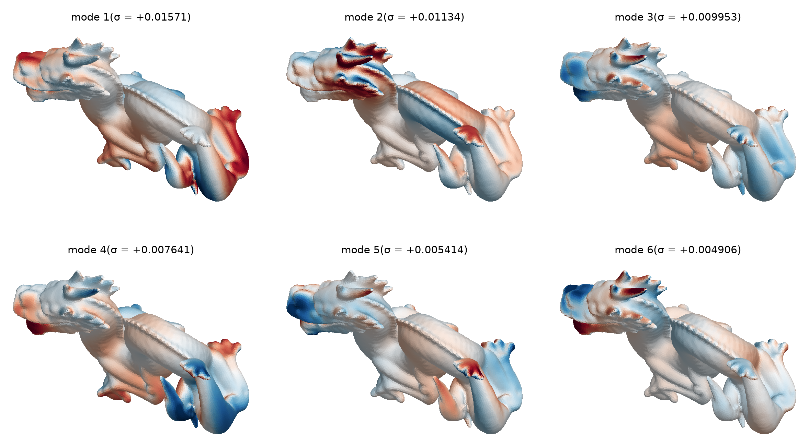
*龙表面前 6 阶柔度差 mode 着色分布及对应特征值 $\sigma$ 正负标注，红蓝两色表示法向柔度方向相反。*

第一项把物体当成无限大的弹性体，而真实物体有限大、有边界、有薄处，同样的压力下退得不一样。第二项要补的就是这个差。这个差只由物体自己的几何和材料决定，和它将来撞谁、撞在哪里都没有关系，所以每个物体只需要离线算一次。具体做法是先算出锁住 affine 以后真实物体的表面柔度 $K_{\text{lock}}$ ，减去同样材料的半空间表面柔度 $H$ ，再取这个差的前 80 个特征方向作为 mode：

$$W^{-1/2}(K_{\text{lock}}-H)W^{-1/2}v_m=\sigma_mv_m,\qquad r_m=W^{-1/2}v_m$$

得到的 $\sigma_m$ 可正可负。这个矩阵太大，没法直接写出来（龙的有限元有 102 万个自由度），所以我们只做「乘一组向量」的运算，用随机化特征值方法（Halko, Martinsson & Tropp 2011）加上块 Krylov 续算求出来，每个 mode 的相对误差不超过 1% 才用。换杨氏模量时 mode 只需要按 $\sigma_m\propto1/E$ 缩放，换泊松比才需要重算。每个物体算 80 个 mode 的时间是：兔约 2 分钟（115 秒），鸭约 49 分钟（2934 秒），龙约 94 分钟（5657 秒）（均含特征值求解与块 Krylov 续算）。

### 步骤二到四：实时输入经过两项公式得到能量

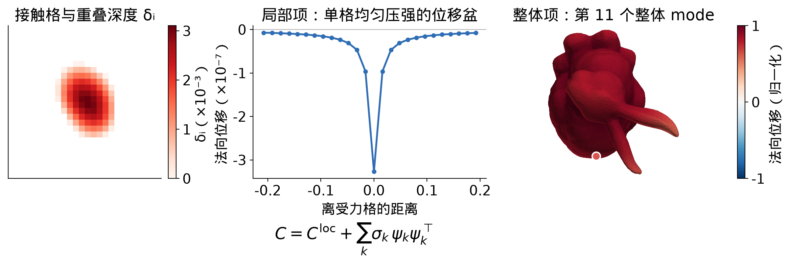
*左边是每一格的重叠深度 $w$ ；中间是第一项，即单位压力在半空间上压出的位移盆；右边是第二项里对接触处影响最大的那个 mode；下面是两项合起来的柔度 $C$ 。*

柔度 $C_{ij}$ 的意思是在第 $j$ 格加单位压强时，第 $i$ 格往回退多少。两个物体各贡献两项，方括号里的分式是第一项，后面的求和是第二项：

$$C_{ij}=\sum_{b=A,B}[\frac{L_{ij}}{E_b^{\prime}}+h^2\sum_{m=1}^{80}\sigma_{b,m}r_{b,m}(x_i)r_{b,m}(x_j)],\qquad L_{ij}=\frac{1}{\pi}\int\int_{\text{格}j}\frac{dA_y}{|x_i-y|}$$

拼好柔度以后，接触能量和每一格的接触力由下面这个二次规划给出：

$$U_{\text{skel}}=\max_{p\ge0}\ h^2[p^\top w-\frac{1}{2}p^\top Cp],\qquad \frac{\partial U_{\text{skel}}}{\partial w}=h^2p^{\ast}$$

两项的分工是这样的：第一项在两个物体之间加起来是 $L_{ij}/E^{\ast}$ ，只认等效模量，管的是等效的部分；第二项每个物体用自己的形状和自己的 $\sigma_{b,m}\propto1/E_b$ ，管的是个体的部分。这也回答了上次开会讨论到的刚度和泊松比怎么进的问题：每个物体带着自己的 $E,\nu$ 分别进两项，而不是先合成一个 $E^{\ast}$ 。所以软硬对调时第一项不变、第二项会变，两项加起来才能把「软压硬」和「硬压软」分开，这一点在第 7 周检验。另外，哪些格子受力是解出来的，所以压得越深接触区越大、越压越硬这种 Hertz 式的非线性，骨架自己就能给出来，不用另外加。

推导

下面从点力解出发，一步一步推到骨架的能量和接触力。

（1）无限大弹性体表面上一点受力 $F$ 时，距离它 $r$ 的地方会下沉 $u(r)=\frac{F}{\pi E^{\prime}r}$ ，其中 $E^{\prime}=E/(1-\nu^2)$ ，这是 Boussinesq 的点力解。【条件：线弹性、小应变；物体无限大；表面平（坡度小）】

（2）把重叠处铺成边长 $h$ 的小格。在第 $j$ 格上加单位压强，相当于每一小块面积上作用 $dF=dA_y$ 的力，把第 1 步的解在第 $j$ 格上积分，就得到第 $i$ 格中心的下沉。【条件：格内压强均匀】

$$u_i=\frac{1}{\pi E^{\prime}}\int\int_{\text{格}j}\frac{dA_y}{|x_i-y|}=\frac{L_{ij}}{E^{\prime}}.$$

（3）这就是第一项。它把物体当成无限大，而真实物体有限大、有边界、有薄处，同样的压强下退得不一样，所以差的那部分要另外算。

（4）为了算这个差，在物体表面每个顶点放一个帽函数 $\phi_i$ ，它在这个顶点上等于 1，往相邻顶点线性降到 0。压强写成 $p(x)=\sum_jq_j\phi_j(x)$ ，再在同一组帽函数上读位移，就得到柔度矩阵。【条件：线弹性】

$$K_{ij}=\int\int\phi_i(x)G(x,y)\phi_j(y)dA_xdA_y.$$

（5）式子里的 $G$ 如果取锁住 affine 以后真实物体的柔度，得到的就是 $K_{\text{lock}}$ ；如果取半空间的核 $\frac{1}{\pi E^{\prime}|x-y|}$ ，得到的就是 $H$ 。两个矩阵在同一组基上用同样的方式积分，所以可以直接相减， $R=K_{\text{lock}}-H$ 就是这个物体比半空间多出来（或少掉）的柔度。【条件：锁住 12 个 affine 自由度】

（6）网格上的三角形有大有小，一个帽函数管的面积越大，那个点就显得越软。为了去掉这个影响，令 $W=\mathrm{diag}(\int\phi_idA)$ ，在 $R$ 两边各除以 $\sqrt W$ ，问题就变成对称的特征值问题 $W^{-1/2}RW^{-1/2}v_m=\sigma_mv_m$ ，再令 $r_m=W^{-1/2}v_m$ 。

（7）按 $|\sigma_m|$ 从大到小留下前 80 个，就有 $R(x,y)\approx\sum_m\sigma_mr_m(x)r_m(y)$ 。第 $j$ 格上的总力是 $h^2$ ，它让第 $i$ 格多下沉 $h^2\sum_m\sigma_mr_m(x_i)r_m(x_j)$ ，这就是第二项。【条件：其余特征方向的柔度可以忽略】

（8）泊松比不变时，刚度矩阵可以写成 $K=E\hat K(\nu)$ 。柔度是刚度的逆，所以 $K_{\text{lock}}$ 、 $H$ 和 $R$ 都正比于 $1/E$ ，特征向量不变，只有 $\sigma_m\propto1/E$ 。所以换 $E$ 只需要缩放，换 $\nu$ 才要重算。【条件： $\nu$ 不变】

（9）接触时两个物体各自往回退，两边退的量加起来才把重叠抵消，所以把两个物体的两项加在一起，得到 $C_{ij}=\sum_b[L_{ij}/E_b^{\prime}+h^2\sum_m\sigma_{b,m}r_{b,m}(x_i)r_{b,m}(x_j)]$ 。接触面倾斜时，压强沿压入方向、下沉沿表面法向，两头各要乘一个夹角余弦，在平的地方这个余弦约等于 1。【条件：两个物体的退回可以直接相加；接触区不太弯，可以用一个压入方向】

（10）接触要满足三件事。第一，位移和压强的关系是 $u=Cp$ 。第二，每一格都有 $u_i\ge w_i$ 、 $p_i\ge0$ 、 $p_i(u_i-w_i)=0$ ，意思是有压力的格刚好把重叠退掉，没被压到的格没有压力。第三，存下的弹性能是 $U=\frac{1}{2}h^2p^\top u$ 。【条件：无摩擦，只有法向压力；线弹性】

（11）再看最大化问题 $\max_{p\ge0}h^2[p^\top w-\frac{1}{2}p^\top Cp]$ 。它的 KKT 条件是 $h^2e_i^\top(w-Cp)+\lambda_i=0$ 、 $\lambda_i\ge0$ 、 $\lambda_ip_i=0$ ，消去 $\lambda_i$ 并代入 $u=Cp$ ，正好得到第 10 步里每一格的三个条件。所以这个问题的解 $p^{\ast}$ 就是接触压强。

（12）把互补条件对所有格加起来，得到 $p^{\ast\top}Cp^{\ast}=p^{\ast\top}w$ 。代回最大值， $h^2[p^{\ast\top}w-\frac{1}{2}p^{\ast\top}Cp^{\ast}]=\frac{1}{2}h^2p^{\ast\top}w=\frac{1}{2}h^2p^{\ast\top}u$ ，正是第 10 步的弹性能。 $C$ 正定时这个问题严格凸，解是唯一的。【条件： $C$ 正定】

（13）这个最大值是一族关于 $w$ 的线性函数取最大，对 $w$ 求导就等于最优点处的系数（包络定理），所以 $\partial U_{\text{skel}}/\partial w=h^2p^{\ast}$ ，每一格受的力就是解出来的压强。【条件： $C$ 正定】

（14）最后看两项的分工。第一项两个物体加起来是 $L_{ij}(1/E_A^{\prime}+1/E_B^{\prime})=L_{ij}/E^{\ast}$ 。如果只有这一项， $C=L/E^{\ast}$ ，令 $p=E^{\ast}q$ 就得到 $U=E^{\ast}\max_{q\ge0}h^2[q^\top w-\frac{1}{2}q^\top Lq]$ ，能量只认 $E^{\ast}$ ，软硬对调以后不变。第二项每个物体用的是自己的形状和自己的 $\sigma_{b,m}\propto1/E_b$ ，对调以后就变了。【条件：两侧法向相同】

## 1.3 GT pipeline

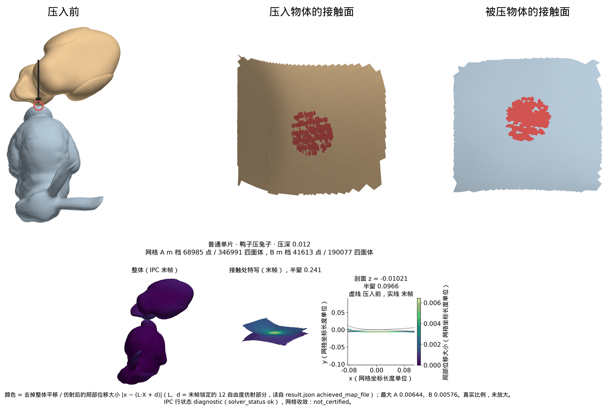
*普通单片（鸭压兔）粗状态互穿（上）与 IPC 锁定仿射松弛至静止平衡后的接触压凹变形（下，位移着色）。*

GT 的输入是两个物体的粗状态 $z$ 、精细网格和各自的 $E,\nu$ 。我们把两个物体的 affine 自由度锁在粗状态上，其余变形全部放开，用 IPC 在精细网格上解到静止；材料是 stable neo-Hookean，接触无摩擦，全程不穿透。静止以后，用精细模型的弹性能减去粗模型自己的能量，就是标准答案：

$$U_{\text{IPC}}=\sum_bE_b^{\text{fine}}-\sum_bE_b(\Phi z_b)$$

线性四面体在薄处和近不可压时会偏硬，所以我们在同一网格上再用二次单元算一次线弹性能，用两者之比修正，给每个算例一个误差区间，第二部分的判据会用到它。

---

# 二、验证：edge case

我们想说明的是，骨架的两项合起来能 cover 各种难的接触。为此我们设计了一组 edge case，每一类专门刁难骨架的一个假设，比如表面是平的、物体无限大、物体不薄、接触处不尖、两边材料一样。每个算例都同时算三样东西：IPC 给出的标准答案、hydroelastic 这个 baseline、以及我们的骨架，然后看骨架的能量是否落在标准答案的 ±10% 以内。需要说明的是，这里每一类的三档压深都只是表面上的浅压，真正的大压深留到第 7 周去补。

总的结论是部分支持。光滑处、面贴面、大面积贴合、近不可压、斜压、尺寸差和两侧材料差，骨架都能 cover；尖处与棱处骨架偏硬。去掉第二项以后就不行了，所以第二项是必要的。压平块 14 类也已全部完成逐物体 mode 重跑（6 例基本对、8 例跨线、0 例明显不对）。

## 2.1 判据

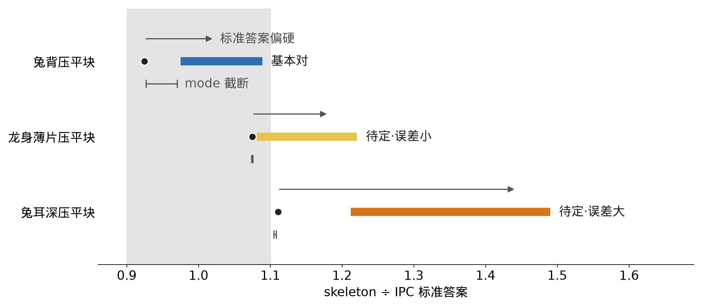
*黑点是原始比值，彩条是修正以后的区间。*

骨架除以标准答案落在 0.9 到 1.1 之间就算对。标准答案自己也有误差，所以每个算例用修正以后的区间来判断：区间整段在带内算基本对，跨过带的边界算跨线，只有整段落在带外、而且确认是骨架公式本身的问题，才算明显不对。

## 2.2 第二项是必要的：支持

骨架本身一定是两项。为了检验第二项是不是必要，我们做了一次消融：同样的 26 例，把第二项去掉只剩半空间项，和标准答案比。结果完整的骨架没有一例整段出带，去掉第二项以后有 20 例整段出带，所以第二项是必要的。

| 26 例，和 GT 比 | 整段落在带外的算例数 |
|---|---|
| hydroelastic | 24 |
| 骨架 | 0 |
| 消融：去掉第二项 | 20 |

## 2.3 两项能 cover 什么：部分支持

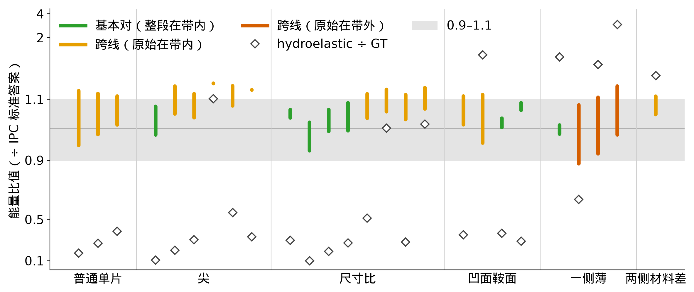
*26 例逐物体 mode 骨架相对 IPC 标准答案的修正区间（竖条）与 hydroelastic ÷ GT（菱形）对比，灰带为 0.9–1.1。*

在兔、龙、鸭互压的 26 例里，骨架有 8 例基本对、18 例跨线、没有一例明显不对；同一批例子上 hydroelastic 没有一例基本对：

| 兔、龙、鸭互压 26 例（和 GT 比） | 基本对 | 跨线 | 明显不对 |
|---|---|---|---|
| hydroelastic | 0 | 2 | 24 |
| 骨架 | 8 | 18 | 0 |

按类别看，普通单片、鞍面、一侧薄、尺寸比的第 12 号样本和两侧材料差这几类是支持的：骨架和标准答案的比值在 0.77 到 0.98 之间，区间都在带内或跨线，没有明显不对。局部形状、物体的有限大小、薄处的整片弯曲，两项合起来都能表达。不支持的是尖处和尺寸比的第 7 号样本：比值在 1.0 到 1.06，骨架偏硬，修正区间整段或大半落在 1.1 以上，原因还待查。同样这 26 例上，hydroelastic 和标准答案的比值在 0.10 到 2.79 之间，只有 2 例的原始比值落在 0.9–1.1，修正区间没有一例整段在带内，24 例整段出带。压平块的 14 类逐物体 mode 重跑同样 0 例明显不对：基线、整体转动、面贴面、大面积贴合、近不可压、斜压 6 类基本对（0.865–0.959），其余 8 类跨线（其中尖 1.374、一侧薄 1.359 在均匀网格加密一档后分别降至 1.123、1.061；棱加密一档后为 1.228）。

26 例逐个的数（原始比值 → 修正区间 · 判定）

| 算例 | 原始比值 → 修正区间 · 判定 |
|---|---|
| 普通单片 · 鸭压兔 S1 | 0.922 → [0.950, 1.142] · 跨线 |
| 普通单片 · 鸭压兔 S2 | 0.939 → [0.983, 1.127] · 跨线 |
| 普通单片 · 鸭压兔 S3 | 0.953 → [1.011, 1.114] · 跨线 |
| 尖 · 兔压龙 S1 | 0.945 → [0.982, 1.071] · 基本对 |
| 尖 · 兔压龙 S2 | 0.997 → [1.045, 1.169] · 跨线 |
| 尖 · 兔压龙 S3 | 1.041 → [1.146, 1.147] · 跨线 |
| 尖 · 龙压龙 S1 | 0.994 → [1.032, 1.126] · 跨线 |
| 尖 · 龙压龙 S2 | 1.033 → [1.073, 1.171] · 跨线 |
| 尖 · 龙压龙 S3 | 1.062 → [1.186, 1.188] · 跨线 |
| 尺寸比 · 龙压兔 第 12 号 S1 | 0.898 → [0.933, 1.018] · 基本对 |
| 尺寸比 · 龙压兔 第 12 号 S2 | 0.931 → [0.992, 1.059] · 基本对 |
| 尺寸比 · 龙压兔 第 12 号 S3 | 0.956 → [1.032, 1.059] · 基本对 |
| 尺寸比 · 龙压兔 第 7 号 S1 | 0.957 → [0.994, 1.085] · 基本对 |
| 尺寸比 · 龙压兔 第 7 号 S2 | 0.992 → [1.031, 1.125] · 跨线 |
| 尺寸比 · 龙压兔 第 7 号 S3 | 1.013 → [1.052, 1.149] · 跨线 |
| 尺寸比 · 龙压兔 第 7 号（细网格） S1 | 0.989 → [1.027, 1.121] · 跨线 |
| 尺寸比 · 龙压兔 第 7 号（细网格） S3 | 1.023 → [1.062, 1.160] · 跨线 |
| 鞍面 · 兔压兔 样本 1 | 0.938 → [1.011, 1.114] · 跨线 |
| 鞍面 · 兔压龙 样本 3 | 0.922 → [0.958, 1.121] · 跨线 |
| 鞍面 · 兔压兔 样本 3 | 0.929 → [1.003, 1.031] · 基本对 |
| 鞍面 · 兔压兔 样本 16 | 0.984 → [1.057, 1.085] · 基本对 |
| 一侧薄 · 兔压龙 | 0.767 → [0.984, 1.010] · 基本对 |
| 一侧薄 · 龙压鸭 S1 | 0.845 → [0.886, 1.076] · 跨线 |
| 一侧薄 · 龙压鸭 S2 | 0.872 → [0.923, 1.109] · 跨线 |
| 一侧薄 · 龙压鸭 S3 | 0.887 → [0.982, 1.169] · 跨线 |
| 两侧材料差 · 龙压龙，下侧硬 10 倍 | 0.969 → [1.043, 1.114] · 跨线 |

S1、S2、S3 是同一构型由浅到深的三档压深。

每一类配一个例子：

| 类 | 刁难在哪 | 图 | 原始比值 → 修正区间 | 判定 |
|---|---|---|---|---|
| 基线 | 兔背轻压平块，最普通 |  | 0.940 → [0.991, 1.062] | 基本对 |
| 整体转动 | 整个场景转 45° |  | 0.945 → [0.971, 1.071] | 基本对 |
| 尖 | 兔耳尖斜压，接触区很小 |  | 1.374 → [1.470, 1.796]（加密后 1.123 → [1.201, 1.468]） | 跨线 |
| 棱 | CAD 零件的棱，接触面不光滑 |  | 1.228 → [1.262, 1.392] | 跨线 |
| 面贴面 | 一整片近平的面压上去 | 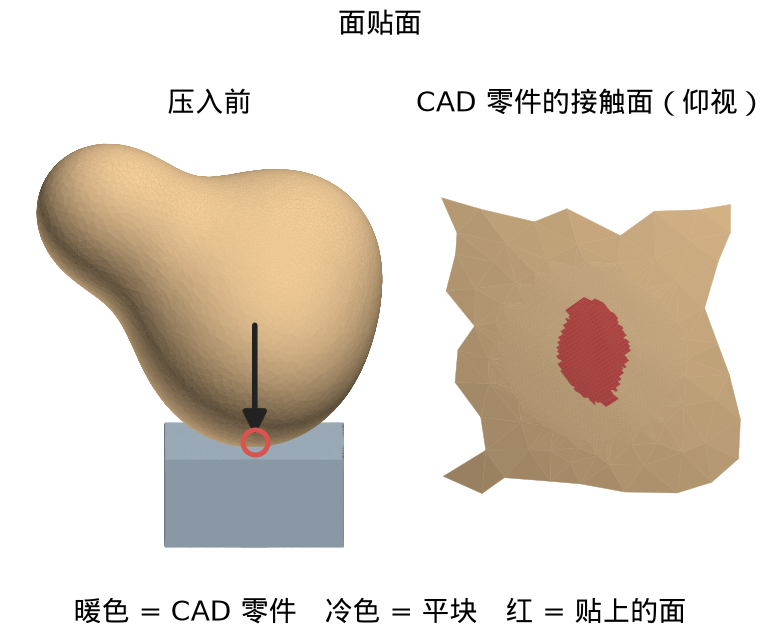 | 0.951 → [0.977, 1.078] | 基本对 |
| 大面积贴合 | 柱面整片贴上 |  | 0.892 → [0.916, 1.085] | 基本对 |
| 一侧薄 | 兔耳薄片，整片会弯 |  | 1.359 → [1.449, 1.653]（加密后 1.061 → [1.130, 1.290]） | 跨线 |
| 两侧都薄 | 两个薄球冠壳互压 |  | 0.930 → [1.028, 1.227] | 跨线 |
| 两侧材料差 | 平块比兔子硬 1000 倍 |  | 0.930 → [0.956, 1.132] | 跨线 |
| 近不可压 | 泊松比 0.49 |  | 0.865 → [1.016, 1.097] | 基本对 |
| 斜压 | 斜 30° 压入 |  | 0.959 → [0.986, 1.088] | 基本对 |
| 已有整体变形 | 粗模型先整体变形 1% |  | 0.950 → [0.976, 1.155] | 跨线 |
| 靠连接处 | 腿和身体相连处，几何突变 |  | 0.936 → [0.962, 1.139] | 跨线 |
| 多处接触 | 腿和身体两处同时压 |  | 0.960 → [0.986, 1.167] | 跨线 |
| 鞍面（软–软） | 两兔互压，接触在马鞍形处 | 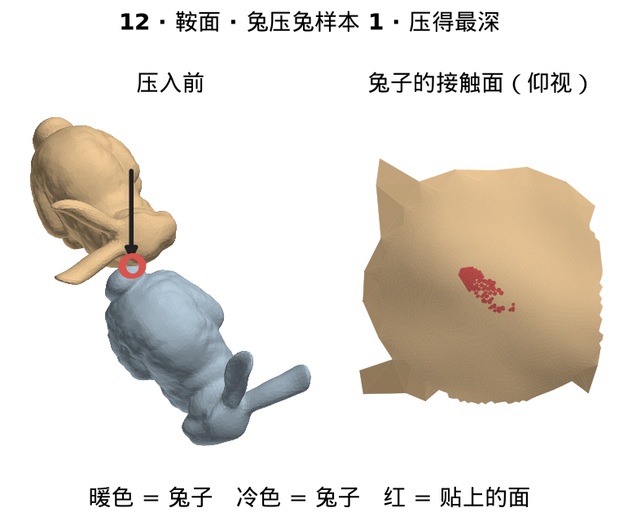 | 0.938 → [1.011, 1.114] | 跨线 |
| 尖（软–软） | 兔的尖处压龙 |  | 1.041 → [1.146, 1.147] | 跨线 |
| 尺寸比（软–软） | 兔体积约为龙的 3.6 倍 | 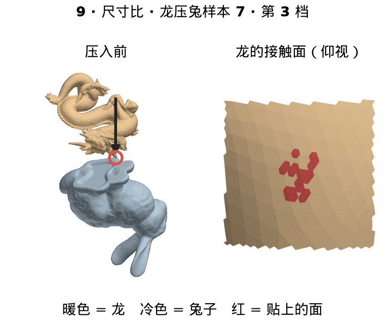 | 1.013 → [1.052, 1.149] | 跨线 |
| 普通单片（软–软） | 鸭压兔 |  | 0.953 → [1.011, 1.114] | 跨线 |

18 类静止平衡后的接触区放大变形图（位移着色，与上表压入前构型并排对照）

| 类 | 静止后变形图 | 类 | 静止后变形图 |
|---|---|---|---|
| 基线 | 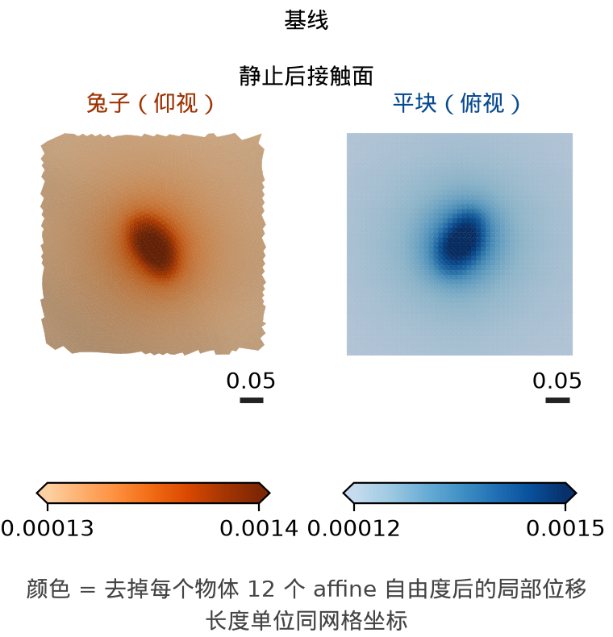 | 整体转动 |  |
| 尖 |  | 棱 | 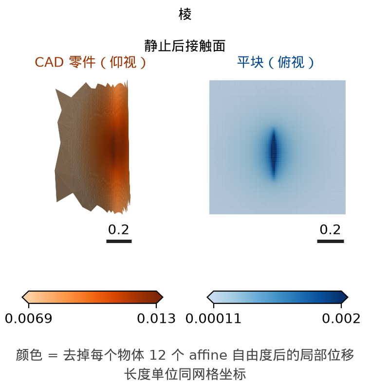 |
| 面贴面 |  | 大面积贴合 |  |
| 一侧薄 | 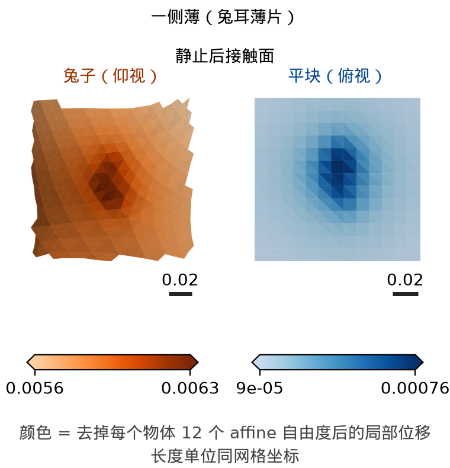 | 两侧都薄 | 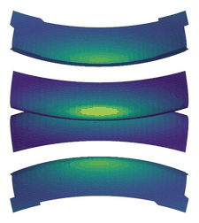 |
| 两侧材料差 |  | 近不可压 |  |
| 斜压 |  | 已有整体变形 |  |
| 靠连接处 |  | 多处接触 |  |
| 鞍面（软–软） | 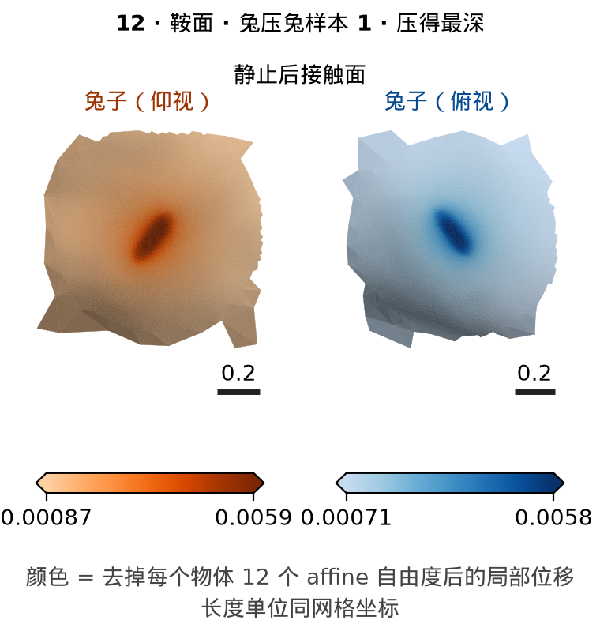 | 尖（软–软） |  |
| 尺寸比（软–软） |  | 普通单片（软–软） |  |

*每一类静止平衡后的接触处放大变形图（位移着色），用于对照上表压入前构型的局部受压形貌。*

## 2.4 和 hydroelastic 比：只看本地不够

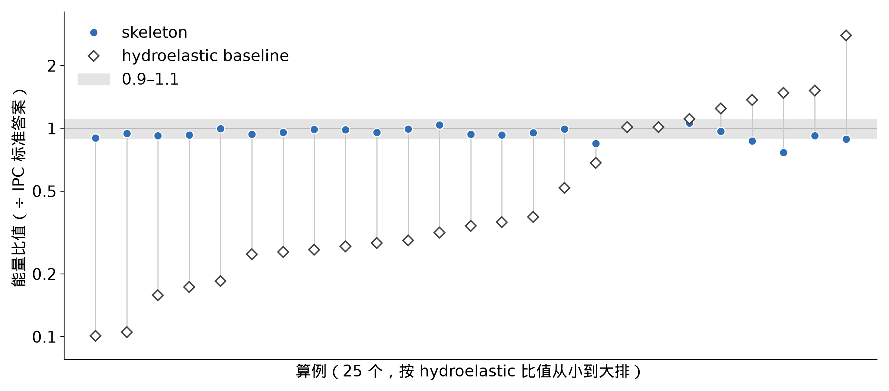
*每一列是一个算例：蓝点是骨架除以 IPC，菱形是 hydroelastic 除以 IPC，灰带是 0.9 到 1.1。*

hydroelastic 在每一点上只看本地穿进去多深，在 26 例里它的结果在标准答案的 0.10 倍到 2.79 倍之间，同一批例子上骨架在 0.77 到 1.06 之间。它看不到物体整体的弯曲，也看不到几处接触之间的相互影响，所以 cover 不了这些 edge case，而这正是骨架第二项补上的部分。
## 2.5 薄长部件要取够 mode

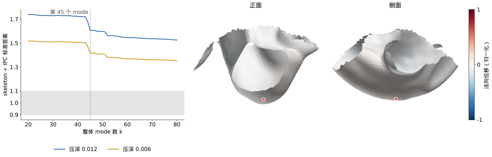
*龙背压平块（逐物体 `dragon_e006` + `box`）：mode 加到第 45、52 个时，比值出现两次明显陡降；右边画的是第 45 个 mode 在接触点附近的表面法向位移分布。*

第二项要 cover 薄长或局部弯曲的部件，必须取到足够多的整体 mode。龙背这个例子用逐物体 `dragon_e006` 80 阶模态时，只取前 24 个 mode 骨架比标准答案硬 73%（压深 0.012）和 51%（压深 0.006）；加入第 45 个、第 52 个 mode 时分别出现陡降，到 $k=80$ 时分别降到 1.53 和 1.35（仍高于 0.9–1.1 灰带，说明逐物体 80 阶全局模态在此局部棱接触上仍偏硬，需要更高阶模态或局部补充）。

---

# 三、Research

已有的接触力学公式，以及我们能拿来对照到哪

| 公式 | 原文条件 | 和我们的关系 |
|---|---|---|
| Boussinesq 点力 $u=F/(\pi E^{\ast}r)$ | 线弹性、半空间、表面坡度小 | 骨架半空间项的来源 |
| 合成模量 $1/E^{\ast}=\sum_k(1-\nu_k^2)/E_k$ | 两弹性体无摩擦法向接触 | 只在半空间、两侧法向相同时等价于我们的写法 |
| Hertz $F=\frac{4}{3}E^{\ast}\sqrt Rd^{3/2}$ ， $U=\frac{8}{15}E^{\ast}\sqrt Rd^{5/2}$ | 接触半径远小于曲率半径；半空间 | 光滑凸面小压深时可以对照；也是 baseline |
| 余能二次规划 $\min_{p\ge0}\frac{1}{2}p^\top Hp-\bar u^\top p$ | 线弹性、无摩擦 | 就是骨架的式子，我们把 $H$ 换成有限体柔度 $C$ |
| 有限体 Green 函数 = Boussinesq + 正则部分 | 光滑边界 | 支持「半空间项 + 修正项」的拆法 |
| 每个物体的柔度投影到接触空间再相加 | 线弹性、小位移 | 就是 $C=\sum_b$ 的结构 |
| 全局子空间 + 接触附近局部半空间基 | 变形区远小于物体 | 最接近我们的先例；变形区和物体同尺寸时失效 |
| hydroelastic 压力场 | 压力场不满足力学平衡 | baseline |

出处：Johnson 1985；Popov, Heß & Willert 2019；Bemporad & Paggi 2015；Argatov 2013；Duriez 等 2006；Harmon & Zorin 2013；Elandt 等 2019。

骨架每一步的成立条件

| 步骤 | 条件 | 不成立时 |
|---|---|---|
| 半空间项 | 线弹性、小应变、表面坡度小 | 误差约为坡度的平方；尖、棱处变大 |
| 一个压入方向 | 接触区不太弯 | 深压时接触面绕成弯曲面，偏差大 |
| 80 个 mode | 剩余柔度光滑 | 尖、棱处截断误差变大 |
| 锁 12 个 affine 自由度 | 整体变形归粗模型 | 粗模型大变形时 mode 要重算 |
| 二次规划 | 无摩擦、 $C$ 正定 | 不正定就不解 |

材料非线性、几何非线性骨架都管不到，留给 neural。

</content>
</invoke>
