# 第 5–6 周：骨架方法，以及它在浅压 edge case 上的验证

**结论：在表面浅压下，不用训练的「骨架」公式已经能把接触能量算到标准答案附近；算不准的是零件的棱和龙鳍这种薄长部件，骨架都偏大（偏硬）。** 每个物体用只有 12 个自由度的粗模型描述，再加一项接触能量，让粗模型也能算出接触处的变形能量。接触能量由骨架直接给出。骨架是两项线弹性公式：第一项把接触处当成半空间（表面为无限大平面的弹性体），第二项用每个物体预先算好的 mode（描述物体有限大小和形状的一组变形方向，见 2.1 节）把有限大小和形状补回来。与精细仿真的标准答案相比（判据见 3.1 节），在接触区够大的 18 个两物体互压算例里，骨架 12 例落在 0.9–1.1 这条带内、5 例跨线、只有 1 例尖处接触整段偏离；现有的 hydroelastic 方法 18 例全部整段偏离。去掉第二项后直接比值升到 0.93–4.46，所以第二项是必要的。在单个物体压平块的一组算例里，骨架 6 类基本对、5 类跨线（区间跨过 1.1 这条线）、零件的棱整段偏离，龙鳍压平块也偏大。每个物体的预处理只做一次，耗时十几分钟。

---

# 我们要算什么

***接触能量 U 等于：同一个粗状态下，精细模型在不穿透的条件下松弛到静止后的能量，减去粗模型自己的能量。** 图中是兔背压平块。左柱 $\Pi(\Phi z)$ 是只按粗状态变形时的弹性能，右柱 $\min_\xi\Pi$ 是不穿透条件下松弛到静止后的弹性能，即下面式子的两项。其中 $z$ 是粗状态，即两个物体各自的 affine 参数（整体平移、转动、拉伸和剪切）； $\Phi z$ 是按粗状态算出的精细网格节点位置； $\Pi$ 是精细模型的弹性能； $\xi$ 是粗模型表示不了的那部分变形， $\min_\xi$ 表示让它松弛到静止。这个粗状态没有整体变形，所以粗状态的能量约为 0。*

**要算的是粗模型表示不了的那部分接触能量 U。** 粗模型给每个物体只留 12 个 affine 自由度，表示不了接触处被压凹的那一小块，两个物体在粗模型下可以互相穿进去。让精细模型的整体运动（这 12 个自由度）和粗状态一致，其余变形在两物体不穿透的条件下松弛到静止，U 就是松弛前后的能量之差。粗状态本身是穿进去的，退掉穿透必须变形，所以松弛后的能量比松弛前高， $U\ge0$ 。作用在粗模型上的接触力是 $-\partial U/\partial z$ ：

$$U(z)=\min_{\xi:\ \text{两物体不穿透}}\ \Pi(\Phi z+\Psi\xi)-\Pi(\Phi z)$$

其中 $z$ 共 24 个数，属于物体 $b$ 的 12 个记作 $z_b$ ； $\Phi$ 是把 affine 参数映射成节点位置的线性映射， $\Phi z$ 的单位是长度； $\Psi$ 是锁住 affine 以后剩下的全部变形方向组成的一组基， $\xi$ 是精细模型在这组基上的坐标； $\Pi$ 的单位是能量，只算物体自身的形变，不含任何接触势垒； $U$ 的单位与 $\Pi$ 相同。

第一项 $\Pi(\Phi z+\Psi\xi)$ 是允许精细变形、在不穿透的限制下能找到的最低弹性能：穿得越深，要退掉的越多，它越大；材料越硬，同样的退让付出的能量越多，它也越大。第二项 $\Pi(\Phi z)$ 是粗模型自己已经算过的弹性能，减掉它是为了不重复计算。所以接触能量是物体为了不穿透、在粗模型之外额外付出的弹性能。它对 $z$ 的导数取负号，就是接触作用在 24 个粗自由度上的力：沿哪个自由度推一下 $U$ 降得最快，力就往哪个方向。骨架实际算的是每一小格的压强（2.1 节），再按「每个 affine 自由度动一下，各小格的重叠变多少」加起来，得到这 24 个力。

这个式子是定义：精细模型的全部自由度拆成「粗模型的 affine 部分」和「其余部分」两块，任何位移都能唯一地写成 $\Phi z+\Psi\xi$ ，因为 $\Psi$ 张成的正是锁住 affine 以后剩下的空间（直接推导）；在 affine 部分固定为 $z$ 时对其余部分求最低能量，再减去粗模型自己的能量。 $U\ge0$ 是因为不加接触限制时取 $\xi=0$ 可行，而只按粗状态变形就已经是无接触时能量最低的状态，加上不穿透的限制只会让最低值变高（直接推导）。这要求两物体之间无摩擦，并且精细模型的弹性能对 $\xi$ 在 $\xi=0$ 处取最小，即没有接触时粗状态本身就是静止状态。粗状态没有整体拉伸、剪切时 $\Pi(\Phi z)=0$ ，而 $\Pi\ge0$ ，这一条自动成立；粗状态带着很大的整体变形、精细模型在无接触时自己还会再动（比如屈曲）时，这一条不成立， $U$ 可能为负。

---

# 骨架与标准答案怎么算

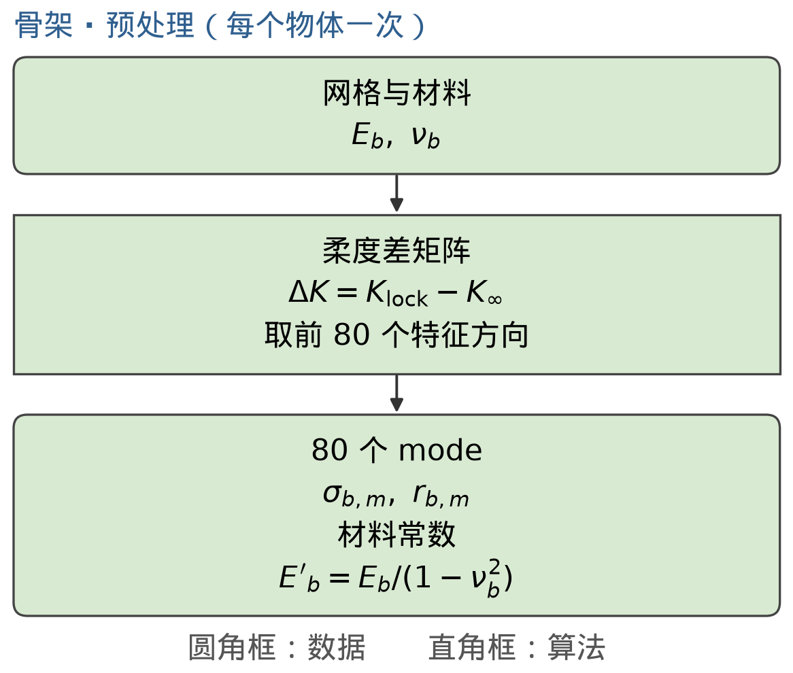
***骨架的预处理：每个物体只做一次。** 输入是物体 $b$ （ $b=A,B$ 表示两个物体）的网格和材料：杨氏模量 $E_b$ 、泊松比 $\nu_b$ 。表面柔度矩阵给出表面各点加单位压力时各点往回退多少：锁住 12 个 affine 自由度后真实物体的表面柔度矩阵 $K_{\text{lock}}$ ，减去把物体当成半空间时的 $K_\infty$ ，得到柔度差 $\Delta K$ 。取 $\Delta K$ 的前 80 个特征方向，就是这个物体的 80 个 mode：第 $m$ 个 mode 的特征值 $\sigma_{b,m}$ 表示沿这个方向真实物体比半空间软多少，特征方向 $r_{b,m}$ 是表面上的一个压力分布。材料常数 $E_b^{\prime}=E_b/(1-\nu_b^2)$ 是平面应变模量。以后每次接触直接用这些量。*

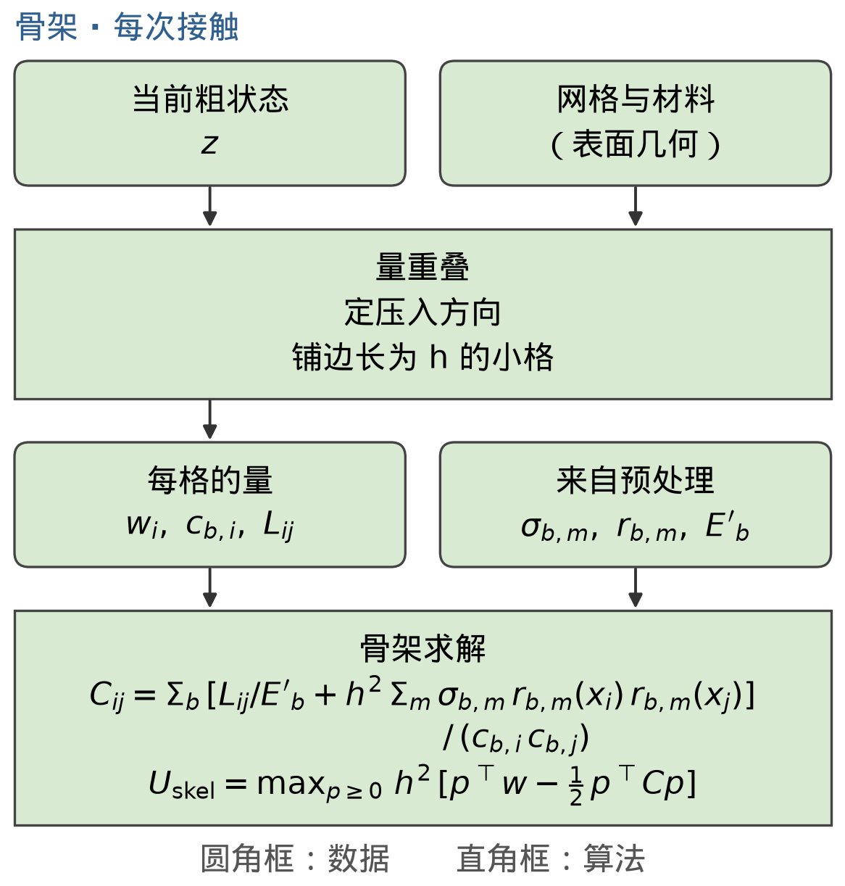
***骨架的每次接触：先量重叠，再拼柔度、解二次规划。** 当前粗状态 $z$ 和两个物体的表面几何一起进「量重叠」：定出一个压入方向，在垂直于它的平面上把重叠处铺成边长为 $h$ 的小格；对中心在 $x_i$ 的第 $i$ 小格，量出两表面互相穿进的深度 $w_i$ （排成向量 $w$ ）、物体 $b$ 在那里的表面法向与压入方向夹角的余弦 $c_{b,i}$ ，以及影响系数 $L_{ij}$ （第 $j$ 小格加单位压强时，半空间表面在 $x_i$ 处下沉 $L_{ij}/E_b^{\prime}$ ）。再和预处理得到的 $\sigma_{b,m}$ 、 $r_{b,m}$ 、 $E_b^{\prime}$ 一起拼出柔度矩阵 $C$ ，其元素 $C_{ij}$ 是第 $j$ 小格加单位压强时第 $i$ 小格往回退多少；最后在各小格压强 $p\ge0$ 上求最大值，得到骨架给出的接触能量 $U_{\text{skel}}$ 。*

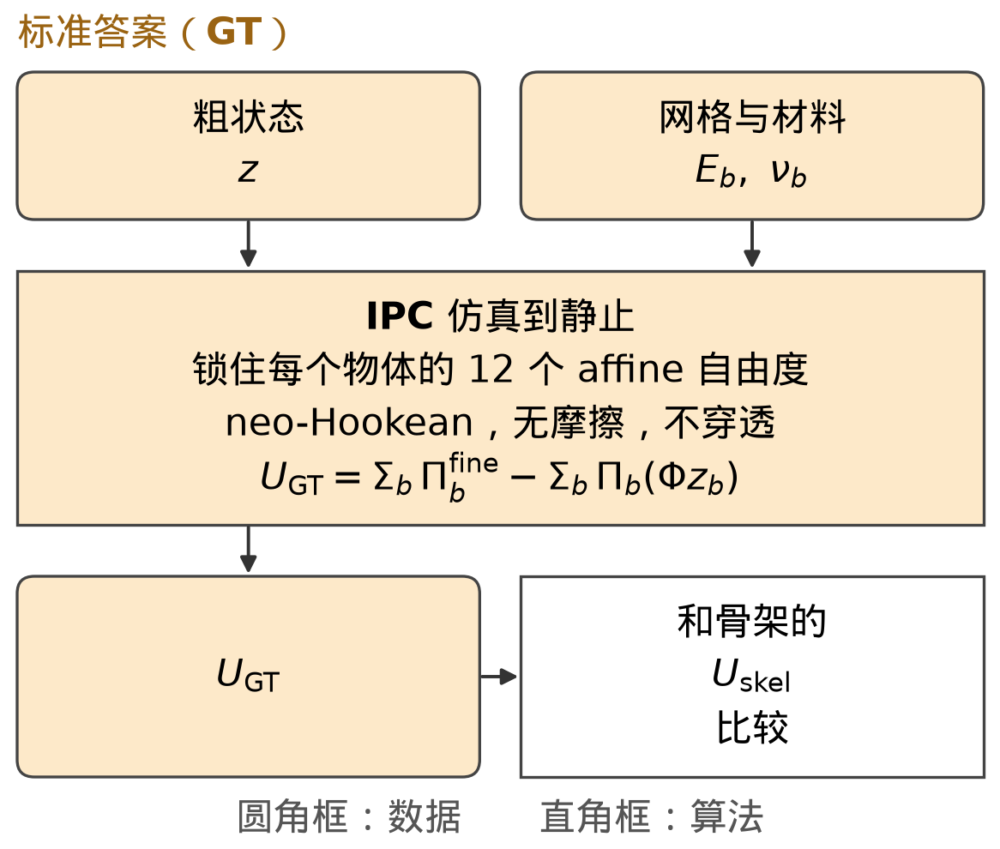
***标准答案（GT）是另一条独立的计算线，只在最后和骨架比较。** 同一个粗状态 $z$ 下，锁住每个物体的 12 个 affine 自由度，用精细网格和 neo-Hookean 材料（一种能承受大变形的非线性弹性材料）做 IPC 仿真（一种保证全程不穿透的接触仿真方法，Li 等 2020）到静止。 $\Pi_b^{\text{fine}}$ 是物体 $b$ 静止后的精细弹性能， $\Pi_b(\Phi z_b)$ 是它只按自己的粗状态 $z_b$ 变形时的弹性能，两者之差对两个物体求和，就是 GT 给出的接触能量 $U_{\text{GT}}$ 。*

**U 有两种算法：骨架是我们的方法，用线弹性公式直接算；标准答案 GT 用精细网格和非线性材料仿真出来。** 两条线互不调用，验证时只比结果。两者之差包括骨架管不到的材料和几何非线性，以及骨架自身近似的误差，计划交给一个小的神经网络学，这一步还没做。

## 骨架：每个物体预处理一次，每次接触套用骨架公式

**骨架的第一项把接触处当成半空间，第二项用每个物体自己的 mode 把有限大小和形状补回来。** mode 只由物体自己的几何和材料决定，与它将来撞谁、撞在哪里无关，所以每个物体离线算一次就够。 $K_{\text{lock}}$ 和 $K_\infty$ 用同样的材料、在同一组表面基上算， $\Delta K=K_{\text{lock}}-K_\infty$ 的前 80 个特征方向由下式求出：

$$W^{-1/2}\,\Delta K\,W^{-1/2}v_m=\sigma_mv_m,\qquad r_m=W^{-1/2}v_m$$

这里的 $K$ 是柔度而不是刚度，只取「法向按、法向退」的部分；它在帽函数基上积分得到（下面折叠块第（3）步），单位是长度³/压强。 $W$ 是每个表面顶点管辖的面积组成的对角阵（面积单位）。 $v_m$ 是第 $m$ 个特征向量，取长度为 1，对应的特征值 $\sigma_m$ 的单位是长度/压强；把 $v_m$ 乘回 $W^{-1/2}$ 得到表面上的函数 $r_m$ ，它在每个表面顶点上有一个值，单位是 1/长度。 $\sigma_m$ 、 $r_m$ 就是图中的 $\sigma_{b,m}$ 、 $r_{b,m}$ ，这里省去物体下标 $b$ 。

$\Delta K$ 是真实物体比半空间多出来（或少掉）的柔度：物体越小、越薄、离边界越近，同样的压力下它比半空间退得越多， $\Delta K$ 越大。两边乘 $W^{-1/2}$ 是为了消掉网格疏密的影响：顶点密的地方每个顶点管的面积小，不除掉的话密处会被多算。 $\sigma_m$ 越大，说明沿 $r_m$ 这个压力分布，真实物体比半空间软得越多； $\sigma_m$ 为负，说明沿这个方向它比半空间硬。整个式子把「这个物体和半空间差在哪里」分解成一组相互独立的压力分布 $r_m$ ，每个方向的差别有多大由 $\sigma_m$ 给出，按 $|\sigma_m|$ 从大到小只留前 80 个；推导见下面折叠块第（3）–（5）步。

这个矩阵太大，无法直接写出（龙的有限元有 102 万个自由度），所以只做矩阵乘一组向量的运算，用随机化特征值方法（Halko, Martinsson & Tropp 2011 算法 4.4 的子空间迭代求近似值域，再按算法 5.3 求特征对）求解，迭代到 80 个 mode 的相对特征值残差都不超过 1%。残差是矩阵乘 $v_m$ 的结果与 $\sigma_mv_m$ 之差的长度除以 $|\sigma_m|$ 。1% 这条停止标准是我们定的。

这一步要求线弹性，并且锁住 12 个 affine 自由度（否则 $K_{\text{lock}}$ 没有定义，物体会整体漂走）；舍去的特征方向对柔度的贡献可以忽略：18 个主结果算例里，从 79 个 mode 加到 80 个，骨架能量最多只变 0.08%。80 是固定的选择，3.4 节龙鳍的例子说明它对薄长部件不够。

**每个物体的预处理是十几分钟：兔约 18 分钟，鸭约 13 分钟。** 这两个数是在 12 维 affine 锁下从头算 80 个 mode 的总耗时（含组装、半空间项、锁住仿射后的凝聚和存检查点）；龙这次是从检查点续算的，记录的 20 分钟不是一次完整的耗时。

**每次接触时，骨架先量出两个表面的重叠，再拼出柔度、解一个凸二次规划。** 输入是两个物体当前的粗状态。由重叠处的几何定出一个压入方向，在垂直于它的平面上把重叠处铺成边长为 $h$ 的小格（ $h$ 有两种取法：17 个主结果算例里 5 个按接触处的弯曲程度定， $h=\sqrt{R_{\min}\hat d_{\text{rule}}}/4$ ， $R_{\min}$ 是接触处两表面相对曲率最大的方向上的曲率半径， $\hat d_{\text{rule}}=1.25\times10^{-4}$ 取 GT 里 IPC 的势垒作用距离 $\hat d$ ，即标签有意义的最浅压深。由来：按 Hertz 解 $d=a^2/R$ （ $d$ 是压深， $a$ 是接触半宽， $R$ 是曲率半径；Popov, Heß & Willert 2019 式 2.29），压深为 $\hat d_{\text{rule}}$ 时接触区沿最弯方向的半宽约为 $\sqrt{R_{\min}\hat d_{\text{rule}}}$ ，除以 4，就让最浅的接触半宽里也有 4 个小格【条件：Hertz 的前提，接触处光滑、可当半空间】；弯得越厉害小格越细。另外 12 个用固定的 $h=0.004$ ，这个值沿用下来，没有书面理由。两种取法都满足 3.1 节「接触半径内至少铺得下 2 个小格」），量出每一小格的 $w_i$ ，再用两个物体的材料和 mode 拼出 $C$ 。方括号里的分式是第一项，后面的求和是第二项：

$$C_{ij}=\sum_{b=A,B}\frac{1}{c_{b,i}c_{b,j}}[\frac{L_{ij}}{E_b^{\prime}}+h^2\sum_{m=1}^{80}\sigma_{b,m}r_{b,m}(x_i)r_{b,m}(x_j)],\qquad L_{ij}=\frac{1}{\pi}\int\int_{\text{小格}j}\frac{dA_y}{|x_i-y|}$$

其中 $y$ 是第 $j$ 小格里的点， $dA_y$ 是 $y$ 处的面积微元， $x_i$ 和 $y$ 都在垂直于压入方向的平面上量； $E_b^{\prime}$ 、 $E_b$ 的单位是压强， $\nu_b$ 没有单位；表面正对压入方向时 $c_{b,i}=1$ ； $r_{b,m}(x_i)$ 是 $r_{b,m}$ 在第 $i$ 小格中心的值。 $L_{ij}$ 的单位是长度， $C_{ij}$ 的单位是长度/压强，即单位压强让表面退多少长度。

第一项 $L_{ij}/E_b^{\prime}$ 说的是：两小格离得越远，互相影响越小（按 $1/|x_i-y|$ 衰减）；材料越硬， $E_b^{\prime}$ 越大，退得越少。第二项 $h^2\sum_m\sigma_{b,m}r_{b,m}(x_i)r_{b,m}(x_j)$ 在物体沿某个方向比半空间软（ $\sigma_{b,m}>0$ ）时为正，让柔度变大，比半空间硬时为负。前面的 $1/(c_{b,i}c_{b,j})$ 反映表面倾斜：表面越斜，余弦越小，同样的法向退让在压入方向上量出来的间隙变化越大。对 $b$ 求和，是因为两个物体各退一部分，合起来抵消重叠，柔度相加。所以 $C$ 就是「在每个小格施加压强，各小格的重叠能退回多少」的表：第一项给出把两个物体都当成半空间时的回答，第二项按每个物体自己的有限大小和形状修正它。推导见下面折叠块第（1）–（7）步。

它成立的条件是线弹性、小应变，每个小格内压强均匀，接触处表面坡度小（第一项按平面算，误差约为坡度的平方）；整片接触区只用一个压入方向，第一项在垂直于压入方向的投影平面上积分，倾斜表面上真实面积比投影面积大的那一部分没算；只取 80 个 mode。拼出的 $C$ 必须正定，下一个式子才有唯一解。每次求解前都检查这一条：以 $L_{ij}$ 组成的矩阵 $L$ 为基准，把 $C$ 化成相对形式 $L^{-1/2}CL^{-1/2}$ ，它的最小特征值大于 0 就说明 $C$ 正定（第一项本身正定）。17 个主结果算例里这个最小特征值都在 0.99995–1.0000 之间，第 7 周 8 个大压深算例在 0.52–0.72 之间，都正定。表面在棱、尖处突然转折，或接触面绕成弯曲面时，这几条不成立，骨架会出偏差。

最后解一个凸二次规划，得到接触能量和每一小格的接触压强：

$$U_{\text{skel}}=\max_{p\ge0}\ h^2[p^\top w-\frac{1}{2}p^\top Cp],\qquad \frac{\partial U_{\text{skel}}}{\partial w}=h^2p^{\ast}$$

其中 $p_i$ 是第 $i$ 小格的压强，乘小格面积 $h^2$ 就是该格的接触力， $p\ge0$ 表示每一格都只能压、不能拉； $w$ 的单位是长度； $p^{\ast}$ 是取到最大值的那组压强； $U_{\text{skel}}$ 的单位和 $\Pi$ 相同（压强 × 长度³）。

$h^2p^\top w$ 是压强在重叠上做的功，重叠越深、压强越大，它越大； $\frac{1}{2}h^2p^\top Cp$ 是两个物体为承受这组压强存下的弹性能，压强越大、物体越软（ $C$ 越大），存下的越多。两者相减再取最大：压强太小时功不够，太大时存能太多，中间有一个最优。整个式子在不许出现拉力的前提下找一组压强，使「压强在重叠上做的功」减去「两物体为此存下的弹性能」最大，这个最大值就是接触能量，它对重叠的导数就是每一小格受的力。推导见下面折叠块第（8）–（10）步；它要求无摩擦、只有法向压力、线弹性，并且 $C$ 正定。

**骨架对材料只要求线弹性，对接触只要求无摩擦；此外第一项还假设接触处表面平、整片接触区只有一个压入方向，第二项只取 80 个 mode，并要求拼出的柔度矩阵 $C$ 正定。它的主要近似在第一项。** 第二项补回的是物体有限大小、有边界、有薄处对柔度的影响，但补不了「表面平、一个压入方向」这一条，所以在棱、尖这种表面突然转折的地方，以及接触面绕成弯曲面的大压深下，骨架会出偏差。另一方面，哪些小格受力是解出来的，压得越深接触区越大、越压越硬，这种接触本身带来的非线性骨架能自己给出来；材料和几何的非线性它管不到。

推导：从点力解到骨架的能量和接触力

（1）半空间表面上一点受法向力 $F$ 时，距离它 $s$ 的地方沿法向下沉 $u(s)=\frac{F}{\pi E^{\prime}s}$ （ $E^{\prime}$ 是半空间材料的平面应变模量，即上文的 $E_b^{\prime}$ ），这是 Boussinesq 的点力解（Popov, Heß & Willert 2019 式 2.2）。下沉按 $1/s$ 衰减，衰减得很慢，所以接触区里离得远的点也会互相影响。【条件：线弹性、小应变；物体是半空间；表面坡度小，误差约为坡度的平方】

（2）在第 $j$ 小格上加单位压强，相当于每一小块面积上作用 $dF=dA_y$ 的力。线弹性下多个力的作用可以叠加（Popov, Heß & Willert 2019 式 2.3），把第（1）步的解在第 $j$ 小格上积分，就得到第 $i$ 小格中心的下沉 $\frac{1}{\pi E^{\prime}}\int\int_{\text{小格}j}\frac{dA_y}{|x_i-y|}=\frac{L_{ij}}{E^{\prime}}$ ，这就是第一项。【条件：线弹性；小格内压强均匀】

（3）真实物体有限大、有边界、有薄处，同样的压强下退得不一样。为了算这个差，在物体表面每个顶点放一个帽函数 $\phi_i$ ，它在这个顶点上等于 1，往相邻顶点线性降到 0。压强用帽函数展开， $p(x)=\sum_jq_j\phi_j(x)$ （ $q_j$ 是第 $j$ 个顶点上的压强值），再用同一组帽函数去读位移，也就是把 $u(x)=\int G(x,y)p(y)dA_y$ 两边乘 $\phi_i(x)$ 再积分（直接推导），就得到表面柔度矩阵 $K_{ij}=\int\int\phi_i(x)G(x,y)\phi_j(y)dA_xdA_y$ 。其中 $G(x,y)$ 是格林函数： $y$ 处一个法向单位力让 $x$ 处沿法向退多少。【条件：线弹性】

（4） $G$ 取锁住 affine 以后真实物体的格林函数，得到 $K_{\text{lock}}$ ；取半空间的格林函数 $\frac{1}{\pi E^{\prime}|x-y|}$ ，得到 $K_\infty$ 。两个矩阵在同一组基上用同样的方式积分，所以可以直接相减（直接推导）， $\Delta K=K_{\text{lock}}-K_\infty$ 就是这个物体比半空间多出来（或少掉）的柔度。为什么这样拆：对表面光滑的有限物体，表面受力—位移关系的主导部分和半空间相同，两者的差是比主导部分低一阶、更平滑的部分（Capoferri & Vassiliev 2021 §8.3，原文前提是有界物体、表面光滑）。所以把半空间的部分用第一项精确算出，剩下更平滑的 $\Delta K$ 再用少数几个方向来补。用多少个方向够，原文没有给，是我们的选择，龙鳍的例子说明 80 个对薄长部件不够。【条件：锁住 12 个 affine 自由度；表面光滑。在棱、尖处，以及厚度和接触区同尺寸的薄处，「主导部分和半空间相同」不成立】

（5）令 $W=\mathrm{diag}(\int\phi_idA)$ 。把 $G$ 在顶点上取值、每个帽函数积出它管的面积，就有 $K_{ij}\approx W_{ii}G(x_i,x_j)W_{jj}$ ；两边各乘 $W^{-1/2}$ 得到对称的特征值问题 $W^{-1/2}\Delta KW^{-1/2}v_m=\sigma_mv_m$ ，特征向量再乘 $W^{-1/2}$ ，即 $r_m=W^{-1/2}v_m$ ，就回到表面上的函数，于是两者格林函数之差 $\Delta G(x,y)$ （真实物体的 $G$ 减半空间的 $G$ ）满足 $\Delta G(x,y)\approx\sum_m\sigma_mr_m(x)r_m(y)$ （直接推导）。按 $|\sigma_m|$ 从大到小留下前 80 个。第 $j$ 小格上的总力是 $h^2$ ，它让第 $i$ 小格多下沉 $h^2\sum_m\sigma_mr_m(x_i)r_m(x_j)$ ，这就是第二项； $r_m$ 在小格中心的值由所在三角形的三个顶点线性插值得到。【条件：其余特征方向的柔度可以忽略； $K_{ij}\approx W_{ii}G(x_i,x_j)W_{jj}$ 要求被积的格林函数在一个顶点管辖的面积内变化很小，所以这一步只用在比主导部分平滑的 $\Delta G$ 上，第一项的 $1/|x-y|$ 单独精确积分】

（6）泊松比不变时，弹性刚度可以写成杨氏模量 $E$ 乘一个只和泊松比 $\nu$ 有关的量（ $E$ 、 $\nu$ 即一个物体的 $E_b$ 、 $\nu_b$ ）。柔度是刚度的逆，所以 $K_{\text{lock}}$ 、 $K_\infty$ 和 $\Delta K$ 都正比于 $1/E$ ，特征向量不变，只有 $\sigma_m\propto1/E$ （直接推导）。所以换 $E$ 只需要缩放，换 $\nu$ 才要重算。【条件： $\nu$ 不变】

（7）接触时两个物体各自往回退，两边退的量加起来才把重叠抵消，所以把两个物体的柔度投影到接触方向再相加（Duriez 等 2006 式 17–18）。接触面倾斜时，间隙沿压入方向量，而表面沿自己的法向退回：表面沿法向退回 $\delta$ 时，沿压入方向量的间隙变化 $\delta/c$ （ $c$ 是该处的夹角余弦 $c_{b,i}$ ）；和间隙功共轭的力沿法向、大小是 $h^2p/c$ 。所以两头各除以一个夹角余弦，就得到上面的 $C_{ij}$ （直接推导）。【条件：两个物体的退回可以直接相加；整片接触区可以用一个压入方向；第一项按压入方向的投影平面积分，倾斜表面的真实面积没算】

（8）接触要满足三件事：位移和压强的关系是 $u=Cp$ （ $u_i$ 是第 $i$ 小格两表面合起来退回的量）；每一小格都有 $u_i\ge w_i$ 、 $p_i\ge0$ 、 $p_i(u_i-w_i)=0$ ，意思是有压力的小格刚好把重叠退掉，没被压到的小格没有压力；存下的弹性能是 $U=\frac{1}{2}h^2p^\top u$ （Bemporad & Paggi 2015 式 4、18）。【条件：无摩擦，只有法向压力；线弹性】

（9）最大化问题 $\max_{p\ge0}h^2[p^\top w-\frac{1}{2}p^\top Cp]$ 的最优条件（Boyd & Vandenberghe 2004 §5.5.3）是 $h^2e_i^\top(w-Cp)+\lambda_i=0$ 、 $\lambda_i\ge0$ 、 $\lambda_ip_i=0$ ，其中 $e_i$ 是只有第 $i$ 个分量为 1 的向量， $\lambda_i$ 是第 $i$ 个「压强不能为负」限制对应的乘子。由第一式， $w_i-(Cp)_i=-\lambda_i/h^2\le0$ ，代入 $u=Cp$ 就是 $u_i\ge w_i$ ；再由 $\lambda_ip_i=0$ 得到 $p_i(u_i-w_i)=0$ ，正好是第（8）步里每一小格的三个条件，所以这个问题的解 $p^{\ast}$ 就是接触压强（Bemporad & Paggi 2015 式 16）。把互补条件对所有小格加起来得到 $p^{\ast\top}Cp^{\ast}=p^{\ast\top}w$ ，代回最大值就是 $\frac{1}{2}h^2p^{\ast\top}u$ ，正是第（8）步的弹性能（直接推导）。【条件： $C$ 正定，解才唯一】

（10）这个最大值是一族关于 $w$ 的线性函数取最大，对 $w$ 求导就等于最优点处的系数（包络定理，Milgrom & Segal 2002 定理 1），所以 $\partial U_{\text{skel}}/\partial w=h^2p^{\ast}$ ，每一小格受的力就是解出来的压强乘小格面积。【条件： $C$ 正定】

## GT：精细网格、非线性材料、IPC 仿真到静止

**GT 用精细网格和非线性材料仿真得到，骨架的线弹性近似不进入这条线。** 输入是两个物体的粗状态、精细网格和各自的 $E$ 、 $\nu$ 。把两个物体的 12 个 affine 自由度锁在粗状态上（锁的是质量加权质心，以及对全部节点做质量加权最小二乘拟合出的 $3\times3$ 矩阵，与导师代码的定义相同），其余变形全部放开，静止的判据是最后 20 帧总能量漂移不超过 0.01%，用 IPC（Li 等 2020）在精细网格上解到静止。材料是 neo-Hookean，接触无摩擦。静止后，精细模型的弹性能减去粗模型自己的弹性能就是 GT：

$$U_{\text{GT}}=\sum_b\Pi_b^{\text{fine}}-\sum_b\Pi_b(\Phi z_b)$$

其中两项的单位都是压强 × 长度³，都按 neo-Hookean 算： $\Pi_b^{\text{fine}}$ 取 IPC 静止后的精细网格位置， $\Pi_b(\Phi z_b)$ 取只按粗状态变形的位置。IPC 在两表面距离小于 $\hat d$ 时加一个排斥势垒，强度是 $\kappa$ 。实验中取 $\hat d=1.25\times10^{-4}$ （网格单位）； $\kappa$ 设的是 $1.15\times10^{15}$ ，IPC 库会把它调进按场景自动定的区间，实际用的值没有记录。 $U_{\text{GT}}$ 只算弹性能，不含势垒能。

第一项是物体为了不穿透真正付出的全部弹性能，压得越深、材料越硬，它越大；第二项是粗模型已经算过的部分，减掉它，剩下的就是粗模型看不到的那块。所以这个式子就是第 1 节 $U(z)$ 的定义本身，只是 $\min$ 由 IPC 仿真到静止来完成，弹性能用非线性的 neo-Hookean 来算（直接推导：仿真到静止就是在「12 个 affine 自由度固定、两物体不穿透」的限制下让弹性能（加势垒）最小，所以静止时的 $\Pi_b^{\text{fine}}$ 就是第 1 节式子的第一项）。IPC 用势垒代替「不穿透」这条硬限制，势垒只在两表面距离小于 $\hat d$ 的地方非零，所以静止时两表面之间留着不到 $\hat d$ 的缝（Li 等 2020）。这要求精细网格足够细、仿真真正停在静止、无摩擦。线性四面体单元在薄处和近不可压时偏硬，GT 偏大，这部分在 3.1 节换算时扣掉。

## 刚度和泊松比怎么进入骨架和标准答案

**两条线里，每个物体都带着自己的 $E,\nu$ 分别进去，而不是先合成一个等效模量。** 等效模量 $E^\ast$ 指两个物体合起来的模量， $1/E^\ast=1/E_A^{\prime}+1/E_B^{\prime}$ （Popov, Heß & Willert 2019 式 2.1）。意思是两个物体串在一起被压，柔度相加，所以模量的倒数相加；任何一个物体越软，合起来越软。成立条件是两弹性体无摩擦法向接触、都可以当半空间；我们的物体有限大，不满足后一条，所以 $E^\ast$ 只出现在第一项里，第二项按每个物体自己的形状和材料进去。第一项在两表面平行时只认 $E^\ast$ （直接推导）：表面平行时两个物体在同一小格的方向余弦相同， $c_{A,i}=c_{B,i}=c_i$ ，第一项等于 $\frac{L_{ij}}{c_ic_j}(\frac{1}{E_A^{\prime}}+\frac{1}{E_B^{\prime}})=\frac{L_{ij}}{c_ic_jE^\ast}$ ，只剩等效模量。实验中除特别说明外，两个物体都是 $E=10^5$ 、 $\nu=0.3$ ；例外是 3.4 节「近不可压」一类（压入物体 $\nu=0.49$ ）和「两侧材料差」一类（平块 $E=10^8$ ，硬 1000 倍）。在 GT 里，每个物体的 $E,\nu$ 直接决定自己的 neo-Hookean 材料。在骨架里，每个物体用自己的 $E_b^{\prime}$ 进第一项，用自己的 $\sigma_{b,m}\propto1/E_b$ 进第二项。我们的设想是：第一项管「等效」，第二项带着每个物体自己的形状、管「个体」，两项加起来能分出谁软谁硬；第 7 周用软硬对调检验这个设想。

---

# 浅压 edge case 上的验证

**检验骨架的两项合起来能否覆盖各种难的接触。** 每一类 edge case 专门挑战骨架近似里的一条，或者一种容易出错的情况，比如表面不平、物体有薄处、接触处尖、多处同时接触、两边材料差很多。每个算例都同时算三样：GT、hydroelastic（现有的一种快速接触方法，Elandt 等 2019：每个物体预先算好一个压力场，表面上为 0、往里越深越大；两物体重叠时，每一点的压力只由这一点在两个物体里各有多深决定）和骨架。所有算例都只是表面浅压，每个构型由浅到深取三个压深，下文叫「压得最浅」「压得居中」「压得最深」（压深指两物体从刚接触起靠近的距离，也就是未变形的两个形状重叠区沿压入方向的最大高度，和第 7 周的定义相同：重叠区里每一条沿压入方向的线上，重叠高度等于靠近的距离减去这一处原来的间隙，刚接触那一点的间隙为 0，所以最大高度就是靠近的距离（直接推导，前提是这条线在接触处只穿过每个表面一次，浅压时成立）。「压得最浅」「压得居中」「压得最深」分别是 0.003、0.006、0.012 个网格单位；3.2 节 17 个主结果算例里，压得最深时也不到物体高度的 0.2%；3.4 节「两侧都薄」一类是两个薄壳，压深 0.19，约为壳高的 8%）；真正的大压深放在第 7 周。

## 判据

**骨架算出的能量除以 GT，落在 0.9 到 1.1 之间算对；判定看的是换算以后的区间。** 区间整段在 0.9–1.1 里算「基本对」，区间跨过 0.9 或 1.1 这条线算「跨线」，整段在外算「整段偏离」。另外，骨架在接触半径内至少铺得下 2 个小格的算例称为「接触区够大」；兔、龙、鸭两两互压的 26 个算例里有 17 个满足。

**换算是为了扣掉 GT 自己已知的偏差。** GT 的精细网格用的是线性四面体单元，在薄处和近不可压时会偏硬，GT 偏大，所以换算后比值都往上移，区间下端都高于直接比值。这种偏差来自单元类型本身，在浅压下主要表现在线弹性部分，所以在同一网格上分别用线性单元和更高阶的单元各算一次线弹性，两者之比就是单元造成的偏差；再加上 GT 网格粗细、仿真提前停止这两项各自估出的误差，得到 GT 的范围。表里每一格写成「直接比值 → 换算后的区间」：箭头左边是骨架除以 GT 的原始值，右边是除以「去掉已知偏差后的 GT 范围」得到的区间：

$$\rho=\frac{U_{\text{skel}}}{U_{\text{GT}}},\qquad [\rho_{\text{lo}},\ \rho_{\text{hi}}]=[\rho\prod_ql_q,\ \rho\prod_qu_q]$$

其中 $\rho$ 是直接比值， $[\rho_{\text{lo}},\ \rho_{\text{hi}}]$ 是换算后的区间， $q$ 是一项误差来源， $l_q\le u_q$ 是它的下、上修正因子，都是没有单位的数： GT 的线性单元偏硬一项取 $l_q=u_q$ =（同一网格上线性单元与高阶单元线弹性能量之比）的倒数，只是一个点；GT 仿真提前停止一项取 $l_q=1$ 、 $u_q=1+$ 实测的上界；平块算例另有平块网格粗细一项；骨架只取 80 个 mode 一项取 $1\mp|U_{80}-U_{k^{\prime}}|/U_{80}$ （ $U_k$ 是只用前 $k$ 个 mode 的骨架能量， $k^{\prime}$ 是比 80 少的最近一档）；小格边长一项，有加密实测时取「细一档 ÷ 本档」，否则按 $a/h$ 取 $1\mp0.013$ （ $a/h\ge2$ ）或 $1\mp0.033$ （ $1.5\le a/h<2$ ）。接触半径 $a=h\sqrt{n/\pi}$ ， $n$ 是受力的小格数，也就是和受力区面积相同的圆的半径。

某一项误差越大， $l_q$ 和 $u_q$ 离 1 越远，区间越宽；GT 偏硬的那一项让 GT 偏大，所以它的因子大于 1，把整个区间往上推。hydroelastic 只乘 GT 一侧的三项（单元、提前停止、平块网格），没有骨架自己的两项。整个式子就是把每一项已知误差的上下限连乘到直接比值上，得到真实比值可能落在的范围。例如下表第 1 行：直接比值 0.949，线性单元一项把它推到 1.020，其余各项再给出 [1.006, 1.034]。

这一步是直接推导：每一项误差都写成乘在能量上的因子，比值的误差就是这些因子的乘积，取每一项的上限相乘得上端、下限相乘得下端，是最坏情况的组合。它假设各项误差都是乘性的、互相独立，这样连乘出来的区间偏宽（偏保守），不会偏窄。

有几例 GT 一侧各项只有一个估计值、没有上下限，区间就缩成一个点。下表 18 个算例里，骨架区间两端相对直接比值放大 1.03–1.37 倍；放大最多的是「一侧薄 · 兔压龙」，上端约 1.37 倍，因为线性单元在薄处偏硬得最厉害。

## 主结果：接触区够大的 18 个算例里，骨架 12 个基本对、5 个跨线、1 个整段偏离

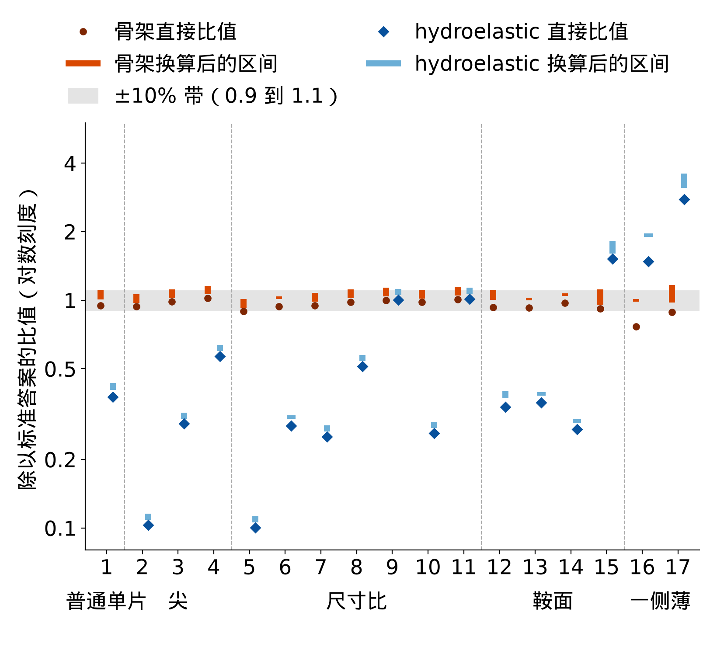
***接触区够大的 18 个算例里，骨架换算后的区间 12 个落在 0.9–1.1 带内、5 个跨着 1.1 线、1 个（尖 · 龙压龙 · 压得最深）整段在带外；hydroelastic 18 个全部整段在带外。** 横轴是下表的编号。圆点和菱形分别是骨架和 hydroelastic 的直接比值，同色系的竖条是各自换算后的区间，区间很窄时画成短横线；灰带是 0.9–1.1。*

**GT 一律在 12 维 affine 锁下算：锁的是质量加权质心和质量加权最小二乘拟合出的 $3\times3$ 矩阵（定义见第 7–8 周第 1 节），mode 也在同一个锁下算。** 「接触区够大」指接触半径内铺得下至少 2 个骨架小格，且同一标签上的 P1/P2 线弹性参照网格够细、能给出换算区间。类名说明构型：「尖」是尖处接触，「尺寸比」是两个物体大小差很多（样本 7 里兔体积约为龙的 3.6 倍），「鞍面」是接触在马鞍形的面上，「一侧薄」是一侧是薄片；同一类里不同的摆放用编号区分；「标准答案用细网格」两行把 GT 换成更细的网格重算作对照，

| 编号 | 类 | 算例 | 骨架（直接 → 换算区间） | 判档 | hydroelastic（直接 → 换算区间） | 判档 |
|---|---|---|---|---|---|---|
| 1 | 普通单片 | 鸭压兔 · 压得居中 | 0.937 → [0.968, 1.061] | 基本对 | 0.235 → [0.246, 0.263] | 整段偏离 |
| 2 | 普通单片 | 鸭压兔 · 压得最深 | 0.950 → [0.994, 1.048] | 基本对 | 0.347 → [0.368, 0.378] | 整段偏离 |
| 3 | 尖 | 兔压龙 · 压得居中 | 0.960 → [1.012, 1.110] | 跨线 | 0.154 → [0.164, 0.176] | 整段偏离 |
| 4 | 尖 | 兔压龙 · 压得最深 | 0.992 → [1.056, 1.113] | 跨线 | 0.255 → [0.275, 0.282] | 整段偏离 |
| 5 | 尖 | 龙压龙 · 压得最深 | 1.042 → [1.134, 1.195] | 整段偏离 | 0.567 → [0.626, 0.642] | 整段偏离 |
| 6 | 尺寸比 | 龙压兔样本 12 · 压得居中 | 0.931 → [0.976, 1.071] | 基本对 | 0.155 → [0.165, 0.176] | 整段偏离 |
| 7 | 尺寸比 | 龙压兔样本 12 · 压得最深 | 0.952 → [1.009, 1.064] | 基本对 | 0.245 → [0.263, 0.270] | 整段偏离 |
| 8 | 尺寸比 | 龙压兔样本 7 · 压得最深 | 0.926 → [1.033, 1.133] | 跨线 | 0.597 → [0.675, 0.721] | 整段偏离 |
| 9 | 尺寸比 | 龙压兔样本 7（标准答案用细网格） · 压得最浅 | 0.915 → [1.006, 1.103] | 跨线 | 0.172 → [0.191, 0.204] | 整段偏离 |
| 10 | 尺寸比 | 龙压兔样本 7（标准答案用细网格） · 压得最深 | 0.934 → [1.056, 1.113] | 跨线 | 0.603 → [0.691, 0.709] | 整段偏离 |
| 11 | 鞍面 | 兔压兔样本 1 · 压得最深 | 0.932 → [0.986, 1.039] | 基本对 | 0.329 → [0.353, 0.363] | 整段偏离 |
| 12 | 鞍面 | 兔压兔样本 3 · 压得最深 | 0.924 → [0.983, 1.037] | 基本对 | 0.347 → [0.375, 0.384] | 整段偏离 |
| 13 | 鞍面 | 兔压兔样本 16 · 压得最深 | 0.963 → [1.020, 1.075] | 基本对 | 0.268 → [0.288, 0.295] | 整段偏离 |
| 14 | 鞍面 | 兔压龙样本 3 · 压得最深 | 0.921 → [0.981, 1.033] | 基本对 | 0.524 → [0.565, 0.580] | 整段偏离 |
| 15 | 一侧薄 | 兔压龙 · 压得最浅 | 0.745 → [0.964, 1.017] | 基本对 | 1.328 → [1.743, 1.788] | 整段偏离 |
| 16 | 一侧薄 | 龙压鸭 · 压得居中 | 0.915 → [0.955, 1.047] | 基本对 | 0.505 → [0.535, 0.571] | 整段偏离 |
| 17 | 一侧薄 | 龙压鸭 · 压得最深 | 0.919 → [0.977, 1.029] | 基本对 | 0.783 → [0.843, 0.865] | 整段偏离 |
| 18 | 两侧材料差 | 龙压龙（被压的龙硬 10 倍） · 压得最深 | 0.975 → [1.039, 1.095] | 基本对 | 0.470 → [0.508, 0.521] | 整段偏离 |

**骨架整段偏离的一例是尖处接触（龙压龙、压得最深），区间 [1.134, 1.195]，偏大，尖处表面不光滑，是第一项（按平面算的半空间近似）最弱的地方；跨线的 5 例都是区间上端略过 1.1。hydroelastic 的直接比值从 0.154 到 1.328，全部整段偏离。** 它的压力只由每一点自己在两个物体里有多深决定，看不到物体整体的弯曲，也看不到同一片接触区里各点之间的相互影响。

下面 18 个单元依次对应上表 18 行。有图的单元：「压入前」左边是整体摆放，箭头是压入方向，每片接触一个红圈，右边是从下往上看压入物体的接触面，红色是静止后贴上的部分；「静止后」是两个接触面正对着看，左边压入物体（橙色系），右边被压物体（蓝色系），颜色是 GT 静止后的局部变形。

### 1 · 普通单片 · 鸭压兔 · 压得居中

**骨架 0.937 → [0.968, 1.061]，基本对；hydroelastic 0.235 → [0.246, 0.263]，整段偏离。**

### 2 · 普通单片 · 鸭压兔 · 压得最深

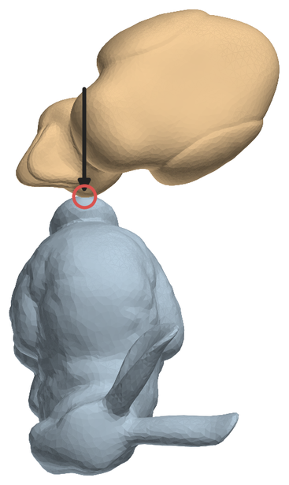 

**骨架 0.950 → [0.994, 1.048]，基本对；hydroelastic 0.347 → [0.368, 0.378]，整段偏离。**

### 3 · 尖 · 兔压龙 · 压得居中

**骨架 0.960 → [1.012, 1.110]，跨线；hydroelastic 0.154 → [0.164, 0.176]，整段偏离。**

### 4 · 尖 · 兔压龙 · 压得最深

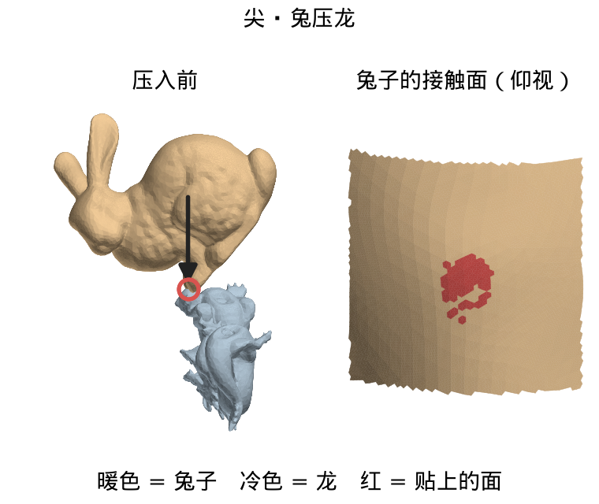 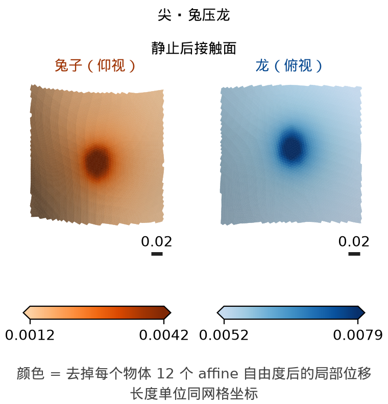

**骨架 0.992 → [1.056, 1.113]，跨线；hydroelastic 0.255 → [0.275, 0.282]，整段偏离。**

### 5 · 尖 · 龙压龙 · 压得最深

**骨架 1.042 → [1.134, 1.195]，整段偏离；hydroelastic 0.567 → [0.626, 0.642]，整段偏离。**

### 6 · 尺寸比 · 龙压兔样本 12 · 压得居中

**骨架 0.931 → [0.976, 1.071]，基本对；hydroelastic 0.155 → [0.165, 0.176]，整段偏离。**

### 7 · 尺寸比 · 龙压兔样本 12 · 压得最深

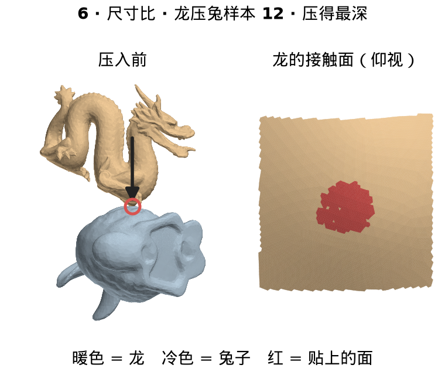 

**骨架 0.952 → [1.009, 1.064]，基本对；hydroelastic 0.245 → [0.263, 0.270]，整段偏离。**

### 8 · 尺寸比 · 龙压兔样本 7 · 压得最深

**骨架 0.926 → [1.033, 1.133]，跨线；hydroelastic 0.597 → [0.675, 0.721]，整段偏离。**

### 9 · 尺寸比 · 龙压兔样本 7（标准答案用细网格） · 压得最浅

**骨架 0.915 → [1.006, 1.103]，跨线；hydroelastic 0.172 → [0.191, 0.204]，整段偏离。**

### 10 · 尺寸比 · 龙压兔样本 7（标准答案用细网格） · 压得最深

**骨架 0.934 → [1.056, 1.113]，跨线；hydroelastic 0.603 → [0.691, 0.709]，整段偏离。**

### 11 · 鞍面 · 兔压兔样本 1 · 压得最深

**骨架 0.932 → [0.986, 1.039]，基本对；hydroelastic 0.329 → [0.353, 0.363]，整段偏离。**

### 12 · 鞍面 · 兔压兔样本 3 · 压得最深

 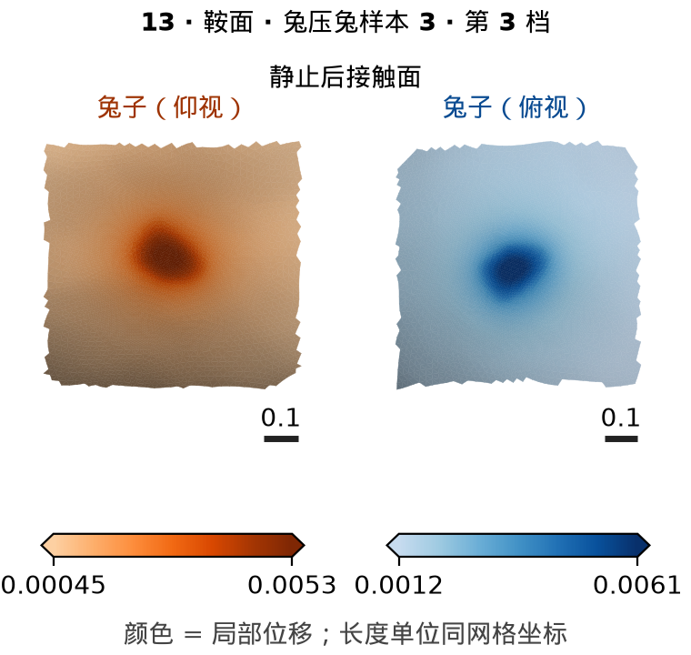

**骨架 0.924 → [0.983, 1.037]，基本对；hydroelastic 0.347 → [0.375, 0.384]，整段偏离。**

### 13 · 鞍面 · 兔压兔样本 16 · 压得最深

 

**骨架 0.963 → [1.020, 1.075]，基本对；hydroelastic 0.268 → [0.288, 0.295]，整段偏离。**

### 14 · 鞍面 · 兔压龙样本 3 · 压得最深

 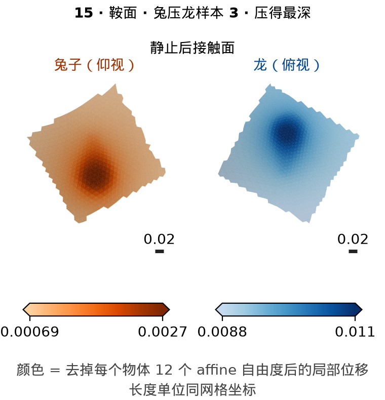

**骨架 0.921 → [0.981, 1.033]，基本对；hydroelastic 0.524 → [0.565, 0.580]，整段偏离。**

### 15 · 一侧薄 · 兔压龙 · 压得最浅

 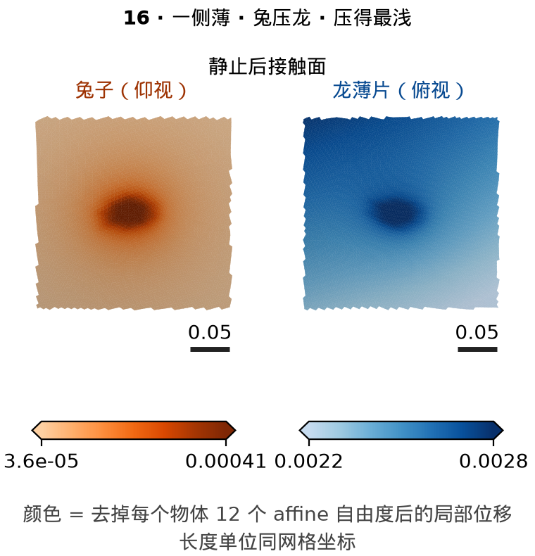

**骨架 0.745 → [0.964, 1.017]，基本对；hydroelastic 1.328 → [1.743, 1.788]，整段偏离。**

### 16 · 一侧薄 · 龙压鸭 · 压得居中

**骨架 0.915 → [0.955, 1.047]，基本对；hydroelastic 0.505 → [0.535, 0.571]，整段偏离。**

### 17 · 一侧薄 · 龙压鸭 · 压得最深

 

**骨架 0.919 → [0.977, 1.029]，基本对；hydroelastic 0.783 → [0.843, 0.865]，整段偏离。**

### 18 · 两侧材料差 · 龙压龙（被压的龙硬 10 倍） · 压得最深

**骨架 0.975 → [1.039, 1.095]，基本对；hydroelastic 0.470 → [0.508, 0.521]，整段偏离。**

## 第二项是必要的

**把第二项去掉、只留第一项，同样这 18 个算例的直接比值在 0.93 到 4.46 之间，大多明显偏大；加上第二项后直接比值收到 0.75–1.04。** 消融时别的都不变，只拿掉每个物体的 mode。第一项把物体当成半空间，真实的兔、龙、鸭有限大、有薄处，只靠第一项算不准，所以骨架必须是两项。

## 按类别看：能覆盖什么，不能覆盖什么

**骨架在光滑处、整体转动、面贴面、大面积贴合、近不可压和斜压这 6 类上基本对；另外 5 类跨线，区间都跨过 1.1 这条线；零件的棱整段偏离，换算后的区间是 1.22–1.35。** 证据来自兔子或 CAD 零件压平块的 14 类 edge case。其中尖（兔耳尖）和一侧薄（兔耳薄片）两类接触区小，接触半径内铺不下 2 个小格，读数列在下面的单元里；下表是另外 12 类，每类取一个代表算例：

| 类 | 挑战哪一条 | 骨架（直接比值 → 区间） | 判定 |
|---|---|---|---|
| 基线 | 兔背轻压平块，最普通 | 0.939 → [0.990, 1.061] | 基本对 |
| 整体转动 | 整个场景（两个物体和压入方向）一起转 45° | 0.940 → [0.966, 1.066] | 基本对 |
| 面贴面 | 圆鼓零件的凸面压平块，接触区是一整块椭圆 | 0.950 → [0.976, 1.076] | 基本对 |
| 大面积贴合 | 圆柱侧面躺着压平块，接触区是沿柱长的一条长带 | 0.891 → [0.915, 1.084] | 基本对 |
| 近不可压 | 泊松比 0.49 | 0.857 → [1.007, 1.088] | 基本对 |
| 斜压 | 兔子整体斜 30° 摆放后竖直压下 | 0.956 → [0.982, 1.084] | 基本对 |
| 两侧都薄 | 两个薄球冠壳互压 | 0.921 → [1.017, 1.214] | 跨线 |
| 两侧材料差 | 平块比兔子硬 1000 倍 | 0.925 → [0.950, 1.125] | 跨线 |
| 已有整体变形 | 粗模型先整体变形 1% | 0.945 → [0.971, 1.150] | 跨线 |
| 靠连接处 | 腿和身体相连处，几何突变 | 0.935 → [0.961, 1.138] | 跨线 |
| 多处接触 | 腿和身体两处同时压 | 0.955 → [0.981, 1.161] | 跨线 |
| 棱 | 零件的棱，接触面不光滑 | 1.191 → [1.224, 1.350] | 整段偏离 |

下面每类一个单元，图的读法同 3.2 节。

### 基线

 

**骨架 0.939 → [0.990, 1.061]，基本对。** 兔背轻压平块，表面光滑、只有一处接触，是最普通的情况。

### 整体转动

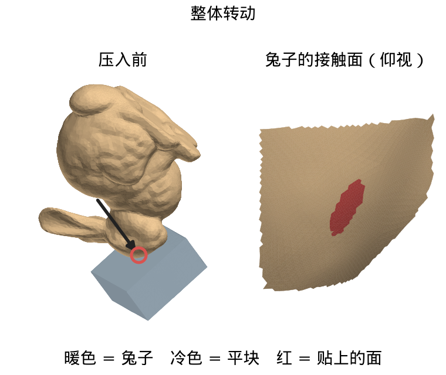 

**骨架 0.940 → [0.966, 1.066]，基本对。** 整个场景（两个物体和压入方向）一起转 45° 以后结果不变，骨架不依赖坐标朝向。

### 面贴面

 

**骨架 0.950 → [0.976, 1.076]，基本对。** 圆鼓零件的凸面压平块，接触区是一整块椭圆。

### 大面积贴合

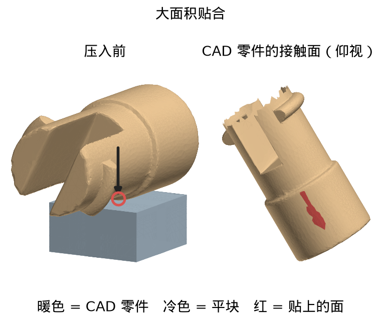 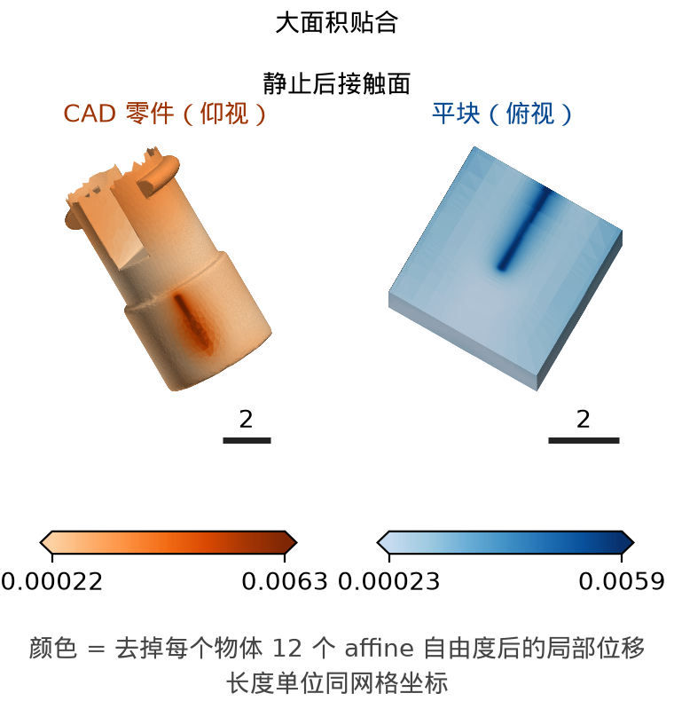

**骨架 0.891 → [0.915, 1.084]，基本对。** 圆柱侧面躺着压平块，接触区是沿柱长的一条长带。

### 近不可压

 

**骨架 0.857 → [1.007, 1.088]，基本对。** 构型是兔头压平块，只把兔子的泊松比改成 0.49；直接比值偏低是因为线性单元在近不可压时偏硬、GT 偏大，换算后落在带内。

### 斜压

 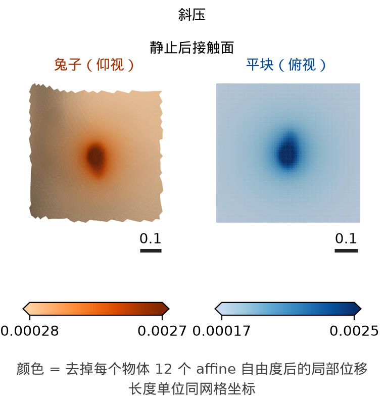

**骨架 0.956 → [0.982, 1.084]，基本对。** 兔子整体斜 30° 摆放后竖直压下，接触换到头的前下方，压入方向和表面法向不一致。

### 两侧都薄

 

**骨架 0.921 → [1.017, 1.214]，跨线。** 两个薄球冠壳互压，两侧都会整片弯曲，区间上端越过 1.1。

### 两侧材料差

 

**骨架 0.925 → [0.950, 1.125]，跨线。** 和基线一样是兔背压平块，平块换成比兔子硬 1000 倍的材料，压深也比基线深（0.012 对 0.003）；静止后图里平块的色标最大只有兔子色标的千分之一左右，变形几乎全在兔子一侧。

### 已有整体变形

 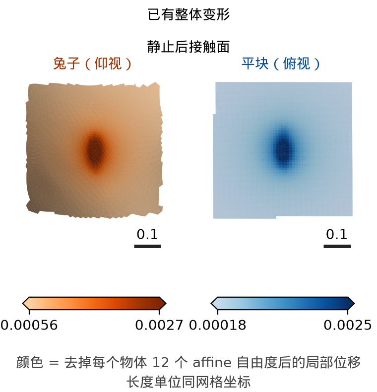

**骨架 0.945 → [0.971, 1.150]，跨线。** 压的部位和近不可压一样是兔头，区别在粗模型先带了 1% 的整体变形。

### 靠连接处

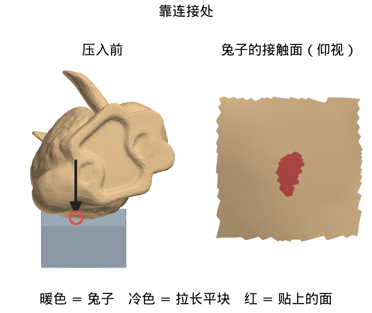 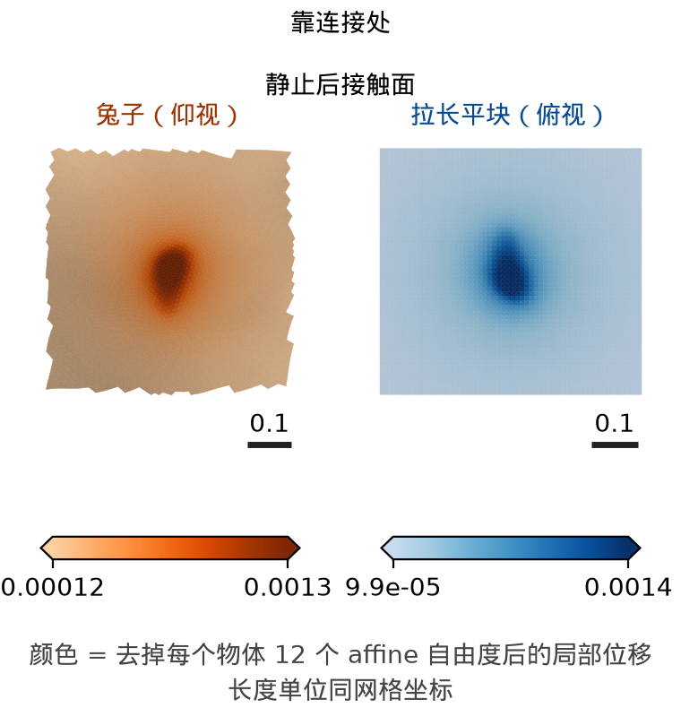

**骨架 0.935 → [0.961, 1.138]，跨线。** 接触在腿和身体相连处、大腿一侧，只有一片接触，附近几何突变。

### 多处接触

 

**骨架 0.955 → [0.981, 1.161]，跨线。** 腿和身体两处同时压，两处通过物体互相影响。

### 棱

 

**骨架 1.191 → [1.224, 1.350]，整段偏离，偏大。** 第一项把接触处当成表面平，而棱处表面突然转折，第二项补不了这一条。

### 尖（兔耳尖）

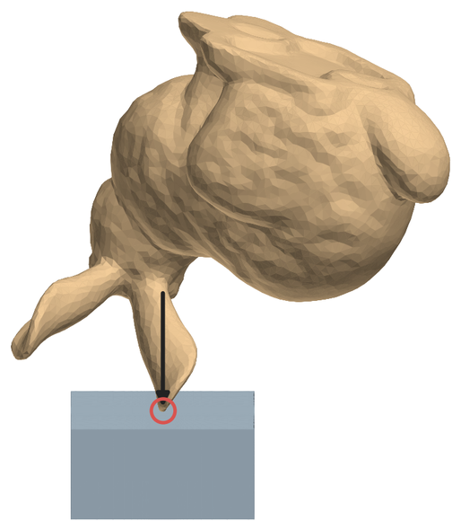 

**接触区小，接触半径内铺不下 2 个小格；骨架 1.341 → [1.435, 1.752]。**

### 一侧薄（兔耳薄片）

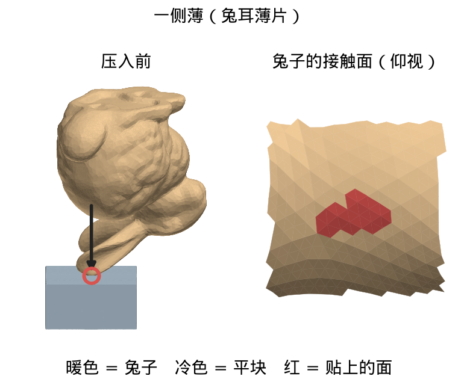 

**接触区小，接触半径内铺不下 2 个小格；骨架 1.333 → [1.421, 1.620]。**

### 龙鳍压平块（不在上面 14 类里）

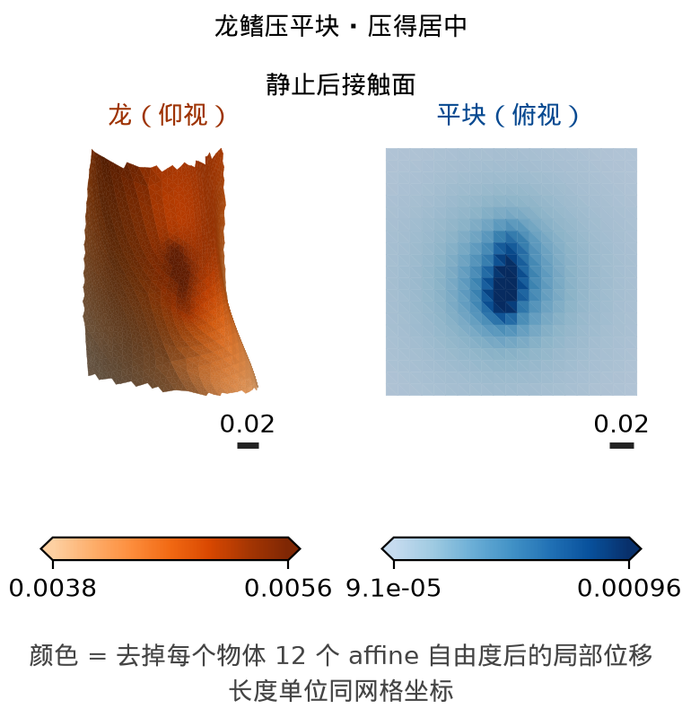 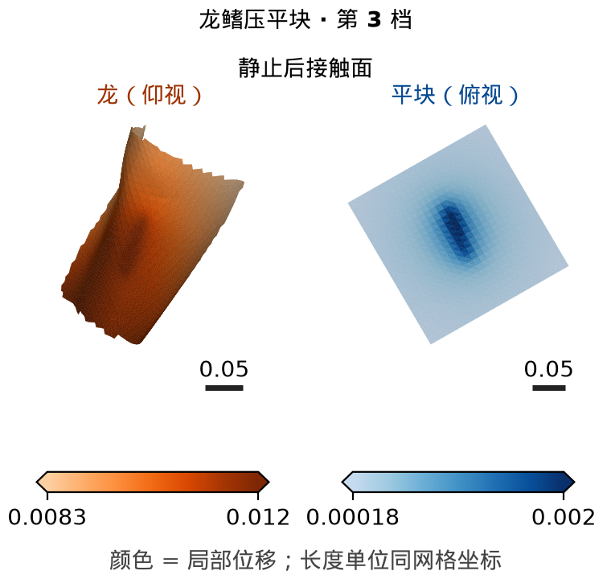

**龙鳍这种薄长部件，取 80 个 mode 时骨架仍是 GT 的 1.30 倍（压得居中）和 1.43 倍（压得最深），覆盖不了。** 薄长部件会整片弯曲，描述这种弯曲要用到很多个 mode，80 个还不够。

### 尖处

**尖处：两物体互压里接触区够大的 3 个尖处算例，1 个基本对、2 个跨线。** 兔耳尖压平块的读数见上面「尖（兔耳尖）」单元。

---

# 为什么用整体的 mode

**每个物体用一套整体的 mode，而不是把表面分成小片、按撞的位置查表，因为分片不耦合会算错，每次现算又太慢。** 一套 mode 可以用在不同的接触位置上，因为 mode 描述的是整个物体对表面任意位置受力的反应，撞在哪里只决定读取 mode 在哪一块的值。三种做法对比如下：

| 做法 | 结果 |
|---|---|
| 把表面分成小片，每片单独存一份柔度，彼此不耦合 | 不行：一个物体两处同时受压时，两处会通过整个物体互相影响；在一个两处同时受压的算例里按片拆开、片之间不耦合，片上的合力和不拆开时相比最多偏 23% |
| 每个物体存一份刚度矩阵的分解，每次接触时现算碰到的那些小格 | 太慢：同一个龙压鸭的浅压接触，IPC 仿真要 204 秒；现算碰到的 3614 个小格要 1408 秒，是 IPC 的 6.9 倍 |
| 整体 mode（我们用的做法） | 天然耦合所有接触；同一个龙压鸭算例，找到接触区之后，组装骨架系统（含在接触点读取 mode）并做预计算约 0.35 秒，带 80 个 mode 的单次求解约 1.5 秒（各跑 2 次；是在有别的作业满载的卡上测的，绝对秒数偏大） |

一个物体算一次的 mode，换对手、换接触位置能不能照样算准，在第 7 周检验。

---

# Research

已有的接触力学公式和成立条件，以及和骨架的关系

| 公式 | 原文条件 | 和我们的关系 |
|---|---|---|
| Boussinesq 点力 $u=F/(\pi E^{\prime}s)$ （Popov, Heß & Willert 2019 式 2.2） | 线弹性、半空间、表面坡度小（误差约为坡度的平方） | 骨架第一项的来源 |
| 等效模量 $1/E^{\ast}=\sum_b(1-\nu_b^2)/E_b$ （Popov, Heß & Willert 2019 式 2.1） | 两弹性体无摩擦法向接触，都可当半空间 | 两侧表面平行时，骨架第一项就退化成它 |
| Hertz $F=\frac{4}{3}E^{\ast}\sqrt{R_e}d^{3/2}$ ， $U=\frac{8}{15}E^{\ast}\sqrt{R_e}d^{5/2}$ （Popov, Heß & Willert 2019 §2.5.3 式 2.28、2.29、2.34、2.35）； $F$ 是总接触力， $d$ 是靠近量（刚接触后两物体靠近的距离）， $R_e$ 是两表面在接触点的等效曲率半径 | 接触半径远小于曲率半径；两物体都可当半空间；无摩擦 | 光滑凸面小压深时可以对照；第 7 周作 baseline |
| 余能二次规划 $\min_{p\ge0}\frac{1}{2}p^\top C_\infty p-\bar u^\top p$ （Bemporad & Paggi 2015 式 16）； $\bar u$ 是各小格穿进去多深，就是本文的 $w$ ， $C_\infty$ 是原文的半空间柔度 | 线弹性、无摩擦、一侧刚性一侧半空间 | 就是骨架的式子（差一个符号和常数 $h^2$ ），我们把半空间柔度换成有限物体的柔度 $C$ |
| 有限物体（表面光滑）的表面受力—位移关系，主导部分与半空间相同（Capoferri & Vassiliev 2021 §8.3） | 有界物体、光滑边界 | 支持「第一项算半空间、第二项补差别」的拆法；棱、尖、薄处不满足原文前提 |
| 每个物体的柔度投影到接触方向再相加（Duriez 等 2006 式 17–18） | 线弹性、小位移 | 就是 $C=\sum_b$ 的结构 |
| 全局子空间 + 接触附近局部半空间基（Harmon & Zorin 2013） | 变形区远小于物体 | 最接近我们的先例；作者也指出变形区和物体同尺寸时效果差，我们的大压深正是这种情况 |
| hydroelastic 压力场 $p_0=E_h\varepsilon$ （Elandt 等 2019 式 1、8）； $E_h$ 是人为取的刚度（hydroelastic 模量）， $\varepsilon$ 在物体表面为 0、在物体最里面（中轴）为 1；两物体重叠时接触面取两场压力相等处，接触力是接触面上压力的积分 | 原文前提是名义刚体（实际变形很小）；压力场是人为设定的，不来自弹性方程，各点之间不通过物体相互影响 | baseline |

骨架每一步的成立条件

| 步骤 | 条件 | 不成立时 |
|---|---|---|
| 第一项 | 线弹性、小应变、接触处表面平（坡度小，误差约为坡度的平方） | 尖、棱处偏差变大 |
| 一个压入方向 | 接触区不太弯 | 大压深时接触面绕成弯曲面，偏差大 |
| 80 个 mode | 其余方向的柔度可以忽略 | 薄长部件处截断误差变大（龙鳍） |
| 锁 12 个 affine 自由度 | 整体变形归粗模型 | 粗模型整体变形很大时 mode 要重算 |
| 二次规划 | 无摩擦、 $C$ 正定 | $C$ 不正定时解不唯一；所有算例实测 $C$ 均正定（2.1 节） |

材料非线性、几何非线性骨架都管不到，留给神经网络。

