# 第 5–6 周：骨架方法，以及它在浅压 edge case 上的验证

**结论：在表面浅压下，不用训练的「骨架」公式已经能把接触能量算到标准答案附近；算不准的是零件的棱和龙鳍这种薄长部件，骨架都偏大（偏硬）。** 我们用一个只有 12 个自由度的粗模型描述每个物体，再加一项「接触能量」，让粗模型也能算出接触处的变形能量。这项接触能量由骨架直接给出：骨架是两项线弹性公式，第一项把接触处当成无限大的弹性体，第二项用每个物体预先算好的 mode（一组描述物体有限大小和形状的变形方向，2.1 节解释）把有限大小和形状补回来。我们把骨架和精细仿真的标准答案比，判据见 3.1 节：在能下结论的 17 个两物体互压算例里，骨架没有一例整段偏离 0.9–1.1 这条带；现有的 hydroelastic 方法有 15 例整段偏离。去掉第二项后，这 17 例里有 12 例整段偏离，所以第二项是必要的。在另一组「单个物体压一块平块」的算例里，骨架在 6 类上基本对，5 类跨线（偏差可能超出 10%，判不出），零件的棱整段偏离；龙鳍压平块也偏大。每个物体的预处理只做一次，用时是分钟级。

---

# 一、我们要算什么

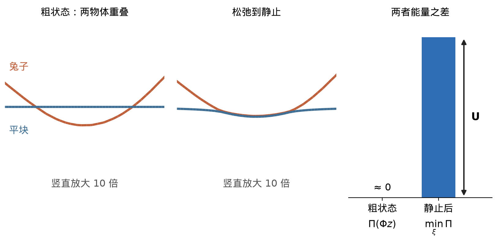
***接触能量 U 等于：同一个粗状态下，精细模型在不穿透的条件下松弛到静止后的能量，减去粗模型自己的能量。** 图中是兔背压平块；这个粗状态没有整体变形，所以 ① 的能量约为 0。*

**我们要算的是粗模型表示不了的那一块接触能量 U。** 粗模型给每个物体只留 12 个 affine 自由度，也就是整体的平移、转动、拉伸和剪切。它能表示物体整体怎么动、怎么变形，却表示不了接触处被压凹下去的那一小块。粗模型下两个物体可以互相穿进去。我们让精细模型的整体运动（也就是这 12 个自由度）和粗状态保持一致，其余变形在「两物体不穿透」的条件下松弛到静止，U 就是松弛后和松弛前的能量之差。粗状态本身是穿进去的，要把穿透退掉物体必须变形，所以松弛后的能量比松弛前高， $U\ge0$ 。作用在粗模型上的接触力是 $-\partial U/\partial z$ ：

$$U(z)=\min_{w:\ \text{两物体不穿透}}\ \Pi(\Phi z+\Psi w)-\Pi(\Phi z)$$

这里 $z$ 是粗状态， $\Phi z$ 是粗状态对应的精细网格位置， $\Psi$ 是锁住 affine 以后剩下的全部变形方向组成的一组基， $w$ 是在这组基上的坐标， $\Pi$ 是精细模型的弹性能。

---

# 二、两条 pipeline

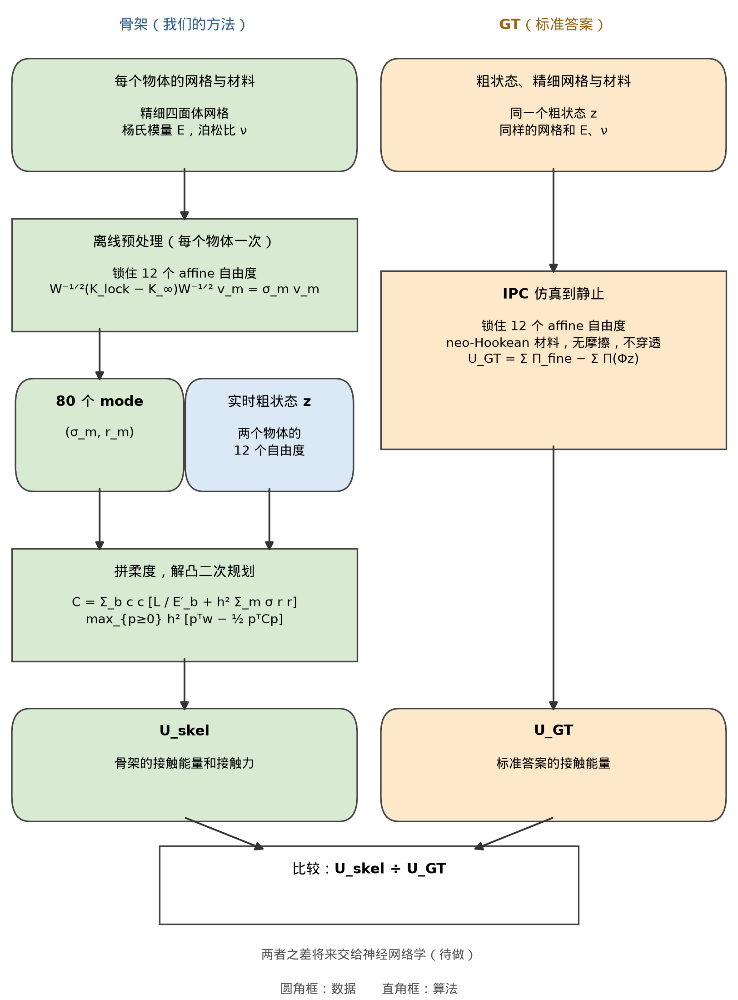
***骨架和标准答案是两条独立的计算线，只在最后比较时汇合。** 左边是骨架，右边是标准答案；圆角框是数据，直角框是算法。两者之差将来交给神经网络学，这一步还没做。*

**U 有两种算法：骨架是我们的方法，用线弹性公式直接算；标准答案（下文称 GT）用精细网格和非线性材料老老实实仿真出来。** 两条线互不调用，验证时只拿两者的结果相比。两者之差包括骨架管不到的材料和几何非线性，也包括骨架自身近似带来的误差，计划交给一个小的神经网络去学。

## 2.1 骨架：每个物体预处理一次，每次接触用两项公式

**骨架的第一项把接触处当成无限大的弹性体，第二项用每个物体自己的 mode 把有限大小和形状补回来。** 表面柔度矩阵描述的是在表面各点加单位压力时，各点往回退多少。mode 指的是这个物体的真实表面柔度和「无限大物体」表面柔度之差里，最主要的 80 个方向。它只由物体自己的几何和材料决定，和这个物体将来撞谁、撞在哪里都没有关系，所以每个物体离线算一次就够。具体做法是算出锁住 affine 以后真实物体的表面柔度矩阵 $K_{\text{lock}}$ ，减去同样材料、但把物体当成无限大时的表面柔度矩阵 $K_\infty$ ，再取这个差的前 80 个特征方向：

$$W^{-1/2}(K_{\text{lock}}-K_\infty)W^{-1/2}v_m=\sigma_mv_m,\qquad r_m=W^{-1/2}v_m$$

其中 $W$ 是每个表面顶点管辖的面积组成的对角阵，用来消掉网格疏密的影响。这个矩阵太大，没法直接写出来（龙的有限元有 102 万个自由度），所以我们只做「乘一组向量」的运算，用随机化特征值方法（Halko, Martinsson & Tropp 2011）求出来，并一直迭代到 80 个 mode 的相对特征值残差都不超过 1%。80 这个数是一个固定的选择；3.4 节龙鳍的例子说明，对薄长部件它还不够。

**每个物体的预处理是分钟级：兔约 2 分钟，鸭约 1.4 分钟，龙约 6.5 分钟。** 兔、鸭这两个数只含算 mode，龙的还含建网格。

**每次接触时，骨架先量出两个表面的重叠，再拼出柔度、解一个凸二次规划。** 输入是两个物体当前的粗状态。我们由重叠处的几何定出一个压入方向，在垂直于它的平面上把重叠处铺成边长为 $h$ 的小格（ $h$ 按接触区大小选），量出每一小格里两个表面互相穿进多深，记作 $w_i$ 。再用两个物体的材料和 mode 拼出柔度 $C$ ，它的意思是在第 $j$ 小格加单位压强时，第 $i$ 小格往回退多少。方括号里的分式是第一项，后面的求和是第二项：

$$C_{ij}=\sum_{b=A,B}\frac{1}{c_{b,i}c_{b,j}}[\frac{L_{ij}}{E_b^{\prime}}+h^2\sum_{m=1}^{80}\sigma_{b,m}r_{b,m}(x_i)r_{b,m}(x_j)],\qquad L_{ij}=\frac{1}{\pi}\int\int_{\text{小格}j}\frac{dA_y}{|x_i-y|}$$

$E_b^{\prime}=E_b/(1-\nu_b^2)$ 是物体 $b$ 的平面应变模量； $c_{b,i}$ 是物体 $b$ 在第 $i$ 小格处的表面法向和压入方向夹角的余弦，表面正对压入方向时等于 1。间隙是沿压入方向量的，表面沿法向退回 $r$ 时，间隙变化 $r/c$ ，所以第一项和第二项都要除以两个小格处的余弦。这个写法是这一版改的：原来是乘以余弦，大压深时把柔度压得很小，能量偏大很多（见第 7 周 1.2 节）；改成除以余弦后，浅压 17 个算例的判档全部不变；其中 3 个算例的直接比值离 1 远了 1 个百分点以上，变化最大的是龙压兔样本 12 第 3 档，从 0.956 变成 0.938。把小格边长缩到 0.75 倍重算这 3 个算例，多出来的偏离几乎不变（1.81、1.34、1.07 个百分点变成 1.82、1.34、1.10 个百分点），说明这是写法本身带来的差别，不是离散误差。最后解一个凸二次规划，得到接触能量和每一小格的接触力：

$$U_{\text{skel}}=\max_{p\ge0}\ h^2[p^\top w-\frac{1}{2}p^\top Cp],\qquad \frac{\partial U_{\text{skel}}}{\partial w}=h^2p^{\ast}$$

**骨架对材料和接触只要求线弹性和无摩擦；它的主要近似在第一项：把每一处接触都当成表面平、只有一个压入方向。** 第二项补回的是物体有限大小、有边界、有薄处对柔度的影响，但补不了「表面平、一个压入方向」这一条，所以在棱、尖这种表面突然转折的地方，以及接触面绕成弯曲面的大压深下，骨架会出偏差。另一方面，哪些小格受力是解出来的，压得越深接触区越大、越压越硬，这种接触本身带来的非线性骨架能自己给出来；材料和几何的非线性它管不到。

推导：从点力解到骨架的能量和接触力

（1）无限大弹性体表面上一点受力 $F$ 时，距离它 $r$ 的地方会下沉 $u(r)=\frac{F}{\pi E^{\prime}r}$ ，这是 Boussinesq 的点力解（Johnson 1985 §3.2）。【条件：线弹性、小应变；物体无限大；表面平】

（2）在第 $j$ 小格上加单位压强，相当于每一小块面积上作用 $dF=dA_y$ 的力，把第 1 步的解在第 $j$ 小格上积分，就得到第 $i$ 小格中心的下沉 $u_i=\frac{1}{\pi E^{\prime}}\int\int_{\text{小格}j}\frac{dA_y}{|x_i-y|}=\frac{L_{ij}}{E^{\prime}}$ ，这就是第一项。【条件：小格内压强均匀】

（3）真实物体有限大、有边界、有薄处，同样的压强下退得不一样。为了算这个差，在物体表面每个顶点放一个帽函数 $\phi_i$ ，它在这个顶点上等于 1，往相邻顶点线性降到 0。压强写成 $p(x)=\sum_jq_j\phi_j(x)$ ，再在同一组帽函数上读位移，就得到表面柔度矩阵 $K_{ij}=\int\int\phi_i(x)G(x,y)\phi_j(y)dA_xdA_y$ ，其中 $G(x,y)$ 是格林函数，即 $y$ 处的单位力让 $x$ 处退多少。【条件：线弹性】

（4）$G$ 取锁住 affine 以后真实物体的格林函数，得到 $K_{\text{lock}}$ ；取无限大物体的格林函数 $\frac{1}{\pi E^{\prime}|x-y|}$ ，得到 $K_\infty$ 。两个矩阵在同一组基上用同样的方式积分，所以可以直接相减， $R=K_{\text{lock}}-K_\infty$ 就是这个物体比无限大物体多出来（或少掉）的柔度。有限物体的格林函数等于无限大物体的格林函数加上一个光滑的修正部分（Capoferri & Vassiliev 2021），所以 $R$ 适合用少数几个方向来近似。【条件：锁住 12 个 affine 自由度】

（5）令 $W=\mathrm{diag}(\int\phi_idA)$ ，在 $R$ 两边各除以 $\sqrt W$ ，问题就变成对称的特征值问题 $W^{-1/2}RW^{-1/2}v_m=\sigma_mv_m$ ，再令 $r_m=W^{-1/2}v_m$ 。按 $|\sigma_m|$ 从大到小留下前 80 个，就有 $R(x,y)\approx\sum_m\sigma_mr_m(x)r_m(y)$ 。第 $j$ 小格上的总力是 $h^2$ ，它让第 $i$ 小格多下沉 $h^2\sum_m\sigma_mr_m(x_i)r_m(x_j)$ ，这就是第二项； $r_m$ 在小格中心的值由所在三角形的三个顶点线性插值得到。【条件：其余特征方向的柔度可以忽略】

（6）泊松比不变时，弹性刚度可以写成 $E$ 乘一个只和 $\nu$ 有关的量。柔度是刚度的逆，所以 $K_{\text{lock}}$ 、 $K_\infty$ 和 $R$ 都正比于 $1/E$ ，特征向量不变，只有 $\sigma_m\propto1/E$ 。所以换 $E$ 只需要缩放，换 $\nu$ 才要重算。【条件： $\nu$ 不变】

（7）接触时两个物体各自往回退，两边退的量加起来才把重叠抵消，所以把两个物体的两项加在一起。接触面倾斜时，间隙沿压入方向量，而表面沿自己的法向退回：法向退回 $r$ 让沿压入方向量的间隙变化 $r/c$ ，和间隙功共轭的力沿法向、大小是 $h^2p/c$ ，所以两头各除以一个夹角余弦，就得到上面的 $C_{ij}$ 。【条件：两个物体的退回可以直接相加；整片接触区可以用一个压入方向】

（8）接触要满足三件事：位移和压强的关系是 $u=Cp$ ；每一小格都有 $u_i\ge w_i$ 、 $p_i\ge0$ 、 $p_i(u_i-w_i)=0$ ，意思是有压力的小格刚好把重叠退掉，没被压到的小格没有压力；存下的弹性能是 $U=\frac{1}{2}h^2p^\top u$ 。【条件：无摩擦，只有法向压力；线弹性】

（9）最大化问题 $\max_{p\ge0}h^2[p^\top w-\frac{1}{2}p^\top Cp]$ 的最优条件是 $h^2e_i^\top(w-Cp)+\lambda_i=0$ 、 $\lambda_i\ge0$ 、 $\lambda_ip_i=0$ ，消去 $\lambda_i$ 并代入 $u=Cp$ ，正好得到第 8 步里每一小格的三个条件，所以这个问题的解 $p^{\ast}$ 就是接触压强（Bemporad & Paggi 2015）。把互补条件对所有小格加起来得到 $p^{\ast\top}Cp^{\ast}=p^{\ast\top}w$ ，代回最大值就是 $\frac{1}{2}h^2p^{\ast\top}u$ ，正是第 8 步的弹性能。【条件： $C$ 正定】

（10）这个最大值是一族关于 $w$ 的线性函数取最大，对 $w$ 求导就等于最优点处的系数（包络定理），所以 $\partial U_{\text{skel}}/\partial w=h^2p^{\ast}$ ，每一小格受的力就是解出来的压强。【条件： $C$ 正定】

## 2.2 GT：精细网格、非线性材料、IPC 仿真到静止

**GT 是用精细网格和非线性材料老老实实仿真出来的标准答案，骨架的线弹性近似不进入这条线。** 输入是两个物体的粗状态、精细网格和各自的杨氏模量 $E$ 、泊松比 $\nu$ 。我们把两个物体的 12 个 affine 自由度锁在粗状态上，其余变形全部放开，用 IPC（一种保证全程不穿透的接触仿真方法，Li 等 2020）在精细网格上解到静止。材料是 neo-Hookean，可以承受大变形；接触无摩擦。静止以后，用精细模型的弹性能减去粗模型自己的弹性能，就是 GT：

$$U_{\text{GT}}=\sum_b\Pi_b^{\text{fine}}-\sum_b\Pi_b(\Phi z_b)$$

## 2.3 刚度和泊松比怎么进两条线

**两条线里，每个物体都带着自己的 $E,\nu$ 分别进去，而不是先合成一个等效模量。** 等效模量 $E^\ast$ 指两个物体合起来的模量， $1/E^\ast=1/E_A^{\prime}+1/E_B^{\prime}$ ；本页和第 7 周页面都用这个叫法。上次组会上有人问到这一点。在 GT 里，每个物体的 $E,\nu$ 直接决定自己的 neo-Hookean 材料。在骨架里，每个物体用自己的 $E_b^{\prime}$ 进第一项，用自己的 $\sigma_{b,m}\propto1/E_b$ 进第二项。我们原本的设想是：第一项在两表面平行时只认两个物体的等效模量，管「等效」；第二项带着每个物体自己的形状，管「个体」，两项加起来能分出谁软谁硬。这个设想在第 7 周用软硬对调检验。

---

# 三、浅压 edge case 上的验证

**我们要检验的是：骨架的两项合起来，能不能覆盖各种难的接触。** 为此设计了一组 edge case，每一类专门挑战骨架近似里的一条，或者一种容易出错的情况，比如表面不平、物体有薄处、接触处尖、多处同时接触、两边材料差很多。每个算例都同时算三样：GT、hydroelastic（现有的一种快速接触方法，每一点的压力只由本地穿进去多深决定，Elandt 等 2019）和骨架。所有算例都只是表面浅压，每个构型由浅到深取三档压深（下文称第 1、2、3 档，具体深度随构型不同）；真正的大压深放在第 7 周。

## 3.1 判据

**骨架算出的能量除以 GT，落在 0.9 到 1.1 之间算对；判定看的是换算以后的区间。** 区间整段在 0.9–1.1 里算「基本对」，跨过边线算「跨线」（偏差可能在 10% 以内，也可能超出，判不出），整段在外算「整段偏离」。另外，接触区要足够大，骨架在接触半径内至少铺得下 2 个小格，这个算例才拿来下结论，叫「能下结论」；兔、龙、鸭两两互压的 26 个算例里有 17 个满足。

**换算是为了扣掉 GT 自己已知的偏差。** GT 的精细网格用的是线性四面体单元，在薄处和近不可压时会偏硬，GT 偏大，所以换算后比值都往上移，区间下端都高于直接比值。这种偏差来自单元类型本身，在浅压下主要表现在线弹性部分，所以我们在同一网格上分别用线性单元和更高阶的单元各算一次线弹性，两者之比就是单元造成的偏差；再加上 GT 网格粗细、仿真提前停止这两项各自估出的误差，得到 GT 的一个范围。所以表里每一格写成「直接比值 → 换算后的区间」：箭头左边是骨架除以 GT 的原始值，右边是除以「去掉已知偏差后的 GT 范围」得到的区间。GT 这一侧的换算对任何方法都一样；骨架的区间还多算了骨架自己的两项误差（只取 80 个 mode、小格边长 $h$ 的取法），hydroelastic 没有这两项，所以它的区间只按 GT 一侧换算；有几例 GT 一侧各项只有一个估计值、没有上下限，区间就缩成一个点。下表 17 个算例里，骨架区间两端相对直接比值放大 1.04–1.32 倍；放大最多的是两个「一侧薄」算例，上端约 1.32 倍，因为线性单元在薄处偏硬得最厉害。

## 3.2 主结果：骨架在能下结论的 17 个算例里没有一例整段偏离

***能下结论的 17 个算例里，骨架换算后的区间都落在或贴着 0.9–1.1 这条带；hydroelastic 没有一例整段在带内，只有 2 例跨着 1.1 线。** 横轴是下表的编号。圆点和菱形分别是骨架和 hydroelastic 的直接比值，同色系的竖条是各自换算后的区间，区间很窄时画成短横线；灰带是 0.9–1.1。*

**在能下结论的 17 个算例里，骨架 7 个基本对、10 个跨线、0 个整段偏离；hydroelastic 0 个基本对、2 个跨线、15 个整段偏离。** 下表就是图里的 17 个算例，按同样顺序排列。看「骨架」一列的判定，没有一例整段偏离；看「hydroelastic」一列，大多数离 1 很远。类名说明构型：「尖」是尖处接触，「尺寸比」是两个物体大小差很多（样本 7 里兔体积约为龙的 3.6 倍），「鞍面」是接触在马鞍形的面上，「一侧薄」是一侧是薄片；同一类里不同的摆放用编号区分；「标准答案用细网格」两行是同一构型，GT 换成更细的网格再算一遍作对照，所以 17 个算例里独立的构型是 15 个。第 7 行和第 10 行就是这样一对：GT 换细网格后直接比值从 0.948 变成 0.980，两个区间大部分重叠，判定从基本对变成跨线是因为区间上端越过了 1.1，说明 GT 网格粗细带来的差别是几个百分点。「编号」一列对应图的横轴。

| 编号 | 算例 | 骨架（直接比值 → 区间 · 判定） | hydroelastic（直接比值 → 区间 · 判定） |
|---|---|---|---|
| 1 | 普通单片 · 鸭压兔 · 第 3 档 | 0.948 → [1.005, 1.108] · 跨线 | 0.375 → [0.403, 0.433] · 整段偏离 |
| 2 | 尖 · 兔压龙 · 第 1 档 | 0.937 → [0.974, 1.062] · 基本对 | 0.103 → [0.109, 0.115] · 整段偏离 |
| 3 | 尖 · 龙压龙 · 第 1 档 | 0.984 → [1.023, 1.116] · 跨线 | 0.286 → [0.301, 0.320] · 整段偏离 |
| 4 | 尖 · 龙压龙 · 第 2 档 | 1.020 → [1.060, 1.156] · 跨线 | 0.568 → [0.598, 0.635] · 整段偏离 |
| 5 | 尺寸比 · 龙压兔样本 12 · 第 1 档 | 0.892 → [0.927, 1.011] · 基本对 | 0.100 → [0.106, 0.112] · 整段偏离 |
| 6 | 尺寸比 · 龙压兔样本 12 · 第 3 档 | 0.938 → [1.012, 1.039] · 基本对 | 0.281 → [0.307, 0.307] · 整段偏离 |
| 7 | 尺寸比 · 龙压兔样本 7 · 第 1 档 | 0.948 → [0.985, 1.075] · 基本对 | 0.252 → [0.265, 0.282] · 整段偏离 |
| 8 | 尺寸比 · 龙压兔样本 7 · 第 2 档 | 0.982 → [1.020, 1.113] · 跨线 | 0.513 → [0.540, 0.573] · 整段偏离 |
| 9 | 尺寸比 · 龙压兔样本 7 · 第 3 档 | 0.999 → [1.037, 1.132] · 跨线 | 1.001 → [1.054, 1.120] · 跨线 |
| 10 | 尺寸比 · 龙压兔样本 7（标准答案用细网格） · 第 1 档 | 0.980 → [1.017, 1.111] · 跨线 | 0.261 → [0.274, 0.292] · 整段偏离 |
| 11 | 尺寸比 · 龙压兔样本 7（标准答案用细网格） · 第 3 档 | 1.008 → [1.047, 1.143] · 跨线 | 1.013 → [1.066, 1.133] · 跨线 |
| 12 | 鞍面 · 兔压兔样本 1 · 第 3 档 | 0.931 → [1.004, 1.106] · 跨线 | 0.340 → [0.371, 0.398] · 整段偏离 |
| 13 | 鞍面 · 兔压兔样本 3 · 第 3 档 | 0.925 → [0.998, 1.025] · 基本对 | 0.355 → [0.388, 0.388] · 整段偏离 |
| 14 | 鞍面 · 兔压兔样本 16 · 第 3 档 | 0.970 → [1.043, 1.070] · 基本对 | 0.271 → [0.295, 0.295] · 整段偏离 |
| 15 | 鞍面 · 兔压龙样本 3 · 第 3 档 | 0.918 → [0.953, 1.116] · 跨线 | 1.518 → [1.598, 1.823] · 整段偏离 |
| 16 | 一侧薄 · 兔压龙 · 第 1 档 | 0.767 → [0.984, 1.010] · 基本对 | 1.482 → [1.927, 1.927] · 整段偏离 |
| 17 | 一侧薄 · 龙压鸭 · 第 3 档 | 0.884 → [0.978, 1.164] · 跨线 | 2.770 → [3.105, 3.602] · 整段偏离 |

**hydroelastic 的偏差有大有小，直接比值从 0.100 到 2.770。** 它只看每一点本地穿进去多深，看不到物体整体的弯曲，也看不到同一片接触区里各点之间、以及隔开的几处接触之间通过物体的相互影响；骨架用第一项给出同一片接触区里各点之间的影响，用第二项补上物体有限大小带来的那部分。

下面 17 个单元和上表 17 行一一对应，单元名就是表里的「编号 · 算例」，图和这一行的数据放在一起。每个单元两张图。「压入前」左边是整体摆放，箭头是压入方向，每片接触一个红圈；右边是从下往上看压入物体的接触面，红色是静止后贴上的部分。「静止后」是两个接触面正对着看：左边压入物体（橙色系），右边被压物体（蓝色系），颜色是 GT 静止后的局部位移。每个物体各有一条色标，范围取接触处局部位移的 1%–99% 分位，比大小要看色标上的数字；每张图还有比例尺。

### 1 · 普通单片 · 鸭压兔 · 第 3 档

| 压入前 | 静止后 |
|---|---|
|  | 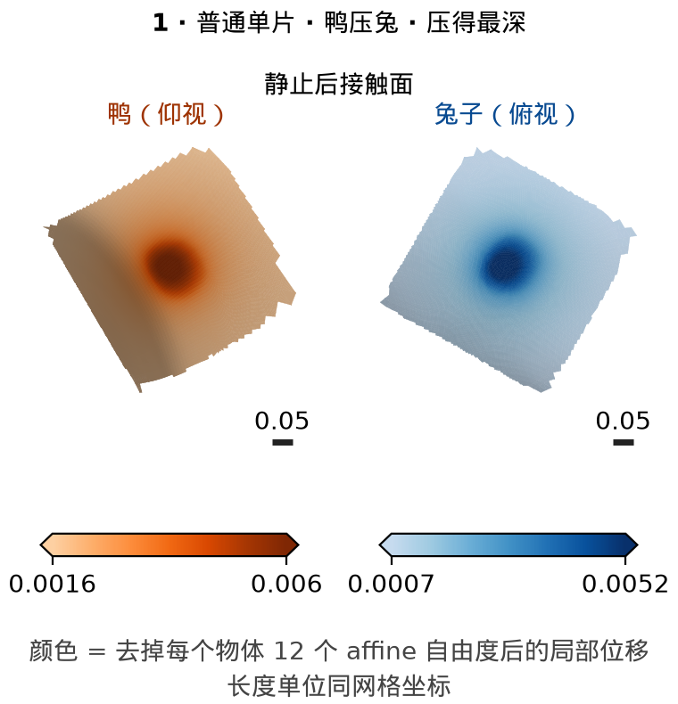 |

**骨架 0.948 → [1.005, 1.108]，跨线；hydroelastic 0.375 → [0.403, 0.433]，整段偏离。** 最普通的两物体单片接触，骨架的区间只在上端越过 1.1 一点。

### 2 · 尖 · 兔压龙 · 第 1 档

| 压入前 | 静止后 |
|---|---|
| 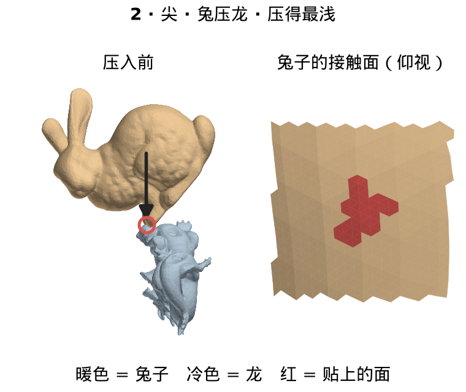 | 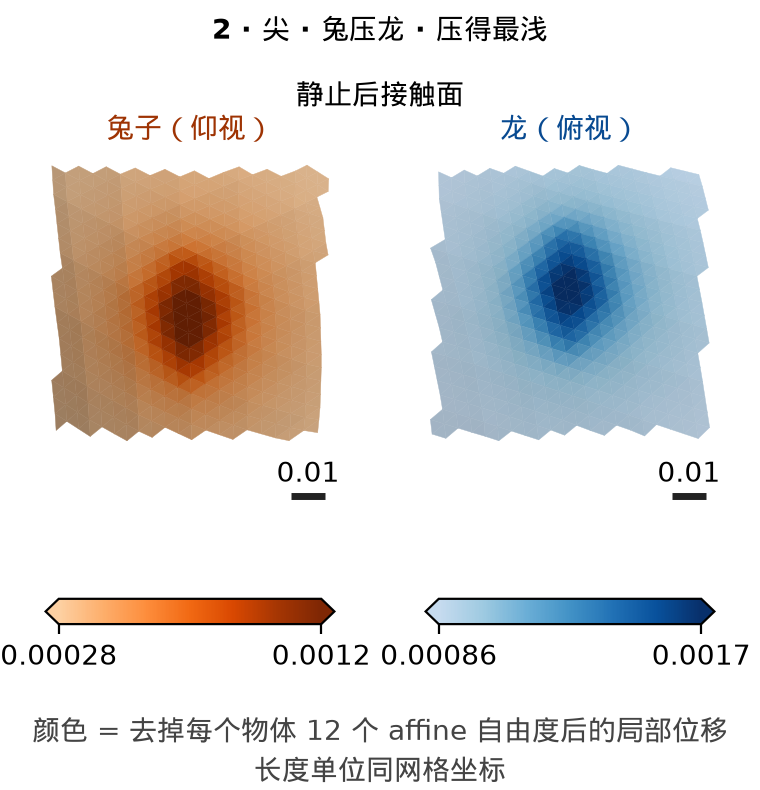 |

**骨架 0.937 → [0.974, 1.062]，基本对；hydroelastic 0.103 → [0.109, 0.115]，整段偏离。** 接触在尖处，hydroelastic 只有 GT 的十分之一左右。

### 3 · 尖 · 龙压龙 · 第 1 档

| 压入前 | 静止后 |
|---|---|
| 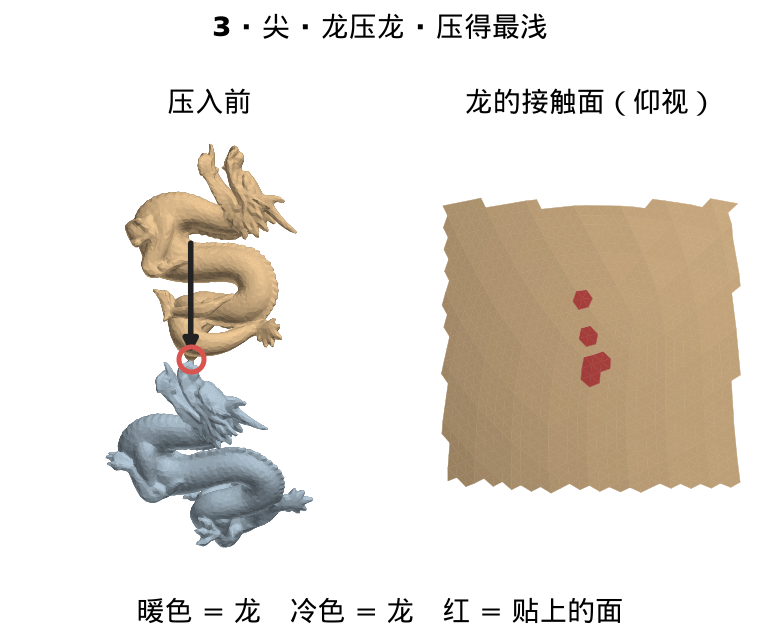 | 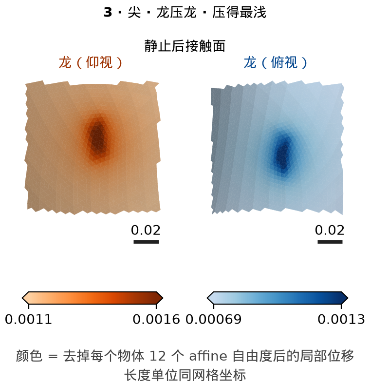 |

**骨架 0.984 → [1.023, 1.116]，跨线；hydroelastic 0.286 → [0.301, 0.320]，整段偏离。** 骨架的区间上端越过 1.1。

### 4 · 尖 · 龙压龙 · 第 2 档

| 压入前 | 静止后 |
|---|---|
| 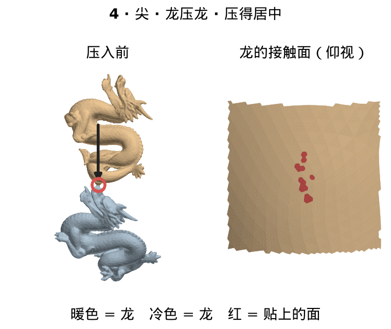 | 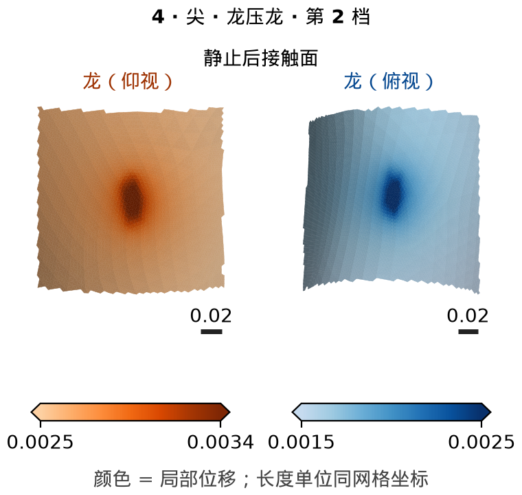 |

**骨架 1.020 → [1.060, 1.156]，跨线；hydroelastic 0.568 → [0.598, 0.635]，整段偏离。** 和第 3 行同一构型，压得更深，骨架的区间上端更高。

### 5 · 尺寸比 · 龙压兔样本 12 · 第 1 档

| 压入前 | 静止后 |
|---|---|
| 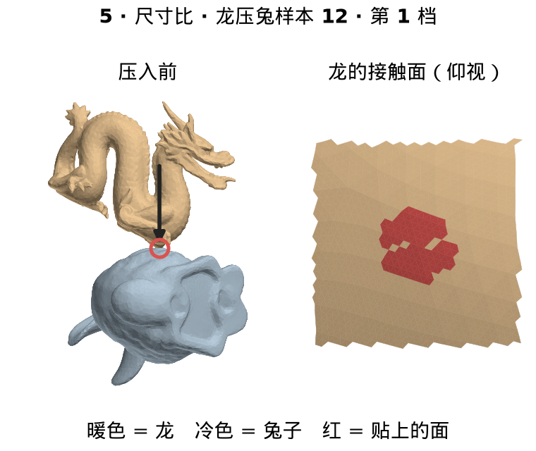 | 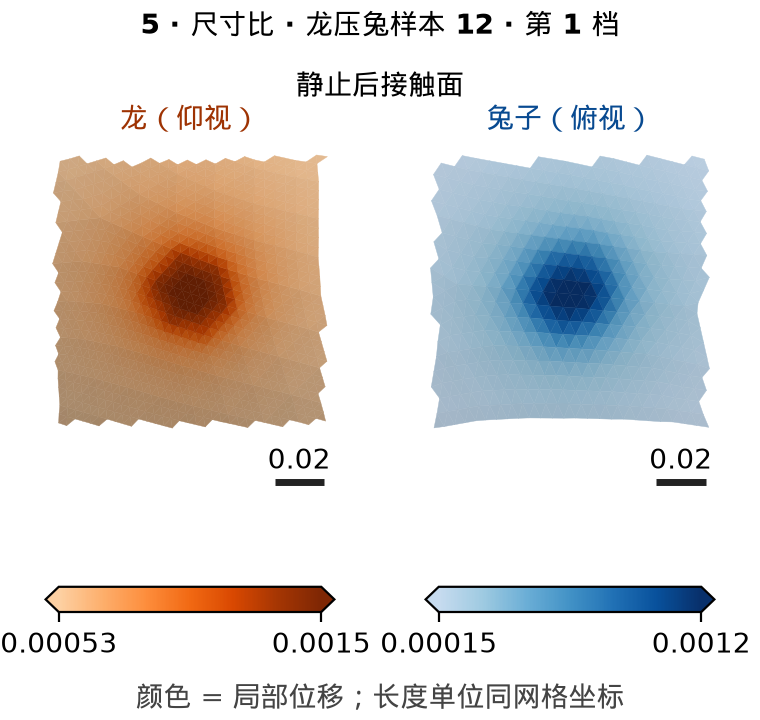 |

**骨架 0.892 → [0.927, 1.011]，基本对；hydroelastic 0.100 → [0.106, 0.112]，整段偏离。** 两个物体大小差很多，hydroelastic 在 17 行里偏小得最多。

### 6 · 尺寸比 · 龙压兔样本 12 · 第 3 档

| 压入前 | 静止后 |
|---|---|
|  | 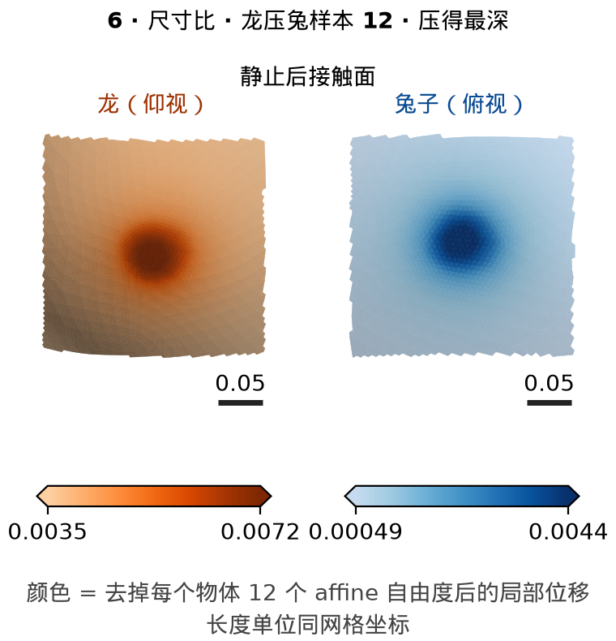 |

**骨架 0.938 → [1.012, 1.039]，基本对；hydroelastic 0.281 → [0.307, 0.307]，整段偏离。** 和第 5 行同一构型，压得更深，骨架仍基本对。

### 7 · 尺寸比 · 龙压兔样本 7 · 第 1 档

| 压入前 | 静止后 |
|---|---|
| 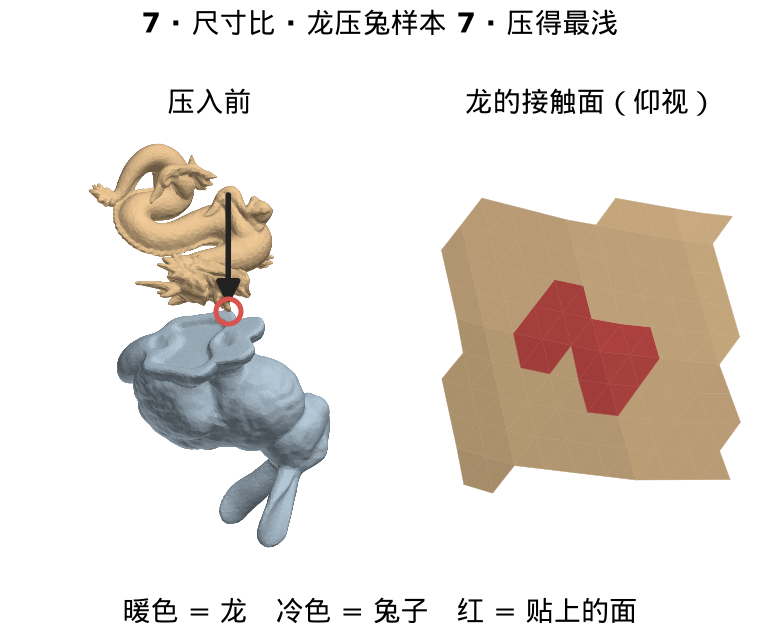 | 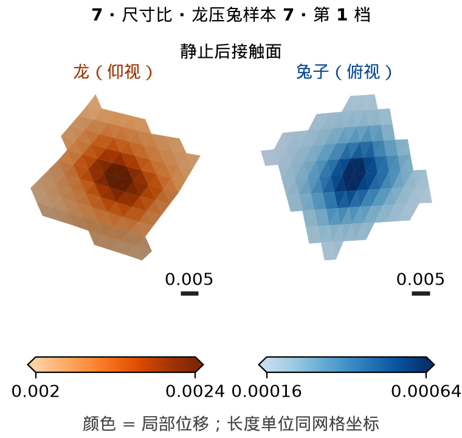 |

**骨架 0.948 → [0.985, 1.075]，基本对；hydroelastic 0.252 → [0.265, 0.282]，整段偏离。** 兔体积约为龙的 3.6 倍。

### 8 · 尺寸比 · 龙压兔样本 7 · 第 2 档

| 压入前 | 静止后 |
|---|---|
| 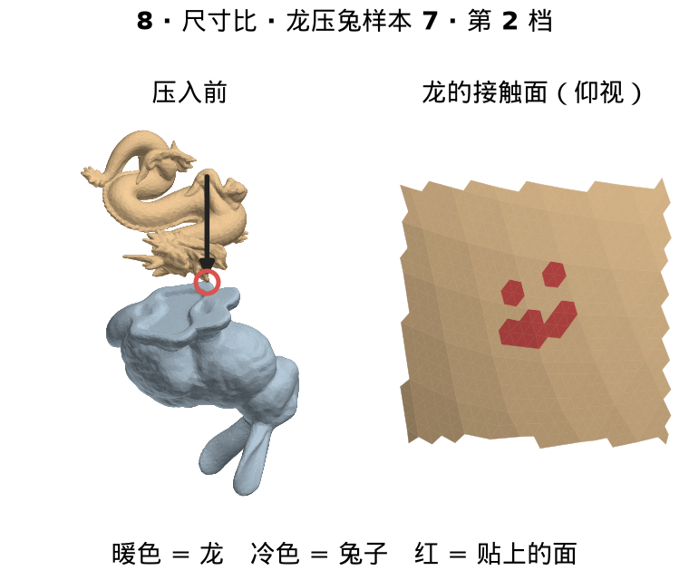 | 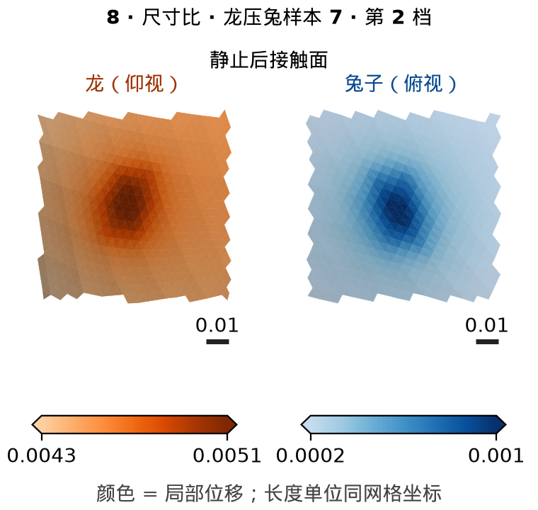 |

**骨架 0.982 → [1.020, 1.113]，跨线；hydroelastic 0.513 → [0.540, 0.573]，整段偏离。** 和第 7 行同一构型，压得更深。

### 9 · 尺寸比 · 龙压兔样本 7 · 第 3 档

| 压入前 | 静止后 |
|---|---|
|  | 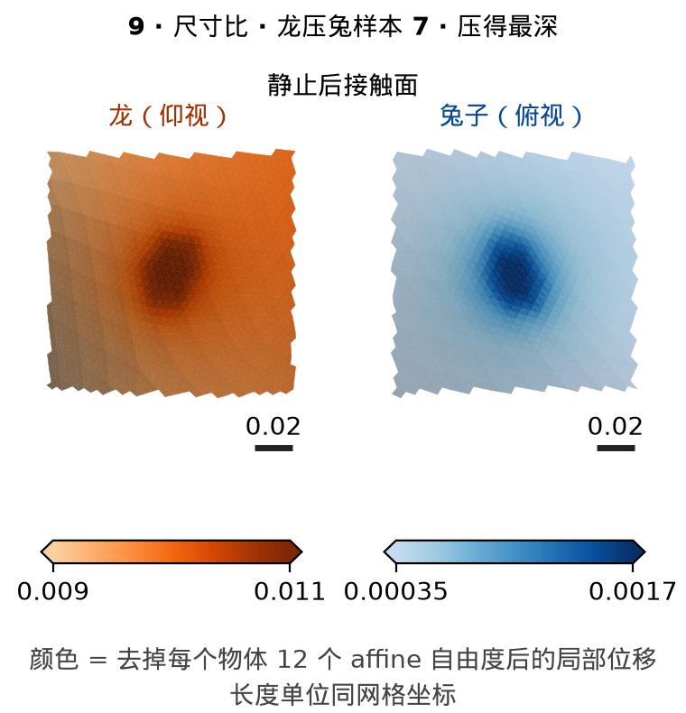 |

**骨架 0.999 → [1.037, 1.132]，跨线；hydroelastic 1.001 → [1.054, 1.120]，跨线。** 这一行两种方法都跨线。

### 10 · 尺寸比 · 龙压兔样本 7（标准答案用细网格） · 第 1 档

| 压入前 | 静止后 |
|---|---|
| 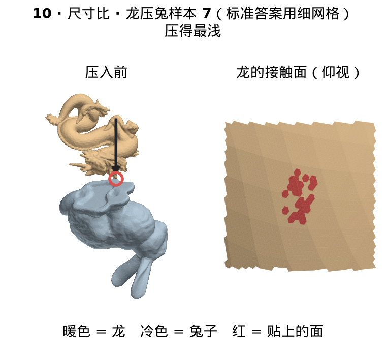 | 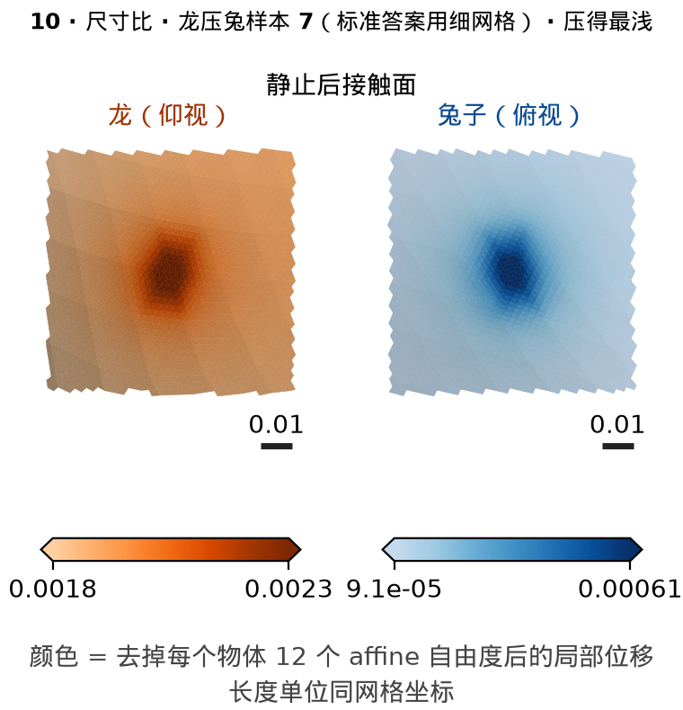 |

**骨架 0.980 → [1.017, 1.111]，跨线；hydroelastic 0.261 → [0.274, 0.292]，整段偏离。** 和第 7 行同一构型，只把 GT 换成更细的网格。

### 11 · 尺寸比 · 龙压兔样本 7（标准答案用细网格） · 第 3 档

| 压入前 | 静止后 |
|---|---|
| 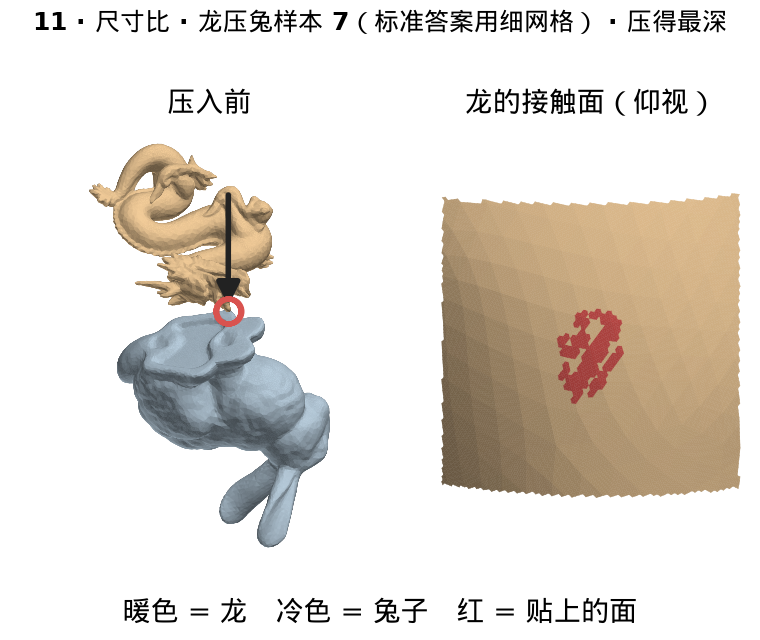 | 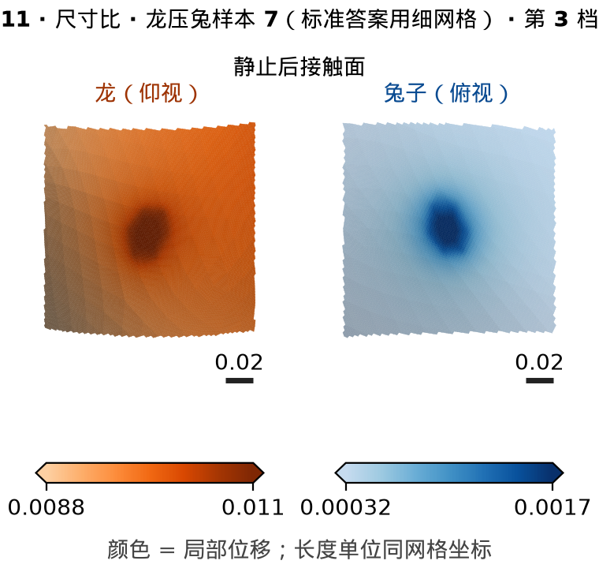 |

**骨架 1.008 → [1.047, 1.143]，跨线；hydroelastic 1.013 → [1.066, 1.133]，跨线。** 和第 9 行同一构型，只把 GT 换成更细的网格。

### 12 · 鞍面 · 兔压兔样本 1 · 第 3 档

| 压入前 | 静止后 |
|---|---|
|  |  |

**骨架 0.931 → [1.004, 1.106]，跨线；hydroelastic 0.340 → [0.371, 0.398]，整段偏离。** 接触在马鞍形的面上。

### 13 · 鞍面 · 兔压兔样本 3 · 第 3 档

| 压入前 | 静止后 |
|---|---|
| 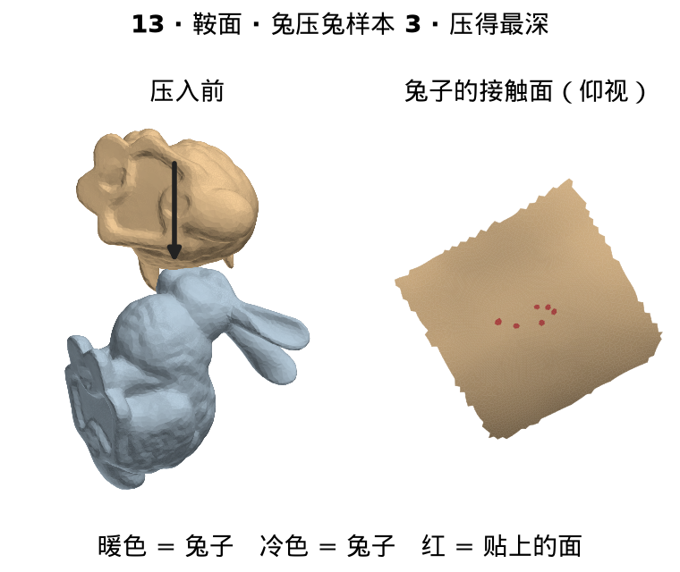 |  |

**骨架 0.925 → [0.998, 1.025]，基本对；hydroelastic 0.355 → [0.388, 0.388]，整段偏离。** 另一处马鞍形接触，骨架基本对。

### 14 · 鞍面 · 兔压兔样本 16 · 第 3 档

| 压入前 | 静止后 |
|---|---|
| 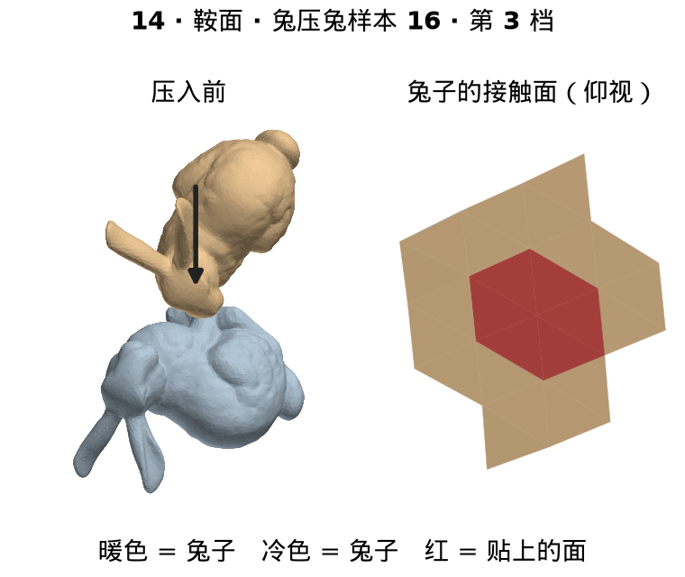 | 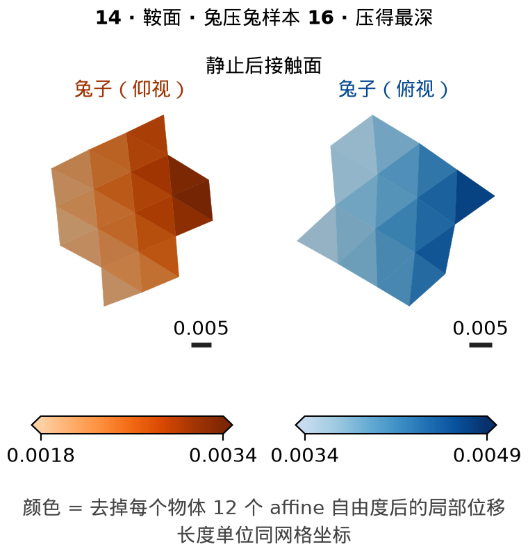 |

**骨架 0.970 → [1.043, 1.070]，基本对；hydroelastic 0.271 → [0.295, 0.295]，整段偏离。** 骨架基本对。

### 15 · 鞍面 · 兔压龙样本 3 · 第 3 档

| 压入前 | 静止后 |
|---|---|
| 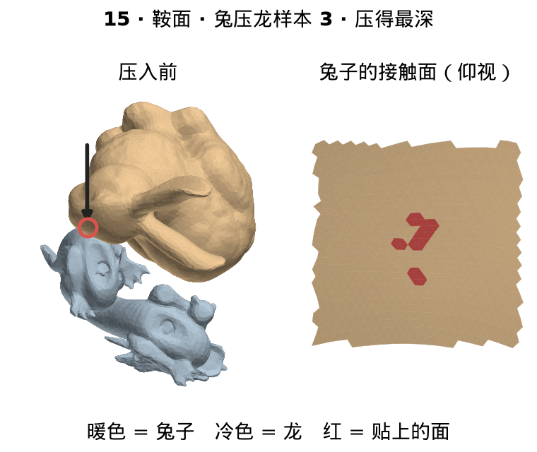 |  |

**骨架 0.918 → [0.953, 1.116]，跨线；hydroelastic 1.518 → [1.598, 1.823]，整段偏离。** 这一行 hydroelastic 偏大。

### 16 · 一侧薄 · 兔压龙 · 第 1 档

| 压入前 | 静止后 |
|---|---|
| 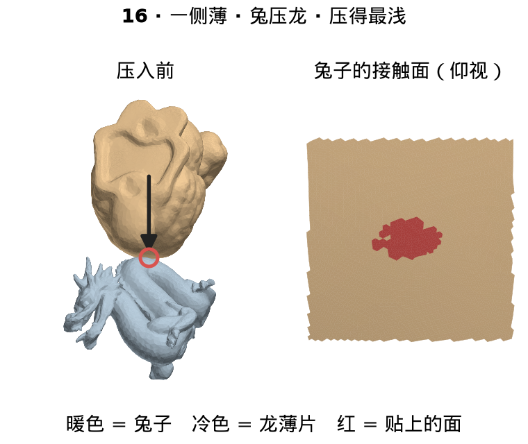 |  |

**骨架 0.767 → [0.984, 1.010]，基本对；hydroelastic 1.482 → [1.927, 1.927]，整段偏离。** 一侧是薄片，线性单元在薄处偏硬得最厉害，所以直接比值偏低、换算后落在带内。

### 17 · 一侧薄 · 龙压鸭 · 第 3 档

| 压入前 | 静止后 |
|---|---|
| 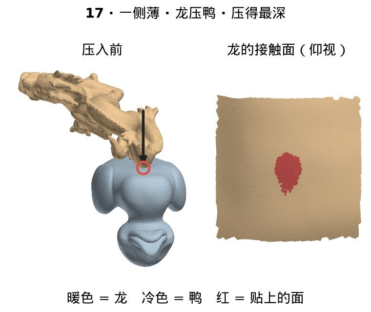 | 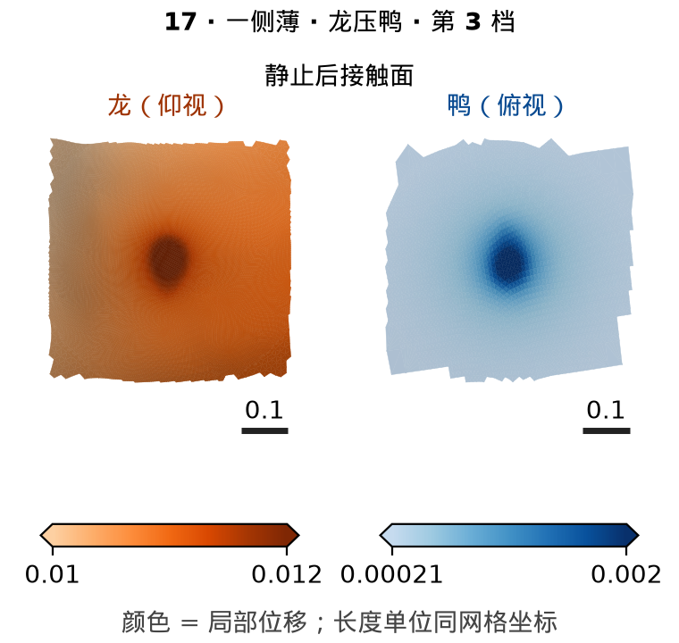 |

**骨架 0.884 → [0.978, 1.164]，跨线；hydroelastic 2.770 → [3.105, 3.602]，整段偏离。** hydroelastic 在 17 行里偏大得最多。

## 3.3 第二项是必要的

**把第二项去掉、只留第一项，同样这 17 个算例里有 12 个整段偏离，而且全部偏大；完整的骨架是 0 个。** 这是一次消融：别的都不变，只拿掉每个物体的 mode。只留第一项时，这 17 个算例的直接比值在 0.96 到 4.97 之间，按同样的换算（去掉 mode 截断这一项，因为只留第一项时没有 mode），整段偏离的 12 个区间都在 1.1 以上。第一项把物体当成无限大，真实的兔、龙、鸭有限大、有薄处，只靠第一项算不准，所以骨架必须是两项。

## 3.4 按类别看：能覆盖什么，不能覆盖什么

**骨架在光滑处、整体转动、面贴面、大面积贴合、近不可压和斜压这 6 类上基本对；另外 5 类跨线，判不出偏差是否在 10% 以内；零件的棱整段偏离，换算后的区间是 1.22–1.35。** 证据来自兔子或 CAD 零件压一块平块的 14 类 edge case，每类专门挑战一条近似。其中尖（兔耳尖）和一侧薄（兔耳薄片）两类接触区太小，接触半径内铺不下 2 个小格，不下结论；下表是另外 12 类的总览，每类取一个代表算例，名字和下面的单元一一对应：

| 类 | 挑战哪一条 | 骨架（直接比值 → 区间） | 判定 |
|---|---|---|---|
| 基线 | 兔背轻压平块，最普通 | 0.939 → [0.990, 1.061] | 基本对 |
| 整体转动 | 整个场景（两个物体和压入方向）一起转 45° | 0.940 → [0.966, 1.066] | 基本对 |
| 面贴面 | 圆鼓零件的凸面压平块，接触区是一整块椭圆 | 0.950 → [0.976, 1.076] | 基本对 |
| 大面积贴合 | 圆柱侧面躺着压平块，接触区是沿柱长的一条长带 | 0.891 → [0.915, 1.084] | 基本对 |
| 近不可压 | 泊松比 0.49 | 0.857 → [1.007, 1.088] | 基本对 |
| 斜压 | 兔子整体斜 30° 摆放后竖直压下 | 0.956 → [0.982, 1.084] | 基本对 |
| 两侧都薄 | 两个薄球冠壳互压 | 0.921 → [1.017, 1.214] | 跨线 |
| 两侧材料差 | 平块比兔子硬 1000 倍 | 0.925 → [0.950, 1.125] | 跨线 |
| 已有整体变形 | 粗模型先整体变形 1% | 0.945 → [0.971, 1.150] | 跨线 |
| 靠连接处 | 腿和身体相连处，几何突变 | 0.935 → [0.961, 1.138] | 跨线 |
| 多处接触 | 腿和身体两处同时压 | 0.955 → [0.981, 1.161] | 跨线 |
| 棱 | 零件的棱，接触面不光滑 | 1.191 → [1.224, 1.350] | 整段偏离 |

下面每一类一个单元，单元名和上表的「类」一致，图的读法同 3.2 节的单元。

### 基线

| 压入前 | 静止后 |
|---|---|
| 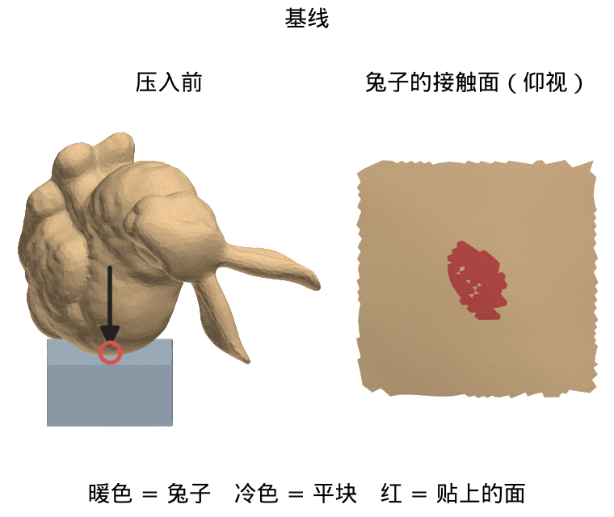 |  |

**骨架 0.939 → [0.990, 1.061]，基本对。** 兔背轻压平块，表面光滑、只有一处接触，是最普通的情况。

### 整体转动

| 压入前 | 静止后 |
|---|---|
|  | 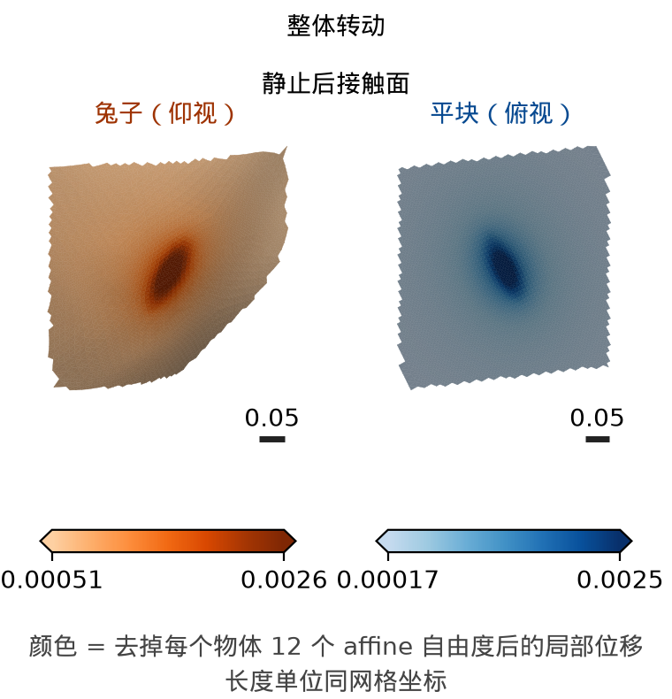 |

**骨架 0.940 → [0.966, 1.066]，基本对。** 整个场景（两个物体和压入方向）一起转 45° 以后结果不变，骨架不依赖坐标朝向。

### 面贴面

| 压入前 | 静止后 |
|---|---|
|  | 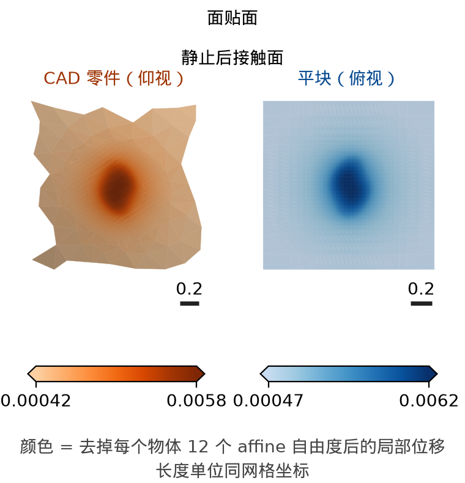 |

**骨架 0.950 → [0.976, 1.076]，基本对。** 圆鼓零件的凸面压平块，接触区是一整块椭圆。

### 大面积贴合

| 压入前 | 静止后 |
|---|---|
|  |  |

**骨架 0.891 → [0.915, 1.084]，基本对。** 圆柱侧面躺着压平块，接触区是沿柱长的一条长带。

### 近不可压

| 压入前 | 静止后 |
|---|---|
| 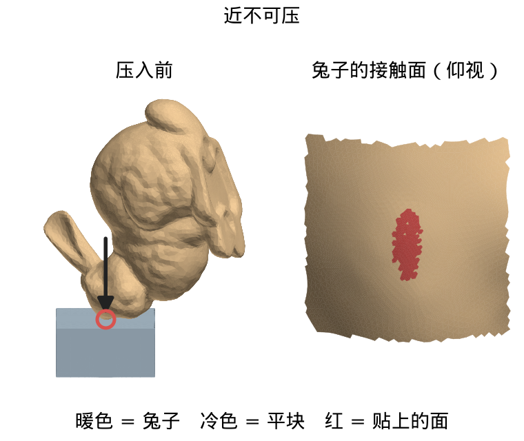 | 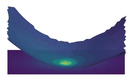 |

**骨架 0.857 → [1.007, 1.088]，基本对。** 构型是兔头压平块，只把兔子的泊松比改成 0.49；直接比值偏低是因为线性单元在近不可压时偏硬、GT 偏大，换算后落在带内。

### 斜压

| 压入前 | 静止后 |
|---|---|
| 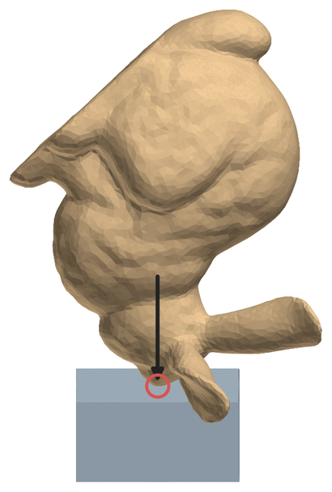 |  |

**骨架 0.956 → [0.982, 1.084]，基本对。** 兔子整体斜 30° 摆放后竖直压下，接触换到头的前下方，压入方向和表面法向不一致。

### 两侧都薄

| 压入前 | 静止后 |
|---|---|
| 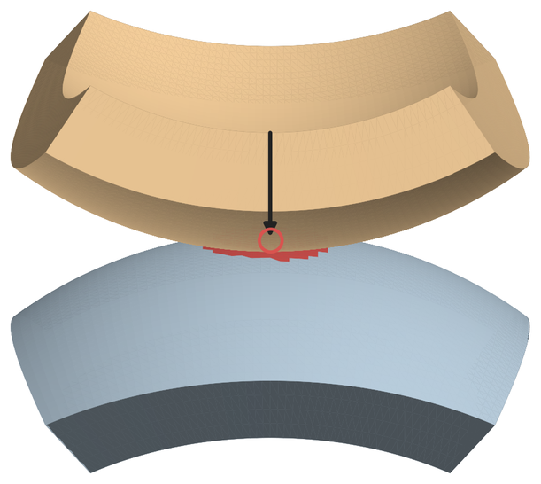 |  |

**骨架 0.921 → [1.017, 1.214]，跨线。** 两个薄球冠壳互压，两侧都会整片弯曲，区间上端越过 1.1。

### 两侧材料差

| 压入前 | 静止后 |
|---|---|
| 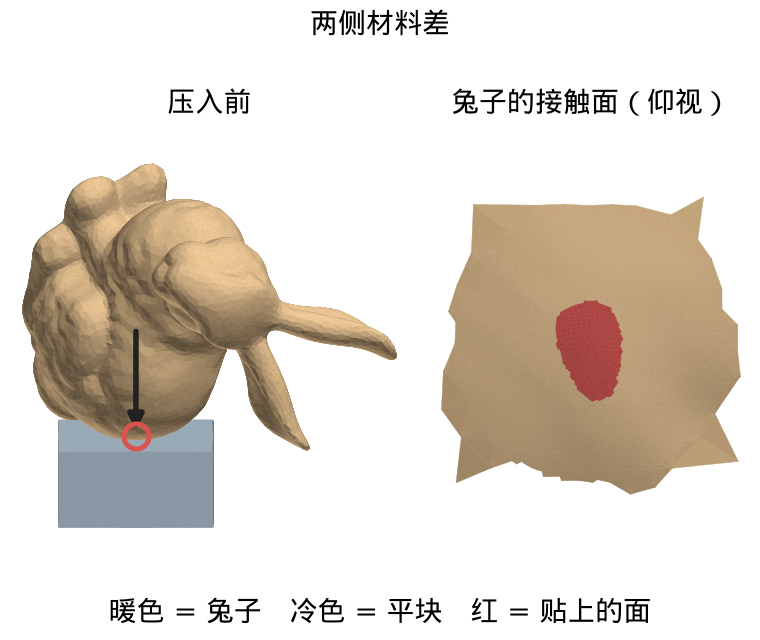 | 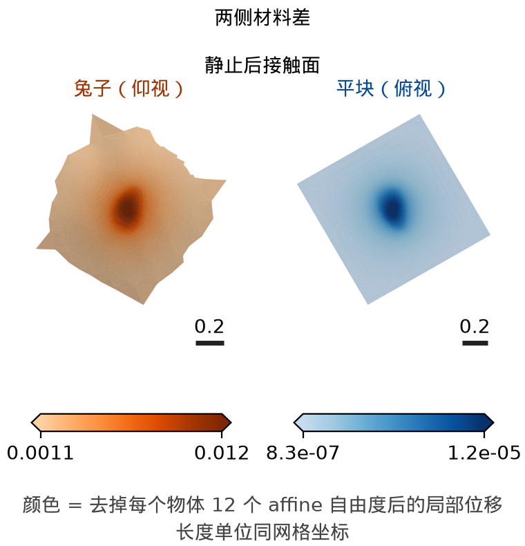 |

**骨架 0.925 → [0.950, 1.125]，跨线。** 和基线一样是兔背压平块，平块换成比兔子硬 1000 倍的材料，压深也比基线深（0.012 对 0.003）；静止后图里平块的色标最大只有兔子色标的千分之一左右，变形几乎全在兔子一侧，比较时看两条色标上的数字。

### 已有整体变形

| 压入前 | 静止后 |
|---|---|
| 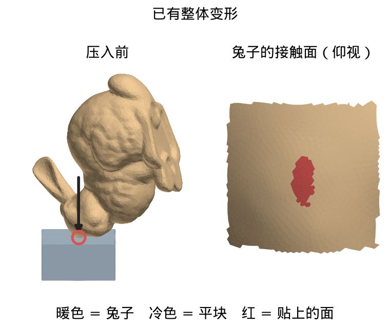 |  |

**骨架 0.945 → [0.971, 1.150]，跨线。** 压的部位和近不可压一样是兔头，区别在粗模型先带了 1% 的整体变形。

### 靠连接处

| 压入前 | 静止后 |
|---|---|
|  |  |

**骨架 0.935 → [0.961, 1.138]，跨线。** 接触在腿和身体相连处、大腿一侧，只有一片接触，附近几何突变。

### 多处接触

| 压入前 | 静止后 |
|---|---|
| 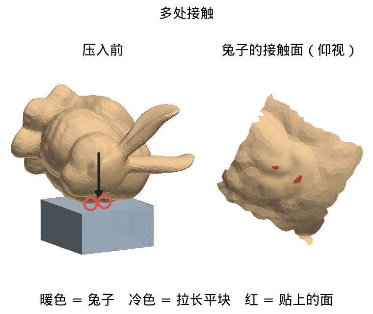 | 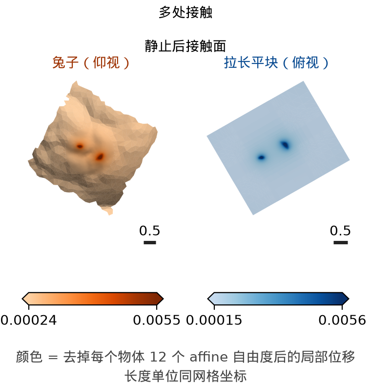 |

**骨架 0.955 → [0.981, 1.161]，跨线。** 腿和身体两处同时压，两处通过物体互相影响。

### 棱

| 压入前 | 静止后 |
|---|---|
| 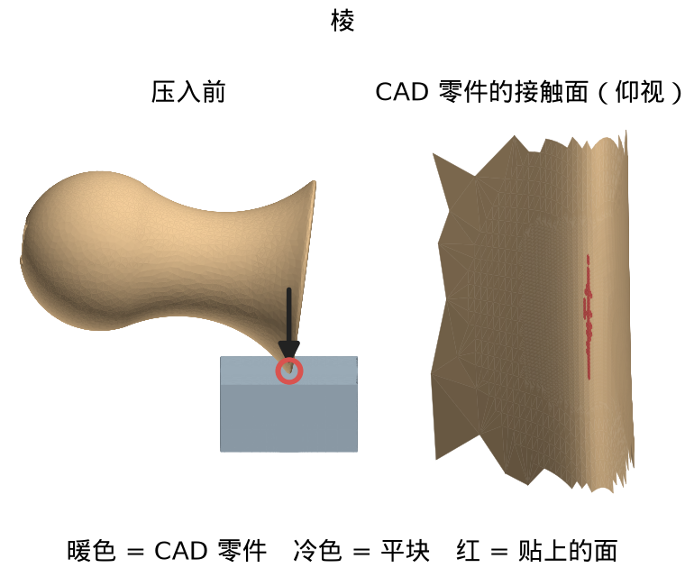 |  |

**骨架 1.191 → [1.224, 1.350]，整段偏离，偏大。** 第一项把接触处当成表面平，而棱处表面突然转折，第二项补不了这一条。

### 尖（兔耳尖）

| 压入前 | 静止后 |
|---|---|
|  |  |

**骨架 1.341 → [1.435, 1.752]，不下结论。** 接触区太小，接触半径内铺不下 2 个小格。

### 一侧薄（兔耳薄片）

| 压入前 | 静止后 |
|---|---|
|  |  |

**骨架 1.333 → [1.421, 1.620]，不下结论。** 理由同上，接触区太小。

### 龙鳍压平块（不在上面 14 类里）

| 第 2 档，静止后 | 第 3 档，静止后 |
|---|---|
|  |  |

**龙鳍这种薄长部件，取 80 个 mode 时骨架仍是 GT 的 1.30 倍（第 2 档）和 1.43 倍（第 3 档），覆盖不了。** 薄长部件会整片弯曲，描述这种弯曲要用到很多个 mode，80 个还不够。

### 尖处

**尖处的情况判不了。** 两物体互压里能下结论的 3 个尖处算例 1 个基本对、2 个跨线；兔耳尖压平块接触区太小，不下结论。偏硬是不是来自算 mode 的网格分辨率，现有数据分不出来。

---

# 四、上次组会上的问题：为什么用整体的 mode

**每个物体用一套整体的 mode，而不是把表面分成小片、按撞的位置查表，因为分片不耦合会算错，每次现算又太慢。** 上次组会上有人问：撞在不同位置应该是不同的形变，为什么用一套整体的 mode？答案是 mode 描述的是整个物体对表面任意位置受力的反应，撞在哪里只决定用到 mode 在哪一块的取值。三种做法的对比如下：

| 做法 | 结果 |
|---|---|
| 把表面分成小片，每片单独存一份柔度，彼此不耦合 | 不行：一个物体两处同时受压时，两处会通过整个物体互相影响；在一个两处同时受压的算例里按片拆开、片之间不耦合，片上的合力和不拆开时相比最多偏 23% |
| 每个物体存一份刚度矩阵的分解，每次接触时现算碰到的那些小格 | 太慢：同一个龙压鸭的浅压接触，IPC 仿真要 204 秒；现算碰到的 3614 个小格要 1408 秒，是 IPC 的 6.9 倍 |
| 整体 mode（现在的做法） | 天然耦合所有接触；同一个龙压鸭算例，方向系数的新旧两种写法求解时间相同（同一张卡、同一时段背靠背各跑 2 次：骨架求解本身，不含找接触区和读 mode，约 0.35 秒（最先跑的那一次是冷启动，0.39 秒）；带 80 个 mode 的单次求解约 1.5 秒）。这组是在有别的作业满载的卡上测的，绝对秒数偏大 |

一个物体算一次的 mode，换对手、换接触位置能不能照样算准，在第 7 周检验。

---

# 五、Research

已有的接触力学公式和成立条件，以及和骨架的关系

| 公式 | 原文条件 | 和我们的关系 |
|---|---|---|
| Boussinesq 点力 $u=F/(\pi E^{\prime}r)$ （Johnson 1985） | 线弹性、半空间、表面坡度小 | 骨架第一项的来源 |
| 等效模量 $1/E^{\ast}=\sum_k(1-\nu_k^2)/E_k$ （Johnson 1985） | 两弹性体无摩擦法向接触 | 两侧都当半空间、表面平行时，骨架第一项就退化成它 |
| Hertz $F=\frac{4}{3}E^{\ast}\sqrt Rd^{3/2}$ ， $U=\frac{8}{15}E^{\ast}\sqrt Rd^{5/2}$ （Johnson 1985； $R$ 是两表面在接触点的等效曲率半径） | 接触半径远小于曲率半径；半空间 | 光滑凸面小压深时可以对照；第 7 周作 baseline |
| 余能二次规划 $\min_{p\ge0}\frac{1}{2}p^\top Hp-\bar u^\top p$ （Bemporad & Paggi 2015） | 线弹性、无摩擦 | 就是骨架的式子，我们把半空间柔度 $H$ 换成有限物体的柔度 $C$ |
| 有限物体格林函数 = Boussinesq + 光滑修正（Capoferri & Vassiliev 2021） | 光滑边界 | 支持「第一项 + 第二项」的拆法 |
| 每个物体的柔度投影到接触空间再相加（Duriez 等 2006） | 线弹性、小位移 | 就是 $C=\sum_b$ 的结构 |
| 全局子空间 + 接触附近局部半空间基（Harmon & Zorin 2013） | 变形区远小于物体 | 最接近我们的先例；作者也指出变形区和物体同尺寸时效果差，我们的大压深正是这种情况 |
| hydroelastic 压力场（Elandt 等 2019） | 每一点的压力只由本地穿透深度决定，各点之间互不影响，不解弹性方程 | baseline |

骨架每一步的成立条件

| 步骤 | 条件 | 不成立时 |
|---|---|---|
| 第一项 | 线弹性、小应变、接触处表面平 | 尖、棱处偏差变大 |
| 一个压入方向 | 接触区不太弯 | 大压深时接触面绕成弯曲面，偏差大 |
| 80 个 mode | 其余方向的柔度可以忽略 | 薄长部件处截断误差变大（龙鳍） |
| 锁 12 个 affine 自由度 | 整体变形归粗模型 | 粗模型整体变形很大时 mode 要重算 |
| 二次规划 | 无摩擦、 $C$ 正定 | $C$ 不正定时解不唯一 |

材料非线性、几何非线性骨架都管不到，留给神经网络。

