# 第 7 周：大压深、软硬与泊松比对调

**结论。** 这周做了三件事。第一，第 5–6 周的 edge case 都只是表面浅压，这周补上了真正的大压深：兔和龙两个软体自然压到一起，不变形时的重叠达到兔子高度的 1/3 和 1/2，8 格的标准答案（静止后的总弹性能）都已算出；骨架的两项在这里明显偏硬，1/3 压深时是标准答案的 20 到 234 倍，1/2 压深时是 2.8 到 43 倍，说明以线弹性为基础的两项 cover 不了真正的大压深。第二，我们用软硬对调检验「第一项管等效、第二项管个体」：标准答案在对调前后明显不同，刚度对调差 5 到 6 倍，只认等效模量的 Hertz、半空间 BEM 分不出来，所以需要一项带着个体信息，这一点得到支持；但完整的骨架在大压深下给出的对调方向和标准答案相反，这一点不支持。第三，每个物体算一次的 mode 能不能换部位、换对手直接复用，现有算例判不了：格距够的算例里没有一格整段出带，但兔对龙、龙对兔各有 5 格跨线。

---

# 一、Pipeline：本周的变化

## 1.1 大压深 GT pipeline

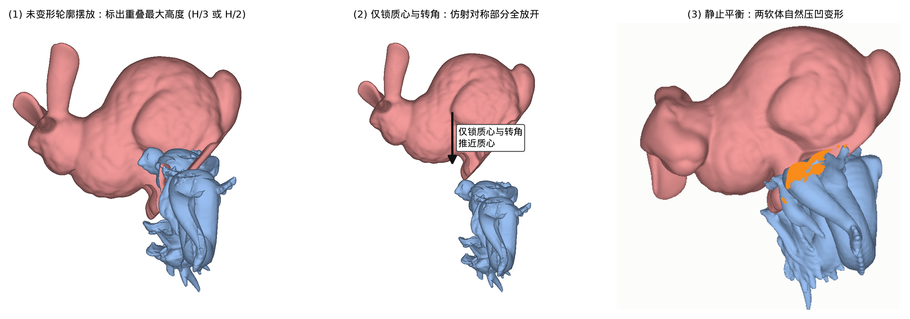
*大压深 GT 造法三栏示意：按未变形轮廓摆出目标重叠高度（$H/3$ 或 $H/2$）、仅锁质心与转角推近、IPC 松弛至静止平衡变形。*

大压深 GT 的输入是兔和龙的网格、各自的 $E,\nu$ ，以及目标压深。压深用的是接触力学里的标准定义（Popov, Heß & Willert 2019 §2.2）：两个物体按不变形的形状摆着时，重叠区沿压入方向的最大高度。第一步是摆放：按不变形的形状二分求出兔子的质心要往龙那边推多远，才能让重叠高度正好等于目标，1/3 档要推 3.771，1/2 档要推 5.114。龙在接触处比较细，所以质心要推得比重叠高度更多。第二步是求静止：只锁每个物体的质心和转角，拉伸和剪切全部放开，用 IPC 解到静止。这样没有任何外力把物体压扁，两个物体只靠接触自己变形；之所以还要锁转角，是因为两个无摩擦的软体顶在一起会转开、滑走，压不深。第三步用静止形状的精细能量减去粗模型的能量，得到标签 $U$ 。

第二步用到的约束、接触势垒和材料如下：

$$\bar x_k=\bar x_k^{\ast},\qquad \mathrm{skew}(A_k)=0,\qquad A_k=(\sum_iw_ix_ir_i^\top)(\sum_iw_ir_ir_i^\top)^{-1}$$

$$b(d)=\kappa(d^2-\hat d^2)^2[\ln\frac{d^2}{\hat d^2}]^2,\qquad \Psi(F)=\frac{\mu}{2}(\mathrm{tr}F^\top F-3)-\mu\ln J+\frac{\lambda}{2}(\ln J)^2$$

其中 $w_i$ 是节点的质量占比， $r_i$ 是静止时节点到质心的向量。 $b$ 是 IPC 的势垒（Li 等 2020），保证全程不穿透； $\Psi$ 是 neo-Hookean 材料，其中的 $\ln J$ 项保证单元不会被压翻。

推导

下面从锁的定义出发，推到「只锁质心和转角，两个物体之间就只靠接触相互作用」。

（1）设每个物体的节点位置是 $x_i$ ，质量占比是 $w_i$ ，静止时到质心的向量是 $r_i$ ，于是 $\sum_iw_ir_i=0$ 。记 $S=\sum_iw_ir_ir_i^\top$ ，质量加权的仿射拟合就是 $A=(\sum_iw_ix_ir_i^\top)S^{-1}$ 。

（2）当物体做一个均匀变形 $x_i=FX_i+t$ 时，静止位置可以写成 $X_i=\bar X+r_i$ 。因为 $\sum_iw_ir_i=0$ ，所以 $\sum_iw_ix_ir_i^\top=F\sum_iw_ir_ir_i^\top=FS$ ，也就是 $A=F$ 。【条件：均匀变形】

（3）所以锁住 $\mathrm{skew}(A)=0$ ，锁的只是 $F$ 的反对称部分，也就是转动；对称部分，也就是拉伸和剪切，完全不受约束。另外再把质心 $\bar x=\sum_iw_ix_i$ 锁在目标位置。

（4）把这两个约束合起来写成 $Gx=c^{\ast}$ ，在约束下让总能量 $\Pi$ （弹性能加 IPC 势垒）最小，最优条件是 $\nabla\Pi(x)=G^\top\lambda$ 。

（5）质心约束对节点 $i$ 的梯度是 $w_iI$ ，所以它的反力是 $w_i\lambda_c$ 。这个力和节点质量成正比、方向处处相同，就像一个均匀的重力，不会在局部把物体压扁。

（6）静止时每个物体受力平衡，这个均匀体力的合力 $\lambda_c$ 就等于对方压过来的接触合力，所以两个物体之间只靠接触相互作用。【条件：静止（受力平衡）】

（7）每一步牛顿迭代解的是下面这个加边的 KKT 方程。约束是线性的，所以每一步都精确满足约束。

$$H\Delta x+G^\top\lambda=-\nabla\Pi,\qquad G\Delta x=c^{\ast}-Gx.$$

（8）之所以要锁转角，是因为两个无摩擦的软体顶在一起时横向不稳定，不锁就会转开、滑走，压不深。【条件：无摩擦】

## 1.2 骨架 pipeline：mode 每个物体只算一次

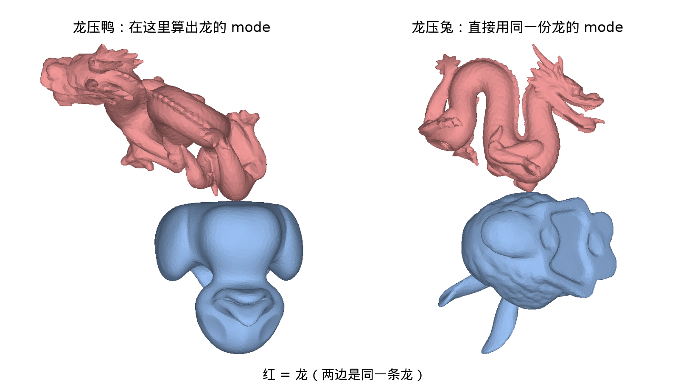
*同一份龙的 mode 从龙压鸭接触点（左）直接复用到龙压兔接触点（右）。*

骨架的 pipeline 和第 5–6 周 1.2 节一样：每个物体先离线预处理出 mode，实时阶段再用粗状态经过两项公式得到能量。这周的变化是把预处理定为每个物体只算一次。mode 只由物体自己的几何和材料决定，所以不管对手是谁、撞在哪里，都用这一份，复用的验证见 2.3 节。

## 1.3 刚度、泊松比怎么进两条 pipeline

这是上次开会讨论到的问题。在 GT 里，每个物体的 $E,\nu$ 换成拉梅参数进 neo-Hookean 材料。在骨架里，每个物体用自己的 $1/E_b^{\prime}=(1-\nu_b^2)/E_b$ 进第一项，用自己的 $\sigma_{b,m}\propto1/E_b$ 进第二项； $E$ 变了 mode 只需要缩放， $\nu$ 变了才需要重算。两个表面在接触处法向一致、而且只有一个接触区时，第一项只认等效模量 $E^{\ast}$ ；一般情况下，每个物体的柔度还要乘上自己表面法向与投影方向夹角余弦的平方，多个接触区之间又经各自的物体耦合，所以第一项也会随哪一侧软而变。第二项带着每个物体自己的形状，这个分工在 2.2 节用软硬对调来检验。

---

# 二、验证

## 2.1 大压深：补第 5–6 周 edge case 的压深

第 5–6 周 edge case 的三档压深都是表面浅压，那时说的「大压深」其实不是真正的大压深。这周要说明的是，骨架的两项在真正的大压深下也能 cover。我们让兔和龙两个软体只锁质心和转角、自然压到静止，不变形时的重叠达到兔子高度 $H$ 的 1/3 和 1/2（造法见 1.1 节），8 格的标准答案都已经算出来了。下表说明这次确实是大压深，两个物体都有明显的变形；表里的「最大局部位移」是去掉整体仿射运动以后的最大位移，也就是接触处被压出的坑有多深。

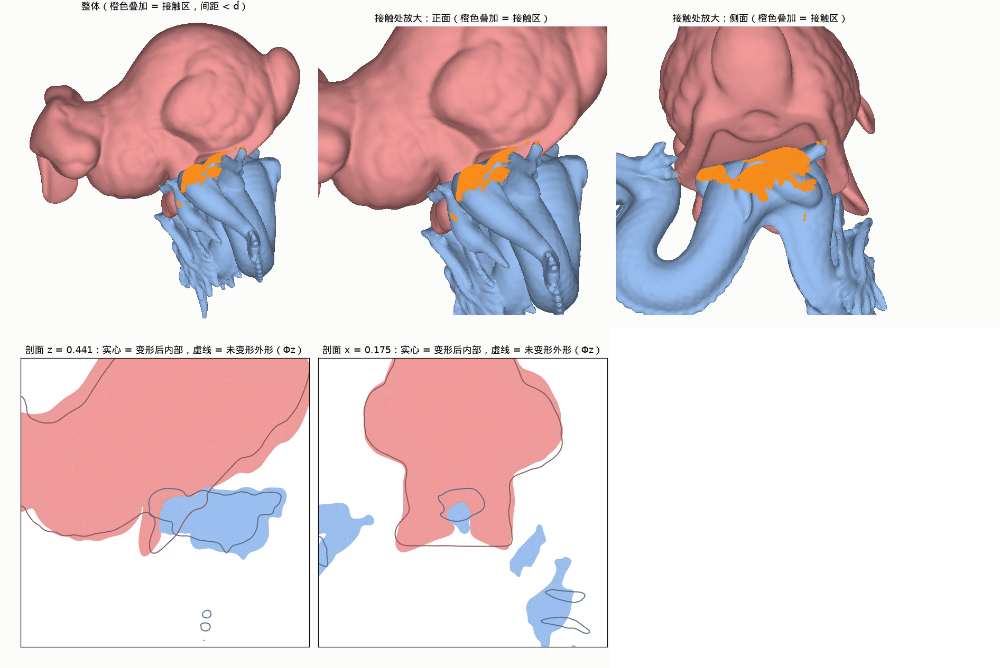
*Bx10，1/3 压深（重叠 / $H$ = 0.333）：兔与龙静止平衡三维视图与双剖面（叠兔子未变形轮廓），最大局部位移 兔 4.98 / 龙 3.86。*

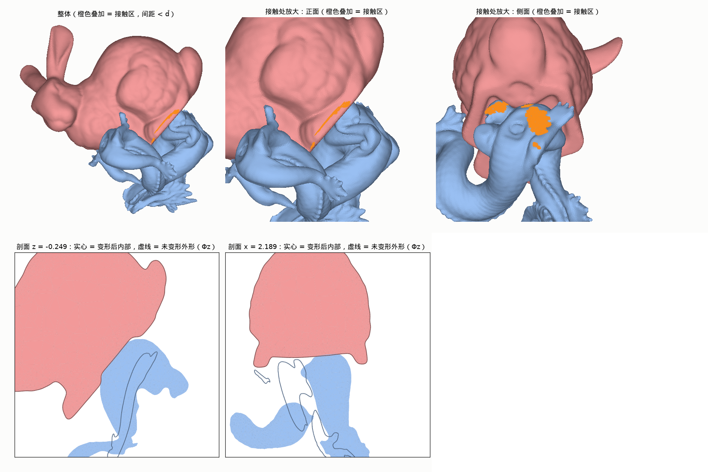
*Ax10，1/3 压深（重叠 / $H$ = 0.333）：兔与龙静止平衡三维视图与双剖面（叠兔子未变形轮廓），最大局部位移 兔 0.087 / 龙 4.65。*

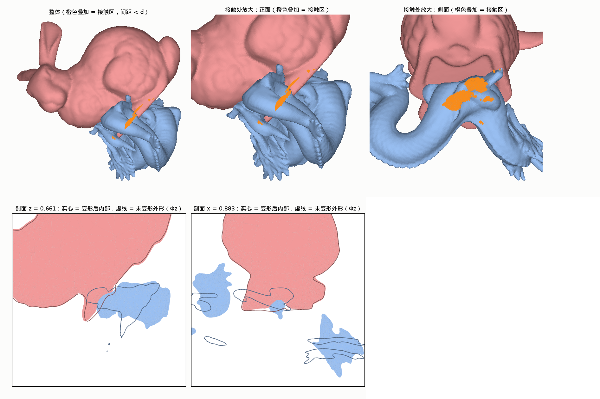
*nuA02B045，1/3 压深（重叠 / $H$ = 0.333）：兔与龙静止平衡三维视图与双剖面（叠兔子未变形轮廓），最大局部位移 兔 1.34 / 龙 5.11。*

*nuA045B02，1/3 压深（重叠 / $H$ = 0.333）：兔与龙静止平衡三维视图与双剖面（叠兔子未变形轮廓），最大局部位移 兔 1.21 / 龙 5.24。*

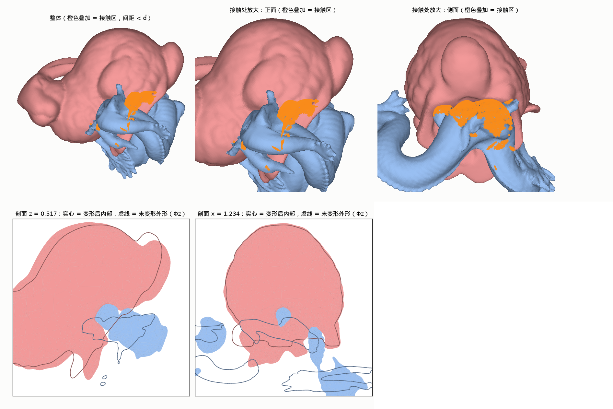
*Bx10，1/2 压深（重叠 / $H$ = 0.500）：兔与龙静止平衡三维视图与双剖面（叠兔子未变形轮廓），最大局部位移 兔 4.79 / 龙 5.07。*

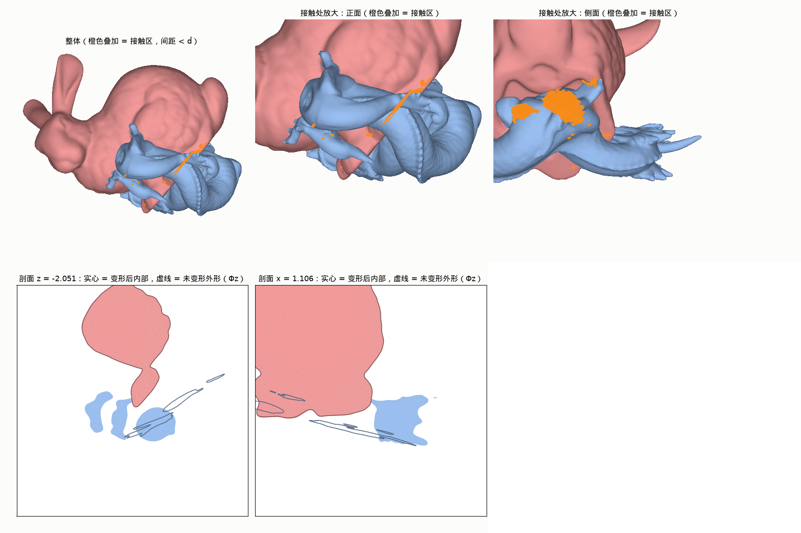
*Ax10，1/2 压深（重叠 / $H$ = 0.500）：兔与龙静止平衡三维视图与双剖面（叠兔子未变形轮廓），最大局部位移 兔 0.19 / 龙 5.54。*

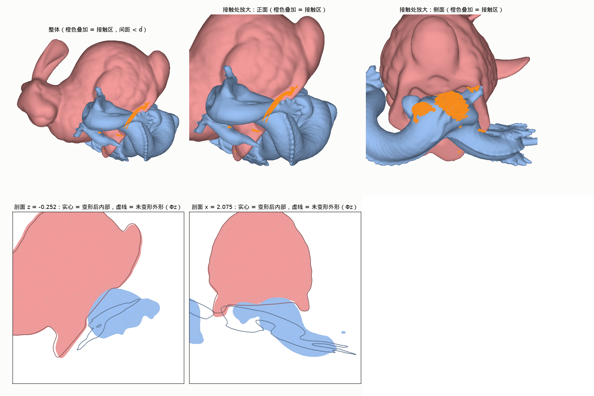
*nuA02B045，1/2 压深（重叠 / $H$ = 0.500）：兔与龙静止平衡三维视图与双剖面（叠兔子未变形轮廓），最大局部位移 兔 1.60 / 龙 5.60。*

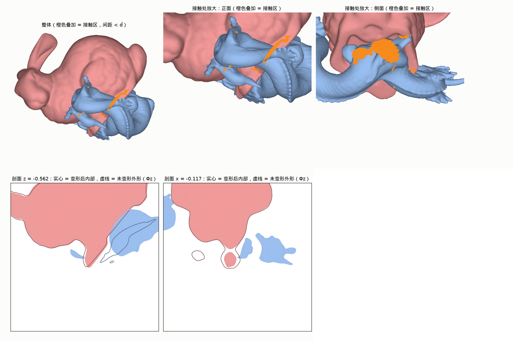
*nuA045B02，1/2 压深（重叠 / $H$ = 0.500）：兔与龙静止平衡三维视图与双剖面（叠兔子未变形轮廓），最大局部位移 兔 1.41 / 龙 5.63。*

| 算例 | 重叠 / $H$ | 接触面积 兔 / 龙 | 最大局部位移 兔 / 龙 |
|---|---|---|---|
| Bx10，1/3 | 0.333 | 4.51 / 5.48 | 4.98 / 3.86 |
| Ax10，1/3 | 0.333 | 1.74 / 2.01 | 0.087 / 4.65 |
| nuA02B045，1/3 | 0.333 | 1.92 / 2.61 | 1.34 / 5.11 |
| nuA045B02，1/3 | 0.333 | 1.98 / 2.41 | 1.21 / 5.24 |
| Bx10，1/2 | 0.500 | 7.51 / 8.75 | 4.79 / 5.07 |
| Ax10，1/2 | 0.500 | 2.59 / 2.92 | 0.19 / 5.54 |
| nuA02B045，1/2 | 0.500 | 3.17 / 4.00 | 1.60 / 5.60 |
| nuA045B02，1/2 | 0.500 | 3.16 / 3.83 | 1.41 / 5.63 |

8 格的标准答案都已算出，表里 GT 一栏是静止后的总弹性能 $\Sigma E_{\text{fine}}$。Hertz、Winkler 与 hydroelastic 均在未变形刚体摆放下求值：其中 Hertz 和 Winkler 只认等效模量，接触半径约为曲率半径的 6–7 倍（1/3 压深约 6、1/2 压深约 7），远超它们的适用条件；hydroelastic 按各自材料模量积分，但缺少整体变形与跨接触耦合，预测仍高出 GT 4.4 到 37.2 倍。骨架也在同样的摆放下求值，两项都用，每个物体用自己的 mode；因为 GT 只锁质心和转角、整体的拉伸剪切是放开的，这里的 mode 也用只锁质心和转角的版本，这样骨架和 GT 比的是同一个量。结果是骨架两项在大压深下明显偏硬：1/3 压深四格是 GT 的 19.6、234、44.6、47.9 倍，比 hydroelastic 还差；去掉第二项时是 23.1、183、49.3、53.8 倍，第二项只把读数改了 9% 到 28%，有升有降。1/2 压深四格是 GT 的 2.8、43.3、9.9、10.7 倍，但这几个数只在一个格距上算得出来，换格距时接触区划分不稳定，同一格换一个格距读数能差 4 倍，同材料下还比 1/3 压深小，所以 1/2 压深的骨架读数本身不可靠。骨架的两项都建立在线弹性小变形上，重叠达到兔高的 1/3、1/2 时已经远出这个范围，这个结果说明大压深下非线性部分占了主导，不能只靠这两项。

| 算例 | GT（静止后总弹性能 $\Sigma E_{\text{fine}}$） | Hertz | hydroelastic | Winkler | 骨架 |
|---|---|---|---|---|---|
| Bx10，1/3 | 255,626 | 598,200 | 1,114,000 | 7,798,000 | 5,001,000 |
| Ax10，1/3 | 41,480 | 598,200 | 1,545,000 | 7,798,000 | 9,721,000 |
| nuA02B045，1/3 | 46,608 | 329,000 | 732,900 | 4,289,000 | 2,081,000 |
| nuA045B02，1/3 | 46,061 | 329,000 | 760,300 | 4,289,000 | 2,204,000 |
| Bx10，1/2 | 516,195 | 1,282,000 | 3,194,000 | 21,680,000 | 1,421,000（单一格距） |
| Ax10，1/2 | 99,482 | 1,282,000 | 2,947,000 | 21,680,000 | 4,307,000（单一格距） |
| nuA02B045，1/2 | 88,657 | 705,100 | 1,954,000 | 11,920,000 | 879,500（单一格距） |
| nuA045B02，1/2 | 87,541 | 705,100 | 1,968,000 | 11,920,000 | 934,700（单一格距） |

*大压深 8 格下 GT（静止后总弹性能）、Hertz 与 Winkler 的弹性能对比（对数刻度）。*

## 2.2 软硬对调：检验「第一项管等效，第二项管个体」

我们 claim 骨架能分开「软压硬」和「硬压软」。理由是两项的分工不同：第一项是 $\sum_b c_{b,i}c_{b,j}L_{ij}/E_b^{\prime}$ ，其中 $c_b=|n_b\cdot e|$ 是物体 $b$ 自己表面法向与投影方向夹角的余弦；只有两侧 $c_b$ 相同（两表面平行）、而且只有一个接触区时，它才等于 $L_{ij}(1/E_A^{\prime}+1/E_B^{\prime})=L_{ij}/E^{\ast}$ ，只认等效模量，对调以后不变；第二项带着每个物体自己的形状，而且 $\sigma_{b,m}\propto1/E_b$ ，对调以后会变。

为了检验这一点，我们把大压深的 8 格两两配对，每一对只换一样东西，并且让两格的 $E^{\ast}$ 相同。两表面平行、只有一个接触区时，第一项对每一对给出完全一样的值；大压深下两侧接触面倾斜不同，第一项对调后也会变，见下表「消融：去掉第二项」一栏。刚度这一对是兔子 $E$ 、龙 $10E$ 和反过来；泊松比这一对是兔子 $\nu=0.2$ 、龙 $\nu=0.45$ 和反过来。

推导

下面推半空间理论预期的压陷怎么分给两个物体，以及泊松比这一对的 $E$ 怎么取。

（1）两个物体受的是同一个压力 $P$ ，在半空间理论里每个物体的压陷和它的柔度成正比，即 $d_k\propto P(1-\nu_k^2)/E_k$ 。【条件：两个物体都当成半空间；线弹性】

（2）所以兔子分到的压陷比例是 $\frac{(1-\nu_A^2)/E_A}{(1-\nu_A^2)/E_A+(1-\nu_B^2)/E_B}$ 。

（3）刚度这一对里，软的一边分到 $\frac{1}{1+1/10}=\frac{10}{11}\approx0.91$ ，也就是 91%。

（4）泊松比这一对里，兔子分到 $\frac{0.96}{0.96+0.7975}=0.546$ ，也就是 54.6%，对调以后是 45.4%。

（5）为了让泊松比这一对的 $E^{\ast}$ 和两边都是 $\nu=0.3$ 时相同，令 $\frac{0.96+0.7975}{sE}=\frac{2\times0.91}{E}$ ，解得 $s=0.9657$ ，两边都用 $sE$ 。

第一个结果是，第二项是必要的，这一点得到支持。标准答案在对调前后明显不同：刚度对调以后总弹性能差了 5 到 6 倍，泊松比对调以后只差约 1%；兔子硬 10 倍时，变形几乎都集中在龙那边（局部位移兔子 0.19、龙 5.54）。而只认 $E^{\ast}$ 的 Hertz 和半空间 BEM 在对调前后给出完全一样的值，所以它们分不出软压硬和硬压软。去掉第二项的骨架在大压深下对调前后并不完全一样：第一项里每个物体的柔度还要乘上各自表面法向与投影方向夹角的余弦，大压深下两侧接触面倾斜得很厉害，这个因子两边不同，所以对调后第一项也会变，但变化的方向和标准答案相反（见下表）。1/2 压深刚度这一对里，主接触区上兔子一侧 $c$ 的均值是 0.93、龙一侧是 0.63（ $c^2$ 的均值 0.885、0.447）：软的一侧 $c$ 越大，第一项柔度越大、能量越小，所以兔子软时第一项反而小。只按这一点手算，对调比在区内取均值时是 0.576、逐格算是 0.508，只用第一项的实测是 0.317。手算给出同一方向，但按倍数算只解释了约一半到六成的差距，其余来自手算没有算的两样：格与格之间的耦合，以及受压区域随对调的变化（主接触区受压格 539 对 255）。

| 一对，对调前 / 后 | GT（静止后总弹性能 $\Sigma E_{\text{fine}}$） | Hertz、半空间 BEM | hydroelastic | 骨架 | 消融：去掉第二项 |
|---|---|---|---|---|---|
| 刚度，1/3（Bx10 / Ax10） | 255,626 / 41,480 | 相同（由等效模量公式） | 1,114,000 / 1,545,000 | 5,001,000 / 9,721,000 | 5,911,000 / 7,611,000 |
| 刚度，1/2 | 516,195 / 99,482 | 相同（由等效模量公式） | 3,194,000 / 2,947,000 | 1,421,000 / 4,307,000 | 1,186,000 / 3,738,000 |
| 泊松比，1/3（nuA02B045 / nuA045B02） | 46,608 / 46,061 | 相同（由等效模量公式） | 732,900 / 760,300 | 2,081,000 / 2,204,000 | 2,299,000 / 2,479,000 |
| 泊松比，1/2 | 88,657 / 87,541 | 相同（由等效模量公式） | 1,954,000 / 1,968,000 | 879,500 / 934,700 | 764,900 / 840,900 |

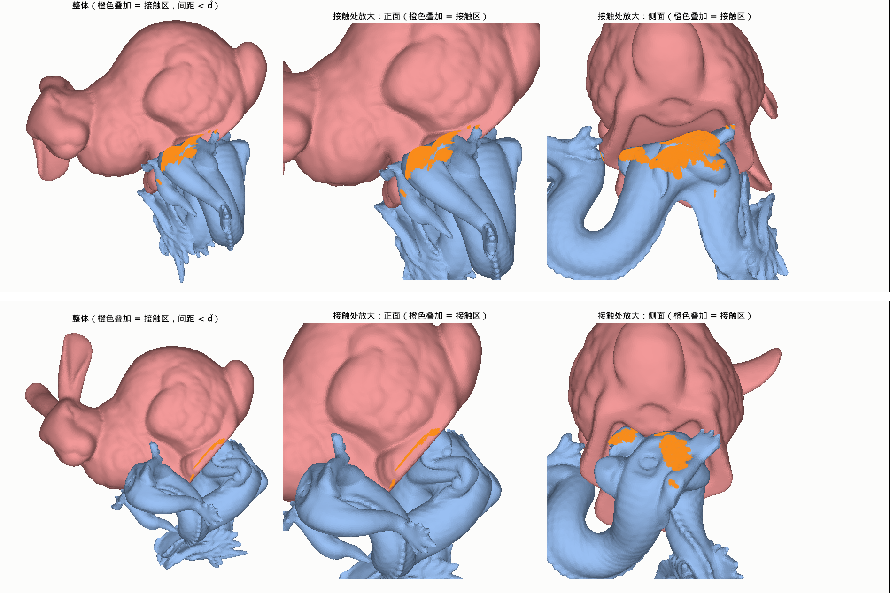
*1/3 压深下刚度对调并排对比（上 Bx10、下 Ax10），直观体现软压硬与硬压软接触区与变形差异。*

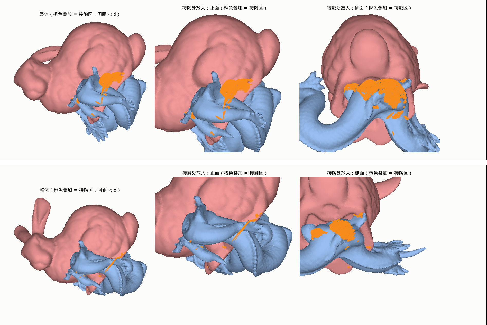
*1/2 压深下刚度对调并排对比（上 Bx10、下 Ax10），直观体现软压硬与硬压软接触区与变形差异。*

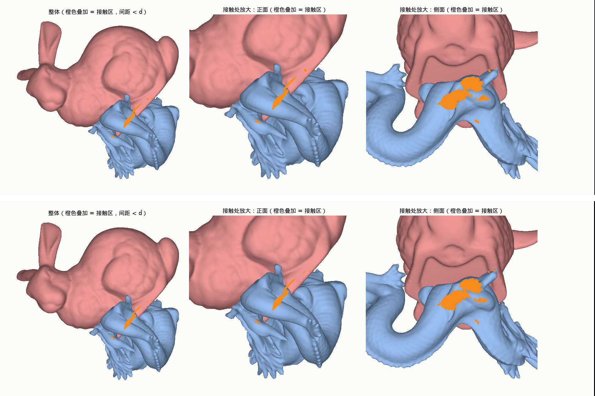
*1/3 压深下泊松比对调并排对比（上 nuA02B045、下 nuA045B02）。*

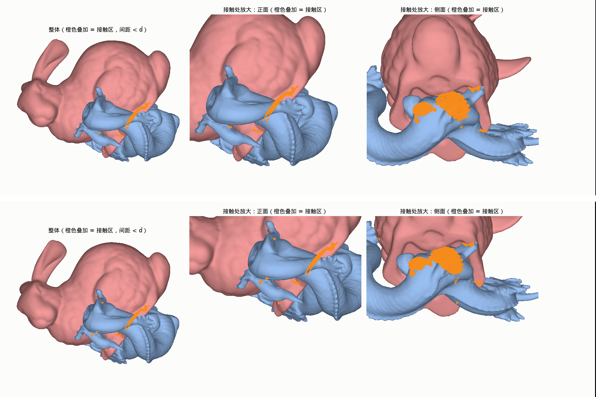
*1/2 压深下泊松比对调并排对比（上 nuA02B045、下 nuA045B02）。*

第二个结果是，完整的骨架在大压深下分不对软压硬和硬压软，这一点不支持。对调以后骨架的读数确实变了，但方向和标准答案相反：标准答案是龙硬 10 倍时总弹性能更大，1/3 压深大 6.2 倍、1/2 压深大 5.2 倍；骨架却是兔子硬时更大，两项骨架的 Bx10 ÷ Ax10 是 0.51 和 0.33，去掉第二项是 0.78 和 0.32，第二项没有把这个比例往标准答案的方向推，1/3 压深反而离得更远。泊松比对调时标准答案只差约 1%，骨架两项差约 6% 且方向相反，而同一格换格距本身就差 4% 到 35%，所以也分不出来。原因和 2.1 节一样：这两个压深下骨架整体高出标准答案几倍到上百倍，读数主要由线弹性的第一项决定，第二项只改了 9% 到 28%；标准答案里兔子硬时变形几乎全在软的龙一侧（局部位移兔子 0.19、龙 5.54），龙的细长部分大幅弯曲让开，这种大变形超出了两项线弹性公式能表达的范围。对调方向反也来自第一项：它按各自表面的法向余弦分配柔度（见上），不是按谁软。

## 2.3 每个物体一套 mode 能不能复用：判不了

mode 只由物体自己决定，所以我们希望每个物体算一次以后，换部位、换对手都能直接用。我们把已有的兔、龙、鸭互压算例，按『同一份 mode 用在哪些接触上』重新整理：兔和龙各只算了一份 mode，分别用在多个接触部位和多个对手上。判法事先定死：每个物体至少 2 个对手，每个对手 3 个不同的接触姿态（方向相差超过 30°），这些姿态在格距够的条件下全部『基本对』才算能复用；任何一格整段出带就算不能通用；其余情况算判不了。结果：格距够的算例里没有一格整段出带，但兔对龙有 5 格跨线，龙对兔同样有 5 格跨线，所以判不了。另有 2 个格距在统计档（每接触半径 1.5–2 格）的算例整段出带；把 mode 网格加密一档后，这两格都变成跨线。下一步用更细一档的 mode 网格重算跨线的格，检验跨线是不是来自均匀 mode 网格在接触处的分辨率。此外，龙压鸭时算的龙 mode 直接用到龙压兔上，和为龙压兔单独算的 mode 相比，骨架读数只差 0.83 个百分点；同一个算例上 hydroelastic 和标准答案的比值是 0.100（偏低 90.0%），作为对照。龙的预处理（网格 80 s + mode 从头冷跑 306 s + 后处理 3 s）实测约 6.5 分钟。

---

# 三、Research

上次开会讨论到的「按 patch 局部加密、按撞的位置去查」：三种做法比较

| 做法 | 结论 |
|---|---|
| 每个 patch 单独存、彼此不耦合 | 不行：同一物体两处受压时会通过整个物体互相影响，按片拆开后片上合力最多偏 23% |
| 每个物体存一份分解，每次接触现算碰到的格子 | 现在比 IPC 慢：龙压鸭 3614 格，一次接触 1408 秒，是 IPC 的 6.9 倍；计算量随网格变细增长 |
| 整体 mode（现行） | 天然耦合所有接触；存储 80 × 表面点数；骨架本身每次接触约 0.8 秒（端到端含找接触区约 217 秒） |

文献里的同类做法：Teng 等 2015（接触区全空间、其余子空间，靠每帧静力凝聚耦合，不是一次预处理）；Harmon & Zorin 2013（全局子空间 + 接触附近局部半空间基，变形区和物体同尺寸时效果差）。

大压深相关的已有公式

| 公式 | 原文条件 | 和我们的关系 |
|---|---|---|
| 压深 = 未变形轮廓的最大重叠（Popov, Heß & Willert 2019 §2.2） | 两弹性体正接触 | 我们压深的定义 |
| neo-Hookean 刚球深压入（Zhang 等 2014） | 刚球、轴对称、不可压、半无限基体，到 $h/R=1$ | 只能对照「越深越偏离 Hertz」的趋势 |
| 深压入 Struve 函数解（Mu 等 2025） | 刚球压不可压 neo-Hookean 半空间 | 同上 |
| 线弹性 + 大变形刚球压入（Wu, Lin & Juang 2016） | 刚球、半空间 | 提醒：大压深下和 Hertz 恰好对上可能是两项误差抵消 |

RigidFormer 能不能当 baseline

原版输入每个物体两帧点云、质量、摩擦，输出刚体下一帧位姿，训练数据是刚体自由运动，没有能量输出，也不吃 $E$ 、 $\nu$ 。能借的是它的物体级编码器（点云 → 每个物体一个向量 → 物体间注意力）：输入换成 $E$ 、 $\nu$ 和粗状态，输出换成接触能量。需要成批的多形状标签才训得动（ongoing）。

---

# 下周 TODO

1. 大压深下骨架两项偏硬几倍到上百倍、软硬对调方向相反：在 1/8、1/6、1/3 几档压深上，找出两项从哪个压深开始失效，再定这一段交给 neural 项还是改骨架。
2. 尖处和龙压兔第 7 号样本骨架偏硬，用网格加密序列查原因。
3. 速度：龙的预处理（网格 80 s + mode 从头冷跑 306 s + 后处理 3 s）实测约 6.5 分钟，是分钟级。更早一次（11-20）同一张网格的冷跑用了 94 分钟，其中系统态（内核）时间 5637 s、用户态 308 s；当时与鸭的预处理同时在跑，用的是另一种实现，numpy 透明大页没有关闭。重跑这一次系统态 79 s、用户态 235 s。两次运行的条件不止一处不同，慢的原因没有做单变量拆分。大压深标签主线冷跑实测 19.0 小时（68434 秒，瓶颈在大量受 CCD 限制的小步），远超 1 小时目标，后续需优化找接触区与步长速度。
4. baseline：RigidFormer 编码器的改造版（进行中）。
