# 第 7 周：大压深、软硬对调、mode 复用

**结论：换了方向系数的写法以后，大压深下骨架是标准答案的 1.07–2.89 倍，仍然偏大，但 8 个算例都比 Hertz、hydroelastic、Winkler 更接近标准答案；软硬对调时骨架的方向和标准答案一致，分出谁软谁硬的是第二项；每个物体算一次的 mode 能不能到处用，现有数据判不了。** 第 5–6 周的 edge case 都只是表面浅压。这周补上真正的大压深，并回答上次组会上提出的另外两个问题：骨架能不能分出谁软谁硬，以及每个物体算一次的 mode 能不能到处用。第一，大压深：压深为兔高的 1/3 时，骨架是标准答案（下文表头简写 GT）的 1.08–2.89 倍，Hertz 是 2.3–14.4 倍；标准答案里还含远离接触处的变形能（1.1 节按区域拆分），所以这个倍数只说明骨架偏大，不是偏大的准确幅度。这周还找到旧写法偏大上百倍的原因是第一项里的方向系数，现在的写法把它除在柔度上（1.2 节）。第二，软硬对调时标准答案对调前后差 5–6 倍，只认等效模量的 Hertz 分不出来；骨架只用第一项时也几乎分不开，加上第二项后方向和标准答案一致，说明带个体信息的第二项是需要的。第三，每个物体算一次的 mode 换对手、换部位能不能照样算准，现有数据判不了。

---

# 一、大压深：骨架仍然偏大，但比现成方法都更接近标准答案

## 1.1 怎么造大压深的标准答案

***大压深的标准答案这样造：从刚接触开始，只把两个物体的质心推近到目标位置，再让它们自己松弛到静止。** 目标位置按不变形的形状算：重叠高度正好是兔高的 1/2。锁住质心相当于给全身加一个均匀的体力，作用和重力一样，所以兔子软的时候，耳朵这种悬着的部分也会下垂。*

**压深指两个物体按不变形的形状摆放时，重叠区沿压入方向的最大高度；这周压到兔子高度 $H$ 的 1/3 和 1/2。** 这是接触力学里的标准定义（Popov, Heß & Willert 2019 §2.2）。我们从两个物体刚接触开始，分几步把兔子的质心推近到目标位置，每一步只锁住每个物体的质心和转角，拉伸和剪切全部放开，用 IPC 解到静止。这样没有任何外力只压在接触处，两个物体之间只靠接触相互作用；锁住质心相当于给全身加一个均匀体力，所以兔子软的时候耳朵这类悬着的部分也会下垂。之所以还要锁转角，是因为两个无摩擦的软体顶在一起会转开、滑走，压不深。材料组合有四种：龙比兔子硬 10 倍、兔子比龙硬 10 倍、兔子泊松比 0.2 而龙 0.45、反过来兔子 0.45 而龙 0.2，两档压深一共 8 个算例。

**按区域拆开算，8 个算例里离接触处 0.1 个兔高以内的弹性能只占总弹性能的 12%–32%，放宽到 0.3 个兔高也只占 36%–86%（距离按未变形的网格量），其余在远离接触处；按 0.1 个兔高划分，远离接触处的弹性能在 8 个算例里有 57%–99.5% 在龙身上，只有龙比兔子硬 10 倍的两个算例，兔子身上占到 39%–43%；所以骨架（只算接触处）和标准答案比的不是同一个量，大压深下的倍数不能直接读成骨架算错了多少。**

**这里的粗状态只有质心和转角，粗模型本身没有弹性能，所以标准答案就是静止后两个物体的总弹性能。** 第 5–6 周的粗模型还带着整体的拉伸和剪切；大压深时这部分也放开交给精细模型，骨架的 mode 也相应改用只锁质心和转角的版本，这样骨架和标准答案用的是同一个粗状态。所以本周的能量和第 5–6 周的能量不是同一个量，两周的数不能直接相比；第 5–6 周的浅压结论用的是那边的定义，不受本周影响。

推导：只锁质心和转角时，两个物体之间只靠接触相互作用

（1）设每个物体的节点位置是 $x_i$ ，质量占比是 $m_i$ ，静止时到质心的向量是 $r_i$ ，于是 $\sum_im_ir_i=0$ 。记 $S=\sum_im_ir_ir_i^\top$ ，质量加权的仿射拟合就是 $A=(\sum_im_ix_ir_i^\top)S^{-1}$ 。

（2）当物体做一个均匀变形 $x_i=FX_i+t$ 时，静止位置可以写成 $X_i=\bar X+r_i$ 。因为 $\sum_im_ir_i=0$ ，所以 $\sum_im_ix_ir_i^\top=F\sum_im_ir_ir_i^\top=FS$ ，也就是 $A=F$ 。【条件：均匀变形】

（3）所以锁住 $\mathrm{skew}(A)=0$ ，锁的只是 $F$ 的反对称部分，也就是转动；对称部分，也就是拉伸和剪切，完全不受约束。另外再把质心 $\bar x=\sum_im_ix_i$ 锁在目标位置。

（4）把这两个约束合起来写成 $Gx=c^{\ast}$ ，在约束下让总能量 $\Pi$ （弹性能加 IPC 的接触势垒）最小，最优条件是 $\nabla\Pi(x)=G^\top\lambda$ ，其中 $\lambda$ 是约束反力。

（5）质心约束对节点 $i$ 的梯度是 $m_iI$ ，所以它的反力是 $m_i\lambda_c$ 。这个力和节点质量成正比、方向处处相同，就像一个均匀的重力：它不会只压在接触处，但会让悬着的部分（比如兔耳）下垂。

（6）静止时每个物体受力平衡，这个均匀体力的合力 $\lambda_c$ 就等于对方压过来的接触合力，所以两个物体之间只靠接触相互作用。【条件：静止（受力平衡）】

（7）每一步牛顿迭代把能量方程和约束拼成一个方程一起解，这就是带约束求最小值时的标准最优条件（KKT 方程）。约束是线性的，所以每一步都精确满足约束。

$$\nabla^2\Pi\,\Delta x+G^\top\lambda=-\nabla\Pi,\qquad G\Delta x=c^{\ast}-Gx.$$

（8）锁转角的原因：两个无摩擦的软体顶在一起时横向不稳定，不锁就会转开、滑走。【条件：无摩擦】

## 1.2 结果：现在的骨架比现成方法都更接近标准答案，但仍然偏大

***大压深下，现在的骨架在 8 个算例里都比 Hertz、hydroelastic、Winkler 更接近标准答案，但仍然偏大。** 每个算例五根柱：标准答案（GT）、Hertz、hydroelastic、Winkler、骨架，能量轴是对数刻度；骨架用的是现在的写法（第 5–6 周 2.1 节，方向系数除在柔度上）；1/2 压深的骨架只算了一种小格边长（小格边长就是第 5–6 周 2.1 节的 $h$）。*

**压深为兔高的 1/3 时，骨架是标准答案的 1.08–2.89 倍；现成方法都偏大得更多：Hertz 2.3–14.4 倍，hydroelastic 4.4–37.2 倍，Winkler 31–188 倍。** 这三种现成方法：Hertz 只用两个物体接触处的曲率和等效模量；hydroelastic 每一点的压力只由本地穿进去多深决定；Winkler 把接触面当成一排互不相连的弹簧。1/2 压深时骨架是 1.07–2.17 倍，现成方法同样偏大更多，Hertz 2.5–12.9 倍，hydroelastic 6.2–29.6 倍，Winkler 42–218 倍。下表与上图同样顺序，能量用同一套单位，只看每一行里各列和 GT 一列之比：

| 算例 | GT | Hertz | hydroelastic | Winkler | 骨架 |
|---|---|---|---|---|---|
| 1/3 压深 · 龙比兔子硬 10 倍 | 255,626 | 598,200 | 1,114,000 | 7,798,000 | 277,300 |
| 1/3 压深 · 兔子比龙硬 10 倍 | 41,480 | 598,200 | 1,545,000 | 7,798,000 | 120,000 |
| 1/3 压深 · 兔子泊松比 0.2、龙 0.45 | 46,608 | 329,000 | 732,900 | 4,289,000 | 81,750 |
| 1/3 压深 · 兔子泊松比 0.45、龙 0.2 | 46,061 | 329,000 | 760,300 | 4,289,000 | 81,090 |
| 1/2 压深 · 龙比兔子硬 10 倍 | 516,195 | 1,282,000 | 3,194,000 | 21,680,000 | 554,800（单一小格边长） |
| 1/2 压深 · 兔子比龙硬 10 倍 | 99,482 | 1,282,000 | 2,947,000 | 21,680,000 | 216,100（单一小格边长） |
| 1/2 压深 · 兔子泊松比 0.2、龙 0.45 | 88,657 | 705,100 | 1,954,000 | 11,920,000 | 150,500（单一小格边长） |
| 1/2 压深 · 兔子泊松比 0.45、龙 0.2 | 87,541 | 705,100 | 1,968,000 | 11,920,000 | 147,600（单一小格边长） |

**1/3 压深的四个算例在两种小格边长下都算了，完整骨架的读数相差 1.8%–10.0%；1/2 压深只算了一种小格边长，所以下面关于骨架的结论以 1/3 压深为准。** 这里的倍数只说明骨架偏大，不是偏大的准确幅度：标准答案里还含远离接触处的变形能（1.1 节按区域拆分）。

**大压深下第二项很重要：只用第一项时 1/3 压深四个算例是标准答案的 1.43–8.88 倍，加上第二项后读数降了 24%–67%。** 第二项是每个物体自己的 mode 带来的有限大小、形状对柔度的修正。大压深时接触区和物体一样大，这部分修正不再是小量。

**旧写法下骨架偏大得多，原因是第一项里的方向系数。** 旧写法把方向系数乘在柔度上，1/3 压深时完整骨架是标准答案的 19.6–234 倍。先检查第一项的求解本身：在 1/3 压深的两个刚度算例上，把输入换成 Hertz 假设的抛物面重叠、去掉方向系数，算出的能量是 Hertz 的 1.0006 倍和 1.0005 倍，求解没有问题。只把输入换回真实的重叠形状，结果是 Hertz 的 1.27 倍；再按旧写法乘上方向系数，变成 9.9 倍和 12.7 倍。大压深时接触面是一大块弯曲面，很多小格的表面法向和压入方向夹角很大，乘上余弦就把这些小格的柔度压得很小，算出的能量就被放大。开跑前定了三种改法，三种在浅压 17 个算例上的判档都不变；现在用的是只用第一项时 8 个算例平均离标准答案最近的那一种，把方向系数除在柔度上（推导见第 5–6 周 2.1 节）。它的代价是浅压有 3 个算例的直接比值离 1 远了 1 个百分点以上，超过了开跑前定的 1 个百分点的线，最大的是 1.81 个百分点（判定不变）。下表是完整骨架在两种写法下除以 GT 的倍数，两种写法各按自己的小格边长规则算：

| 算例 | 旧写法 | 现在 |
|---|---|---|
| 1/3 压深 · 龙比兔子硬 10 倍 | 19.6 | 1.08 |
| 1/3 压深 · 兔子比龙硬 10 倍 | 234 | 2.89 |
| 1/3 压深 · 兔子泊松比 0.2、龙 0.45 | 44.6 | 1.75 |
| 1/3 压深 · 兔子泊松比 0.45、龙 0.2 | 47.9 | 1.76 |
| 1/2 压深 · 龙比兔子硬 10 倍 | 2.75 | 1.07 |
| 1/2 压深 · 兔子比龙硬 10 倍 | 43.3 | 2.17 |
| 1/2 压深 · 兔子泊松比 0.2、龙 0.45 | 9.92 | 1.70 |
| 1/2 压深 · 兔子泊松比 0.45、龙 0.2 | 10.7 | 1.69 |

## 1.3 逐个算例：变形图和这一行的数字

下面 8 个单元和上表 8 行一一对应，单元名和表里的「算例」一字不差。每个单元两张图。第一张左边是两个物体静止后的整体，右边是接触处放大，虚线框标出放大的范围；红色是兔子，蓝色是龙，橙色是从这个角度看得见的接触区。接触区大多夹在两个物体中间，从外面看不见，有几个算例从这个角度一点橙色都没有，所以第二张是穿过接触区的一个剖面（垂直于视线方向，在接触区沿视线方向的范围内取切到接触最多的那个平面），橙线标出被剖面切到的接触区。能量都用同一套单位，括号里是除以 GT 的倍数。

### 1/3 压深 · 龙比兔子硬 10 倍

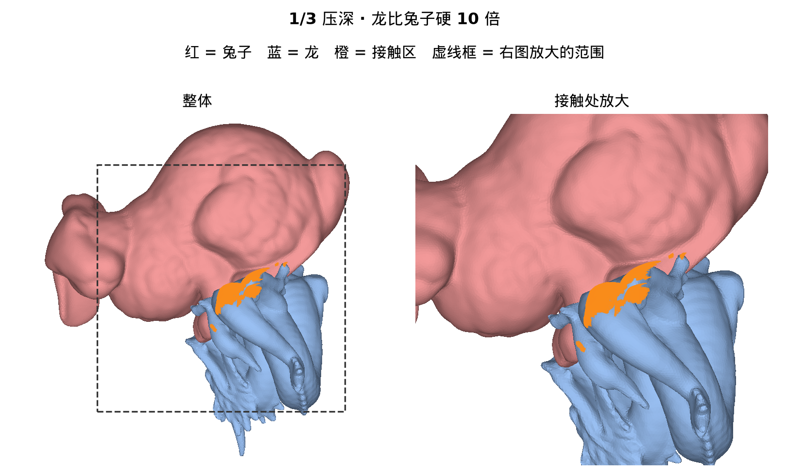

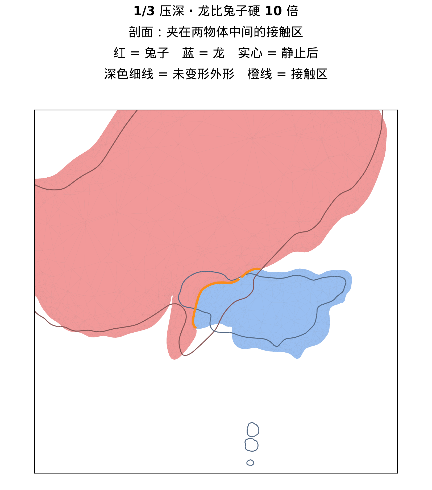

**GT 255,626；骨架 277,300（1.08 倍）。** Hertz 598,200，hydroelastic 1,114,000，Winkler 7,798,000。

### 1/3 压深 · 兔子比龙硬 10 倍

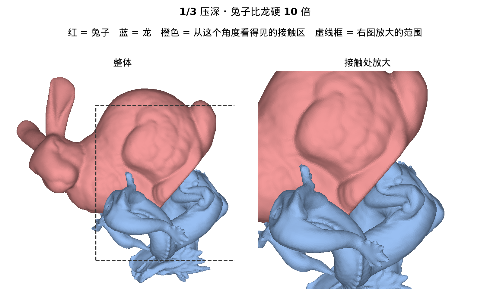

**GT 41,480；骨架 120,000（2.89 倍）。** Hertz 598,200，hydroelastic 1,545,000，Winkler 7,798,000。软的是龙，变形几乎全在龙一侧，GT 小，骨架的倍数在 8 个算例里最大。

### 1/3 压深 · 兔子泊松比 0.2、龙 0.45

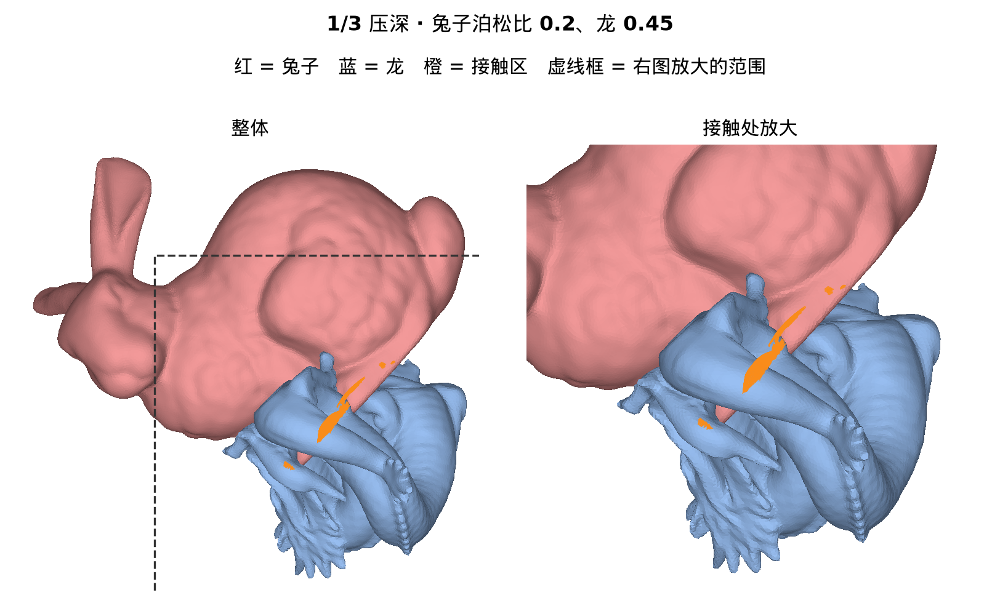

**GT 46,608；骨架 81,750（1.75 倍）。** Hertz 329,000，hydroelastic 732,900，Winkler 4,289,000。

### 1/3 压深 · 兔子泊松比 0.45、龙 0.2

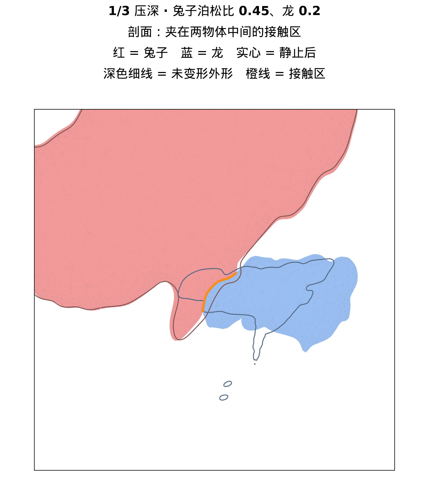

**GT 46,061；骨架 81,090（1.76 倍）。** Hertz 329,000，hydroelastic 760,300，Winkler 4,289,000。和上一个算例只对调了泊松比，GT 只差约 1%。

### 1/2 压深 · 龙比兔子硬 10 倍

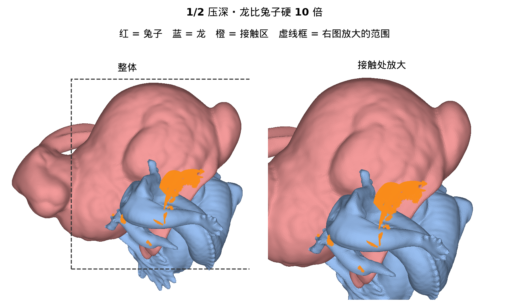

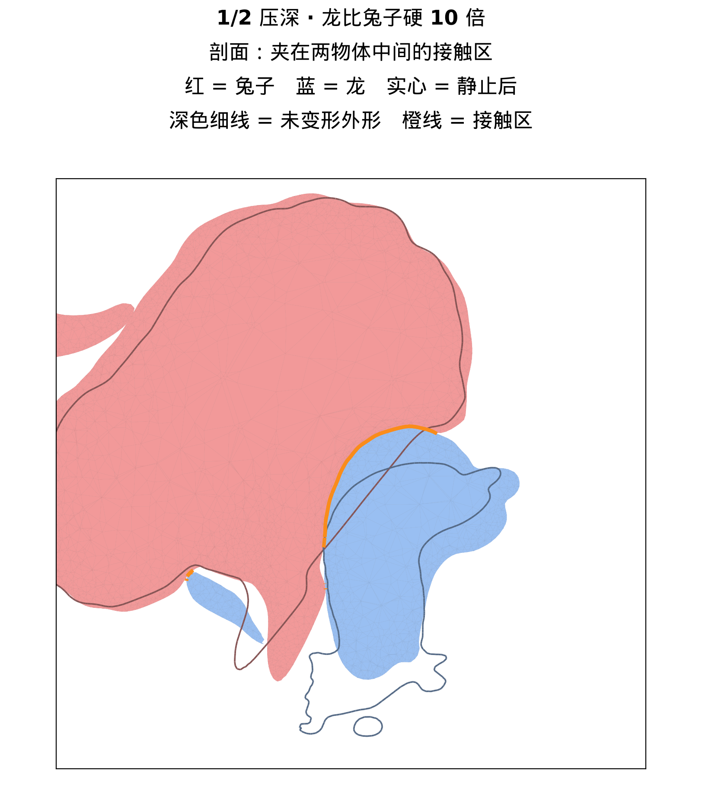

**GT 516,195；骨架 554,800（1.07 倍，单一小格边长）。** Hertz 1,282,000，hydroelastic 3,194,000，Winkler 21,680,000。用去掉整体平移和转动以后的最大局部位移来量变形：兔子 4.79、龙 5.07，兔子的高度是 9.23（长度都用同一套网格单位），两个物体都超过兔高的一半；龙虽然更硬，但它的细长部分整体弯开了。

### 1/2 压深 · 兔子比龙硬 10 倍

**GT 99,482；骨架 216,100（2.17 倍，单一小格边长）。** Hertz 1,282,000，hydroelastic 2,947,000，Winkler 21,680,000。变形几乎全在软的龙一侧：最大局部位移兔子只有 0.19，龙 5.54，超过兔高的一半。

### 1/2 压深 · 兔子泊松比 0.2、龙 0.45

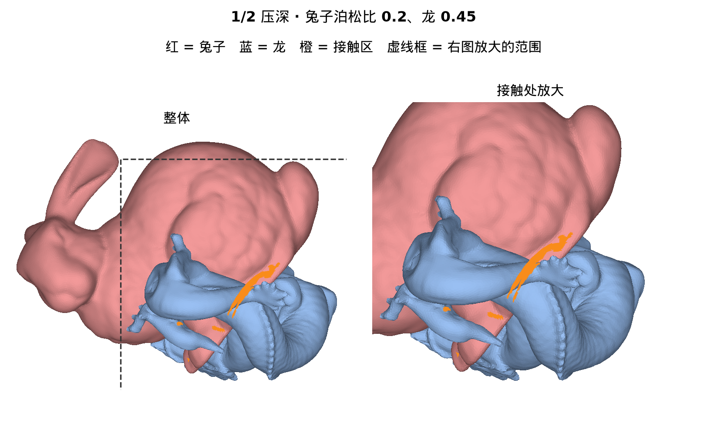

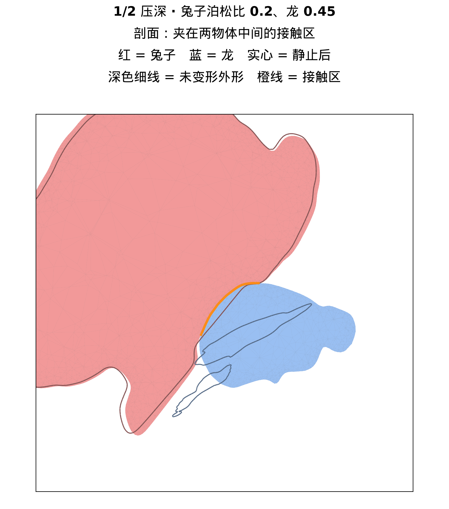

**GT 88,657；骨架 150,500（1.70 倍，单一小格边长）。** Hertz 705,100，hydroelastic 1,954,000，Winkler 11,920,000。

### 1/2 压深 · 兔子泊松比 0.45、龙 0.2

**GT 87,541；骨架 147,600（1.69 倍，单一小格边长）。** Hertz 705,100，hydroelastic 1,968,000，Winkler 11,920,000。

---

# 二、软硬对调：标准答案分得开，现在的骨架方向也对

**我们要检验「第一项管等效、第二项管个体」：两个物体的等效模量相同、只是谁软谁硬对调时，骨架应该能给出不同的能量，而且方向和标准答案一致。** 做法是把 1.2 节的算例两两配对：「龙比兔子硬 10 倍」对「兔子比龙硬 10 倍」，「兔子泊松比 0.2、龙 0.45」对反过来。每一对只换这一样东西，两个物体的等效模量相同。各算例的变形图见 1.3 节同名的单元。

**标准答案在刚度对调前后差 5–6 倍，而只认等效模量的 Hertz 给出完全相同的值，所以确实需要带个体信息的一项：这一点支持我们的设计。** 龙比兔子硬 10 倍时总弹性能更大，1/3 压深大 6.2 倍、1/2 压深大 5.2 倍。泊松比对调时标准答案只差约 1%，差别太小，拿来检验分不分得开没有意义，所以下面只看刚度这一对。hydroelastic 虽然按各自的材料算，也分不对：龙更硬 ÷ 兔子更硬，1/3 压深是 0.72、1/2 压深是 1.08，远小于标准答案的 6.2 和 5.2。

**现在的骨架给出的方向和标准答案一致：1/3 压深时，龙更硬 ÷ 兔子更硬骨架是 2.31，标准答案是 6.2。** 下表是 1/3 压深这一对，前两行是能量（同一套单位），最后一行是两者之比，大于 1 说明龙更硬时能量更大：

| 1/3 压深 | GT | hydroelastic | 骨架 | 只用第一项 |
|---|---|---|---|---|
| 龙更硬 | 255,626 | 1,114,000 | 277,300 | 366,000 |
| 兔子更硬 | 41,480 | 1,545,000 | 120,000 | 368,400 |
| 龙更硬 ÷ 兔子更硬 | 6.2 | 0.72 | 2.31 | 0.99 |

**分出谁软谁硬的是第二项：只用第一项时这个比是 0.99，几乎分不开；加上第二项后变成 2.31，方向和标准答案一致。** 这正是「第一项管等效、第二项管个体」：第一项只认等效模量，对调前后几乎不变；第二项带着每个物体自己的 mode，对调后会变。比值 2.31 还不到标准答案 6.2 的一半，说明个体信息只补回了一部分。1/2 压深这一对骨架是 2.57，标准答案 5.2，方向同样一致。

**旧写法下骨架给出的方向相反，原因是乘在柔度上的方向系数。** 旧写法时，1/3 压深这个比只用第一项是 0.78，完整骨架是 0.51，都小于 1：大压深时两个物体的接触面倾斜得不一样，乘上余弦以后第一项不再只认等效模量，自己带了方向错误的个体信息。换成除以余弦的写法后（第 5–6 周 2.1 节），只用第一项的比回到 0.99，这个问题消失。

---

# 三、一个物体算一次的 mode 能不能到处用：判不了

**我们要检验的是：每个物体只算一次 mode，换对手、换撞的位置，骨架还能不能照样算准。** 做法是把第 5–6 周已有的兔、龙、鸭互压算例，按「同一份 mode 用在哪些接触上」重新整理：兔和龙各只有一份 mode，兔的用在平块、兔、龙、鸭 4 种对手上，龙的用在兔、龙、鸭 3 种对手上；鸭的算例太少，不参与这次判定。判法事先定死：每个物体至少 2 个对手，每个对手 3 个不同的接触姿态（方向相差超过 30°），这些姿态全部「基本对」才算能复用；任何一个能下结论的算例整段偏离，就算不能通用；其余情况算判不了。

**结果判不了：兔和龙互压、能下结论的 10 个算例里，5 个基本对、5 个跨线，没有整段偏离。** 只要有一个跨线，就不满足「全部基本对」，所以判不了不取决于其他对手。这 10 个算例就是第 5–6 周 3.2 节表里兔和龙互压的那 10 行，每一行同时用到兔的 mode 和龙的 mode，所以兔、龙两边看到的是同一组 5 个跨线；其中第 10、11 行是第 7、9 行换细网格 GT 的重算，不是新的接触姿态。这些算例用的是第 5–6 周锁 12 个 affine 的 mode，和本周大压深用的 mode 不是同一版。跨线说明偏差可能超出 10%，不满足「全部基本对」；又没有整段偏离，不能说不通用。另有 2 个接触区偏小、不下结论的算例整段偏离，它们不在 3.2 节的 17 个算例里；把算 mode 用的网格加密一档后，这两个都变成跨线。下一步用更细一档的 mode 网格重算跨线的算例，检验跨线是不是来自 mode 网格在接触处的分辨率。

这 10 个算例的图和数据，见第 5–6 周 3.2 节编号 2、5–11、15、16 的单元。另外 2 个接触区偏小的算例如下，图的读法同第 5–6 周 3.2 节。

### 尖 · 兔压龙 · 第 3 档（接触区偏小，不下结论）

| 压入前 | 静止后 |
|---|---|
| 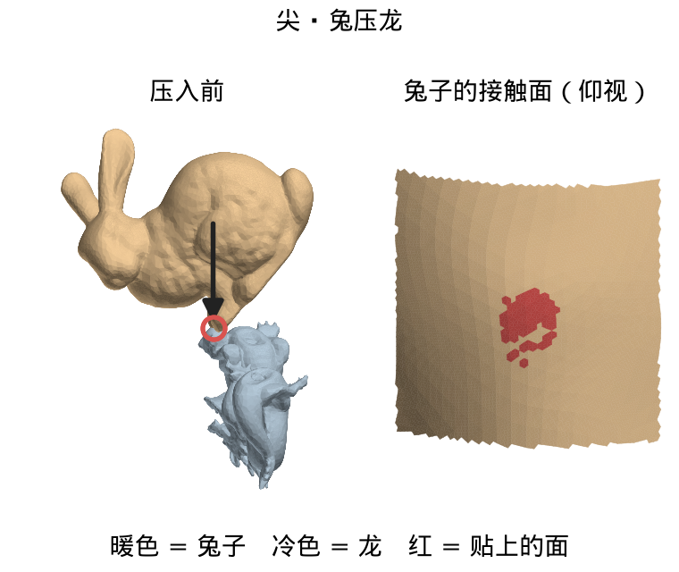 | 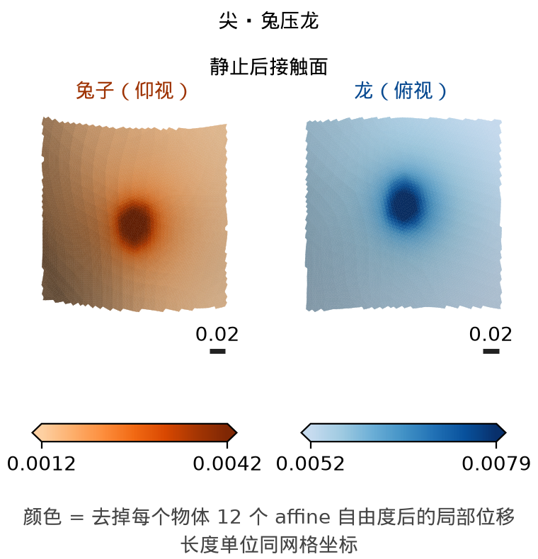 |

**骨架 1.041 → [1.146, 1.147]，整段在带外；mode 网格加密一档后 1.005 → [1.071, 1.145]，跨线。**

### 尖 · 龙压龙 · 第 3 档（接触区偏小，不下结论）

| 压入前 | 静止后 |
|---|---|
|  | 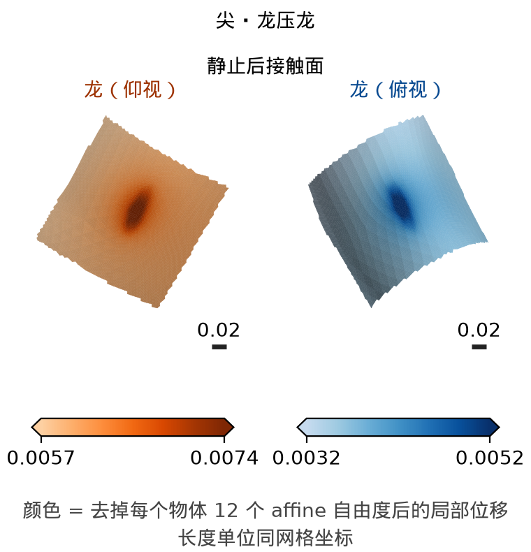 |

**骨架 1.062 → [1.186, 1.188]，整段在带外；mode 网格加密一档后 0.999 → [1.080, 1.154]，跨线。**

---

# 四、Research

大压深相关的已有公式

| 公式 | 原文条件 | 和我们的关系 |
|---|---|---|
| 压深 = 未变形轮廓的最大重叠（Popov, Heß & Willert 2019 §2.2） | 两弹性体正接触 | 我们压深的定义 |
| neo-Hookean 刚球深压入（Zhang 等 2014） | 刚球、轴对称、不可压、半无限基体，压深到球半径为止 | 只能对照「越深越偏离 Hertz」的趋势 |
| 深压入 Struve 函数解（Mu 等 2025） | 刚球压不可压 neo-Hookean 半空间 | 同上 |
| 线弹性 + 大变形刚球压入（Wu, Lin & Juang 2016） | 刚球、半空间 | 提醒：大压深下和 Hertz 恰好对上可能是两项误差抵消 |
| Winkler 弹簧床（Winkler 1867） | 接触面上每一点的压力只和该点的压入量成正比，各点之间互不影响 | baseline；它和 hydroelastic 一样不解弹性方程 |

baseline：RigidFormer 能不能用

**导师已经有一套能直接用的 RigidFormer 流程，用法是把它当整条轨迹的预测器：原样训练、比轨迹，不改它的输出。** 导师先复现了 RigidFormer 官方结果，在 MOVi-Sphere 测试集上前 100 帧的位置误差和官方公布的数前四位一致。然后搭好了一个软接触试点的整条流程：一个软球（杨氏模量 $10^5$）掉到固定的刚性椭球上，用全有限元隐式仿真生成 120 条轨迹，转成 RigidFormer 的数据格式，原样训练 RigidFormer（输出仍然是物体的位姿），再和全有限元的轨迹比较。目前仓库里这组数据上的对比有三种方法：导师的两种和一个 hydroelastic 对照，还没有 RigidFormer 的训练结果。

**这和我们静态、只比能量的设定不同，要放进我们的比较有两条路。** 一是用导师的流程比动态轨迹；二是借它的物体级编码器（点云 → 每个物体一个向量 → 物体之间做注意力），输入换成 $E$ 、 $\nu$ 和粗状态，输出换成接触能量。RigidFormer 原版输入每个物体两帧点云、质量、摩擦，输出刚体下一帧的位姿，没有能量输出，也不用 $E$ 、 $\nu$ 。两条路都需要我们自己的软–软普通网格数据：导师的试点用的是球和刚体，不符合我们只用软体普通网格的要求。

---

# 下周 TODO

1. 大压深：已做的是兔高的 1/3、1/2，再补 1/8、1/6 两档，看骨架偏大的倍数怎样随压深变，再决定剩下的偏大是继续改第一项（按物体真实形状算柔度、不再假设表面平），还是交给神经网络。
2. 软硬对调：用每个物体一套的 mode、现在的写法重算浅压的对调，确认浅压下方向也对。
3. mode 复用：用更细的 mode 网格重算跨线的算例。
4. 速度：大压深的一个标准答案要分几步推近、每步解到静止，从头算要 19.0 小时（68434 秒）；浅压一次 IPC 只要几分钟。要把大压深提速到 1 小时以内。
5. baseline：RigidFormer 编码器的改造版（进行中）。
