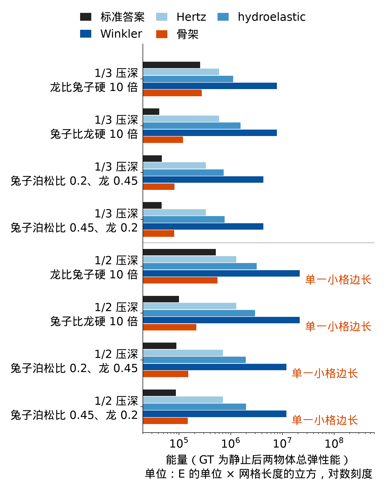
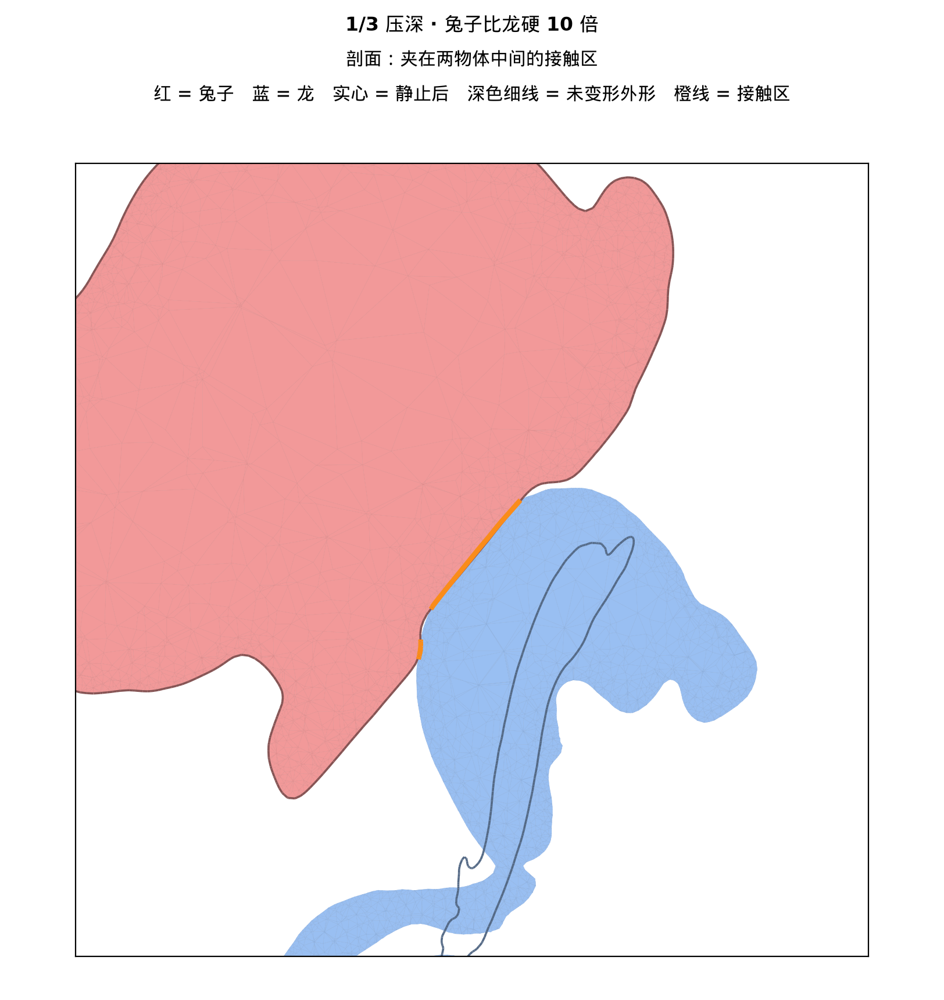
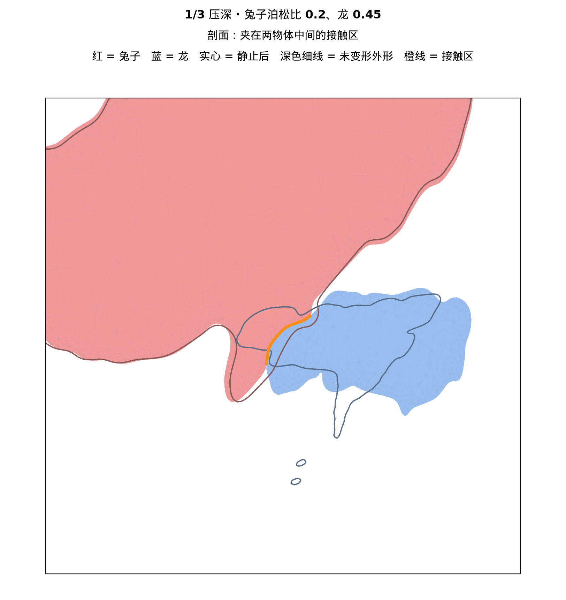
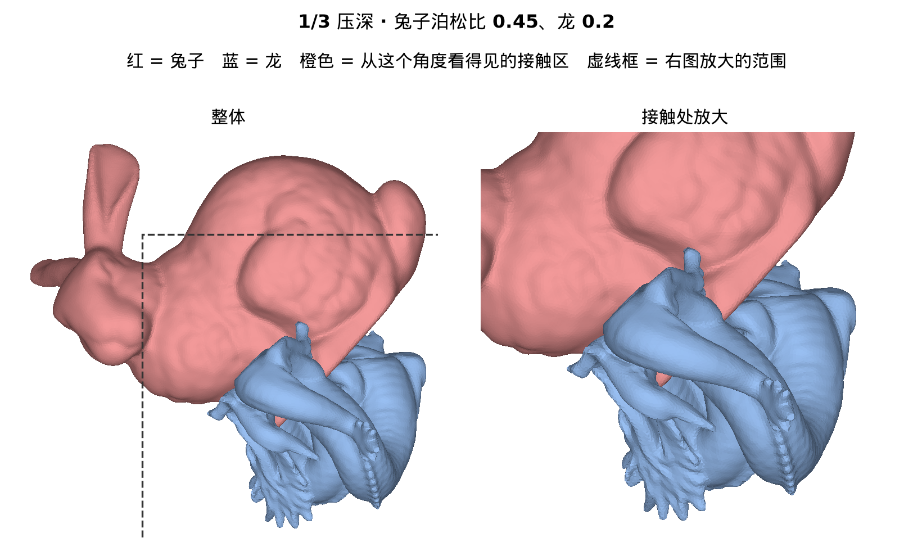
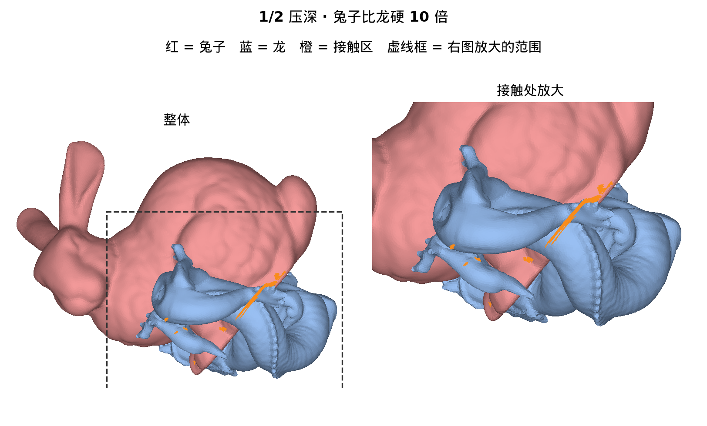
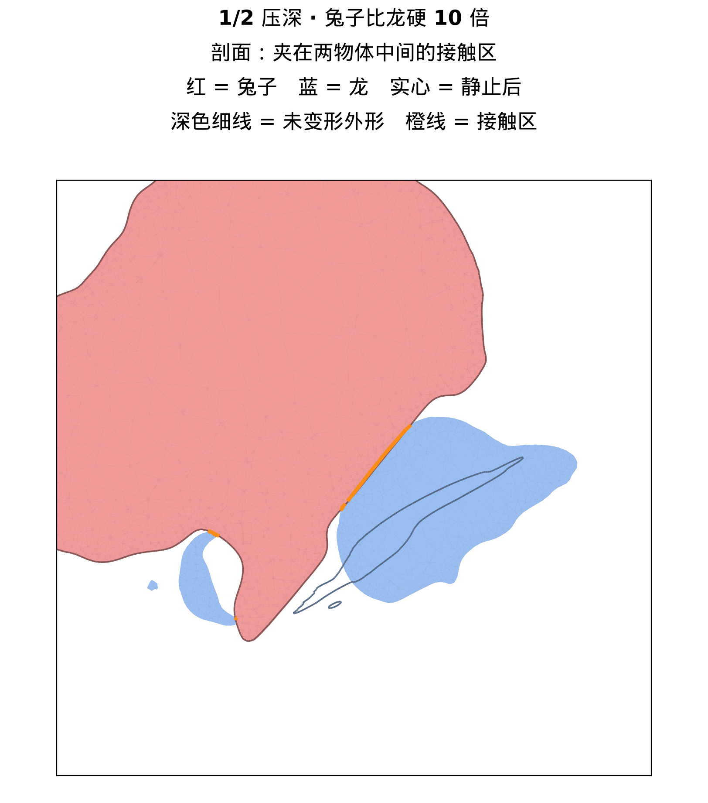
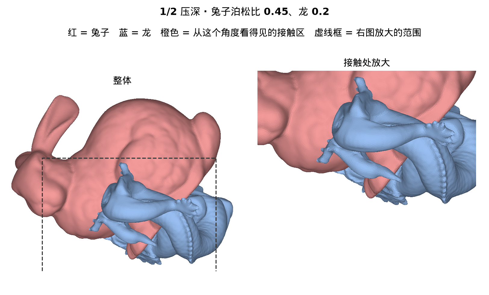
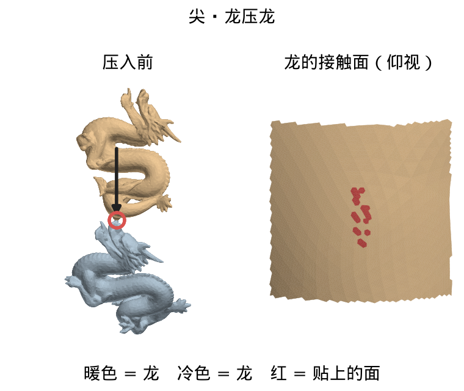

# 第 7 周：大压深、软硬对调、mode 复用

**结论：大压深下骨架是标准答案的 1.07–2.89 倍，仍然偏大，但 8 个算例都比 Hertz、hydroelastic、Winkler 更接近标准答案；软硬对调时骨架的方向和标准答案一致，分出谁软谁硬的是第二项；同一份 mode 用在兔和龙互压的 10 个算例上，5 个基本对、5 个跨线，没有整段偏离。** 第 5–6 周的 edge case 都只是表面浅压。这周做了三件事：真正的大压深、软硬对调，以及每个物体算一次的 mode 换对手、换位置。第一，大压深：压深为兔高的 1/3 时，骨架是标准答案（下文表头简写 GT）的 1.08–2.89 倍，Hertz 是 2.3–14.4 倍；标准答案里还含远离接触处的变形能（1.1 节按区域拆分），所以这个倍数只说明骨架偏大，不是偏大的准确幅度。第一项的方向系数除在柔度上（方向系数就是第 5–6 周 2.1 节的 $c_{b,i}$ ：表面法向和压入方向夹角的余弦；1.2 节）。第二，软硬对调时标准答案对调前后差 5–6 倍，只认等效模量的 Hertz 分不出来；骨架只用第一项时也几乎分不开，加上第二项后方向和标准答案一致，说明带个体信息的第二项是需要的。第三，每个物体算一次的 mode 换对手、换部位：兔和龙互压的 10 个算例里 5 个基本对、5 个跨线，没有整段偏离（第 3 节）。

---

# 大压深：骨架仍然偏大，但比现成方法都更接近标准答案

## 怎么造大压深的标准答案

***大压深的标准答案这样造：从刚接触开始，只把两个物体的质心推近到目标位置，再让它们自己松弛到静止。** 目标位置按不变形的形状算：重叠高度正好是兔高的 1/2。锁住质心相当于给全身加一个均匀的体力，作用和重力一样，所以兔子软的时候，耳朵这种悬着的部分也会下垂。*

**压深指两个物体按不变形的形状摆放时，重叠区沿压入方向的最大高度；这周压到兔子高度 $H$ 的 1/3 和 1/2。** 这是接触力学里的标准定义（Popov, Heß & Willert 2019 §2.2）。我们从两个物体刚接触开始，分几步把兔子的质心推近到目标位置，每一步只锁住每个物体的质心和转角，拉伸和剪切全部放开，用 IPC 解到静止。这样没有任何外力只压在接触处，两个物体之间传力只靠接触；锁住质心相当于给全身加一个均匀体力，所以兔子软的时候耳朵这类悬着的部分也会下垂。锁住转角会额外加一个力偶：它的合力为零，不会推着物体走，但会挡住物体转动。之所以要锁转角，是因为我们试过只锁质心，两个无摩擦的软体会转开、滑开，压不深。@@FACT_push_H@@材料组合有四种：龙比兔子硬 10 倍、兔子比龙硬 10 倍、兔子泊松比 0.2 而龙 0.45、反过来兔子 0.45 而龙 0.2，两档压深一共 8 个算例。

**按区域拆开算，8 个算例里离接触处 0.1 个兔高以内的弹性能只占总弹性能的 12%–32%，放宽到 0.3 个兔高也只占 36%–86%（把每个单元的弹性能按单元到接触区的距离分组相加，再除以总弹性能；距离按未变形的网格量），其余在远离接触处；按 0.1 个兔高划分，远离接触处的弹性能在 8 个算例里有 57%–99.5% 在龙身上，只有龙比兔子硬 10 倍的两个算例，兔子身上占到 39%–43%；所以骨架（只算接触处）和标准答案比的不是同一个量，大压深下的倍数不能直接读成骨架算错了多少。**

**这里的粗状态只有质心和转角，粗模型本身没有弹性能，所以标准答案就是静止后两个物体的总弹性能。** 第 5–6 周的粗模型还带着整体的拉伸和剪切；大压深时这部分也放开交给精细模型，骨架的 mode 也只锁质心和转角，这样骨架和标准答案用的是同一个粗状态。所以本周的能量和第 5–6 周的能量不是同一个量，两周的数不能直接相比；第 5–6 周的浅压结论用的是那边的定义，不受本周影响。

推导：只锁质心和转角时，两个物体之间传力只靠接触

（1）设每个物体的节点位置是 $x_i$ （当前位置），质量占比是 $\omega_i$ （ $\sum_i\omega_i=1$ ），未变形时到质心的向量是 $\rho_i$ ，于是 $\sum_i\omega_i\rho_i=0$ 。记 $S=\sum_i\omega_i\rho_i\rho_i^\top$ （3×3），质量加权的整体变形矩阵是 $\bar F=(\sum_i\omega_ix_i\rho_i^\top)S^{-1}$ 。它是让 $\sum_i\omega_i\|x_i-\bar x-\bar F\rho_i\|^2$ 最小的那个 3×3 矩阵：对 $\bar F$ 求导令其为零，就得到这个式子（直接推导）。意思是：用一个整体的「平移 + 线性变形」去最好地拟合所有节点，拟合出来的线性变形就是 $\bar F$ 。

（2）当物体做一个均匀变形 $x_i=FX_i+t$ 时（ $F$ 是 3×3 的变形梯度，不是力； $t$ 是平移； $X_i$ 是未变形位置），未变形位置可以写成 $X_i=\bar X+\rho_i$ （ $\bar X$ 是未变形时的质心）。因为 $\sum_i\omega_i\rho_i=0$ ，所以 $\sum_i\omega_ix_i\rho_i^\top=F\sum_i\omega_i\rho_i\rho_i^\top=FS$ ，也就是 $\bar F=F$ （直接推导）。【条件：均匀变形】

（3）锁住 $\mathrm{skew}(\bar F)=0$ ，其中 $\mathrm{skew}(\bar F)=(\bar F-\bar F^\top)/2$ 是 $\bar F$ 的反对称部分。小变形时反对称部分就是转动，对称部分是拉伸和剪切（极分解：任何均匀变形都可以写成先做一个纯拉伸、再做一个转动，Love 1927 §34），所以锁它等于不许整体转动；对称的拉伸和纯剪切不受限制，带转动成分的剪切（例如简单剪切）会被挡住一部分。另外再把质心 $\bar x=\sum_i\omega_ix_i$ 锁在目标位置。【条件：小转动时「反对称部分 = 转动」最准确】

（4）把这两个约束合起来写成 $Bx=s^{\ast}$ （ $B$ 是一个常数矩阵，每一行是一个线性约束； $s^{\ast}$ 是目标值），在约束下让总能量 $\Pi_{\text{tot}}$ （弹性能加 IPC 的接触势垒）最小。最优条件是 $\nabla\Pi_{\text{tot}}(x)+B^\top\lambda=0$ ，其中 $\lambda$ 是约束反力（拉格朗日乘子），约束对节点施加的力就是 $-B^\top\lambda$ （Boyd & Vandenberghe 2004 §5.5.3）。

（5）质心约束对节点 $i$ 的梯度是 $\omega_iI$ （ $I$ 是 3×3 单位矩阵），所以它施加在节点 $i$ 上的力是 $-\omega_i\lambda_c$ （直接推导）。这个力和节点质量成正比、方向处处相同，就像一个均匀的重力：它不会只压在接触处，但会让悬着的部分（比如兔耳）下垂。转角约束另外施加一个力偶：它的合力为零（ $\sum_i$ 对应的梯度之和为零，直接推导），不会推着物体走，但会挡住物体转动。

（6）静止时每个物体受力平衡。转角约束的力偶合力为零，所以这个均匀体力的合力就等于对方压过来的接触合力：两个物体之间传力只靠接触，转角锁另加的力偶只挡转动、不在两物体之间传力（直接推导）。【条件：静止（受力平衡）】

（7）每一步牛顿迭代把能量方程和约束拼成一个方程一起解（带等式约束的牛顿法，Boyd & Vandenberghe 2004 式 10.11、10.19）：

$$\nabla^2\Pi_{\text{tot}}\,\Delta x+B^\top\lambda=-\nabla\Pi_{\text{tot}},\qquad B\Delta x=s^{\ast}-Bx.$$

**每个字母。** $\Delta x$ 是这一步所有节点要走的位移； $\nabla\Pi_{\text{tot}}$ 是总能量对节点位置的导数，也就是各节点所受合力的负值； $\nabla^2\Pi_{\text{tot}}$ 是二阶导（切线刚度）。 $B$ 、 $s^{\ast}$ 、 $\lambda$ 同第（4）步。

**每一项。** 第一式左边 $\nabla^2\Pi_{\text{tot}}\Delta x$ 是走一步后受力的变化，右边 $-\nabla\Pi_{\text{tot}}$ 是现在的不平衡力：不平衡越大，步子越大； $B^\top\lambda$ 是约束为了守住目标而加的力。第二式说这一步走完后约束刚好满足：现在离目标差多少，这一步就补多少。

**整个式子。** 在当前位置把能量近似成二次式，求一步，使得走完之后受力平衡、约束满足；这就是第（4）步最优条件的牛顿线性化。

**条件。** 约束是线性的，所以只要某一步走满全长，之后约束就精确满足；@@FACT_kkt_linesearch@@

（8）锁转角的原因是实验：我们试过只锁质心，两个无摩擦的软体会转开、滑开，龙转了 24–58°，压深只剩兔高的 2–5%，所以必须锁转角。

## 结果：骨架比现成方法都更接近标准答案，但仍然偏大

***大压深下，骨架在 8 个算例里都比 Hertz、hydroelastic、Winkler 更接近标准答案，但仍然偏大。** 每个算例五根柱：标准答案（GT）、Hertz、hydroelastic、Winkler、骨架，能量轴是对数刻度；骨架的方向系数除在柔度上（第 5–6 周 2.1 节）；1/2 压深的骨架只算了一种小格边长（小格边长就是第 5–6 周 2.1 节的 $h$）。*

**压深为兔高的 1/3 时，骨架是标准答案的 1.08–2.89 倍；现成方法都偏大得更多：Hertz 2.3–14.4 倍，hydroelastic 4.4–37.2 倍，Winkler 31–188 倍。** 这三种现成方法：Hertz 只用两个物体接触处的曲率和等效模量；hydroelastic 给每个物体预先设一个从表面往里增大的压力场，每一点的压力只由这一点在两个物体里各有多深决定；Winkler 把接触面当成一排互不相连的弹簧。1/2 压深时骨架是 1.07–2.17 倍，现成方法同样偏大更多，Hertz 2.5–12.9 倍，hydroelastic 6.2–29.6 倍，Winkler 42–218 倍。下表与上图同样顺序，能量用同一套单位（@@FACT_units@@），只看每一行里各列和 GT 一列之比：

| 算例 | GT | Hertz | hydroelastic | Winkler | 骨架 |
|---|---|---|---|---|---|
| 1/3 压深 · 龙比兔子硬 10 倍 | 255,626 | 598,200 | 1,114,000 | 7,798,000 | 277,300 |
| 1/3 压深 · 兔子比龙硬 10 倍 | 41,480 | 598,200 | 1,545,000 | 7,798,000 | 120,000 |
| 1/3 压深 · 兔子泊松比 0.2、龙 0.45 | 46,608 | 329,000 | 732,900 | 4,289,000 | 81,750 |
| 1/3 压深 · 兔子泊松比 0.45、龙 0.2 | 46,061 | 329,000 | 760,300 | 4,289,000 | 81,090 |
| 1/2 压深 · 龙比兔子硬 10 倍 | 516,195 | 1,282,000 | 3,194,000 | 21,680,000 | 554,800（单一小格边长） |
| 1/2 压深 · 兔子比龙硬 10 倍 | 99,482 | 1,282,000 | 2,947,000 | 21,680,000 | 216,100（单一小格边长） |
| 1/2 压深 · 兔子泊松比 0.2、龙 0.45 | 88,657 | 705,100 | 1,954,000 | 11,920,000 | 150,500（单一小格边长） |
| 1/2 压深 · 兔子泊松比 0.45、龙 0.2 | 87,541 | 705,100 | 1,968,000 | 11,920,000 | 147,600（单一小格边长） |

三种现成方法的式子和成立条件

@@BASELINES@@

**1/3 压深的四个算例在两种小格边长下都算了（@@FACT_h2@@），完整骨架的读数相差 1.8%–10.0%；1/2 压深只算了一种小格边长，所以下面关于骨架的结论以 1/3 压深为准。** 这里的倍数只说明骨架偏大，不是偏大的准确幅度：标准答案里还含远离接触处的变形能（1.1 节按区域拆分）。

**大压深下第二项很重要：只用第一项时 1/3 压深四个算例是标准答案的 1.43–8.88 倍，加上第二项后读数降了 24%–67%。** 第二项是每个物体自己的 mode 带来的有限大小、形状对柔度的修正。大压深时接触区和物体一样大，这部分修正不再是小量。

**第一项把方向系数除在柔度上，第一项的求解本身经过了检查。** 间隙沿压入方向量，表面沿自己的法向退回，所以每个小格的柔度要除以两个小格处的夹角余弦（推导见第 5–6 周 2.1 节）。求解本身的检查：在 1/3 压深的两个刚度算例上，把输入换成 Hertz 假设的抛物面重叠、去掉方向系数，算出的能量是 Hertz 的 1.0006 倍和 1.0005 倍，和解析解一致。

## 逐个算例：变形图和这一行的数字

下面 8 个单元和上表 8 行一一对应，单元名和表里的「算例」一字不差。每个单元两张图。第一张左边是两个物体静止后的整体，右边是接触处放大，虚线框标出放大的范围；红色是兔子，蓝色是龙，橙色是从这个角度看得见的接触区。接触区大多夹在两个物体中间，从外面看不见，有几个算例从这个角度一点橙色都没有，所以第二张是穿过接触区的一个剖面（垂直于视线方向，在接触区沿视线方向的范围内取切到接触最多的那个平面），橙线标出被剖面切到的接触区。能量都用同一套单位，括号里是除以 GT 的倍数。

### 1/3 压深 · 龙比兔子硬 10 倍

**GT 255,626；骨架 277,300（1.08 倍）。** Hertz 598,200，hydroelastic 1,114,000，Winkler 7,798,000。

### 1/3 压深 · 兔子比龙硬 10 倍

**GT 41,480；骨架 120,000（2.89 倍）。** Hertz 598,200，hydroelastic 1,545,000，Winkler 7,798,000。软的是龙，变形几乎全在龙一侧，GT 小，骨架的倍数在 8 个算例里最大。

### 1/3 压深 · 兔子泊松比 0.2、龙 0.45

**GT 46,608；骨架 81,750（1.75 倍）。** Hertz 329,000，hydroelastic 732,900，Winkler 4,289,000。

### 1/3 压深 · 兔子泊松比 0.45、龙 0.2

**GT 46,061；骨架 81,090（1.76 倍）。** Hertz 329,000，hydroelastic 760,300，Winkler 4,289,000。和上一个算例只对调了泊松比，GT 只差约 1%。

### 1/2 压深 · 龙比兔子硬 10 倍

**GT 516,195；骨架 554,800（1.07 倍，单一小格边长）。** Hertz 1,282,000，hydroelastic 3,194,000，Winkler 21,680,000。用去掉整体平移和转动以后的最大局部位移来量变形：兔子 4.79、龙 5.07，兔子的高度是 9.23（长度都用同一套网格单位），两个物体都超过兔高的一半；龙虽然更硬，但它的细长部分整体弯开了。

### 1/2 压深 · 兔子比龙硬 10 倍

**GT 99,482；骨架 216,100（2.17 倍，单一小格边长）。** Hertz 1,282,000，hydroelastic 2,947,000，Winkler 21,680,000。变形几乎全在软的龙一侧：最大局部位移兔子只有 0.19，龙 5.54，超过兔高的一半。

### 1/2 压深 · 兔子泊松比 0.2、龙 0.45

**GT 88,657；骨架 150,500（1.70 倍，单一小格边长）。** Hertz 705,100，hydroelastic 1,954,000，Winkler 11,920,000。

### 1/2 压深 · 兔子泊松比 0.45、龙 0.2

**GT 87,541；骨架 147,600（1.69 倍，单一小格边长）。** Hertz 705,100，hydroelastic 1,968,000，Winkler 11,920,000。

---

# 软硬对调：标准答案分得开，骨架的方向也对

**我们要检验「第一项管等效、第二项管个体」：两个物体的等效模量相同、只是谁软谁硬对调时，骨架应该能给出不同的能量，而且方向和标准答案一致。** 做法是把 1.2 节的算例两两配对：「龙比兔子硬 10 倍」对「兔子比龙硬 10 倍」，「兔子泊松比 0.2、龙 0.45」对反过来。每一对只换这一样东西，两个物体的等效模量相同（@@FACT_swap_nu@@）。各算例的变形图见 1.3 节同名的单元。

**标准答案在刚度对调前后差 5–6 倍，而只认等效模量的 Hertz 给出完全相同的值，所以确实需要带个体信息的一项：这一点支持我们的设计。** 龙比兔子硬 10 倍时总弹性能更大，1/3 压深大 6.2 倍、1/2 压深大 5.2 倍。泊松比对调时标准答案只差约 1%，差别太小，拿来检验分不分得开没有意义，所以下面只看刚度这一对。hydroelastic 虽然按各自的材料算，也分不对：龙更硬 ÷ 兔子更硬，1/3 压深是 0.72、1/2 压深是 1.08，远小于标准答案的 6.2 和 5.2。

**骨架给出的方向和标准答案一致：1/3 压深时，龙更硬 ÷ 兔子更硬骨架是 2.31，标准答案是 6.2。** 下表是 1/3 压深这一对，前两行是能量（同一套单位），最后一行是两者之比，大于 1 说明龙更硬时能量更大：

| 1/3 压深 | GT | hydroelastic | 骨架 | 只用第一项 |
|---|---|---|---|---|
| 龙更硬 | 255,626 | 1,114,000 | 277,300 | 366,000 |
| 兔子更硬 | 41,480 | 1,545,000 | 120,000 | 368,400 |
| 龙更硬 ÷ 兔子更硬 | 6.2 | 0.72 | 2.31 | 0.99 |

**分出谁软谁硬的是第二项：只用第一项时这个比是 0.99，几乎分不开；加上第二项后变成 2.31，方向和标准答案一致。** 这正是「第一项管等效、第二项管个体」：第一项只认等效模量，对调前后几乎不变；第二项带着每个物体自己的 mode，对调后会变。比值 2.31 还不到标准答案 6.2 的一半，说明个体信息只补回了一部分。1/2 压深这一对骨架是 2.57，标准答案 5.2，方向同样一致。

---

# 一个物体算一次的 mode 换对手、换位置

**我们要检验的是：每个物体只算一次 mode，换对手、换撞的位置，骨架还能不能照样算准。** 做法是把第 5–6 周已有的兔、龙、鸭互压算例，按「同一份 mode 用在哪些接触上」重新整理：兔和龙各只有一份 mode，兔的用在平块、兔、龙、鸭 4 种对手上，龙的用在兔、龙、鸭 3 种对手上；鸭的算例太少，这里只看兔和龙。

**兔和龙互压、接触区够大的 10 个算例里，5 个基本对、5 个跨线，没有整段偏离。** 这 10 个算例就是第 5–6 周 3.2 节表里兔和龙互压的那 10 行，每一行同时用到兔的 mode 和龙的 mode，所以兔、龙两边看到的是同一组 5 个跨线；其中第 10、11 行是第 7、9 行换细网格 GT 的重算，不是新的接触姿态。这些算例用的 mode 是锁住 12 个 affine 自由度算出来的（第 5–6 周 2.1 节）。另有 2 个接触区小（接触半径内铺不下 2 个小格）的算例，它们不在 3.2 节的 17 个算例里：一个跨线，一个整段偏离；把算 mode 用的网格加密一档后，两个都是跨线。下一步用更细一档的 mode 网格重算跨线的算例，检验跨线是不是来自 mode 网格在接触处的分辨率。

这 10 个算例的图和数据，见第 5–6 周 3.2 节编号 2、5–11、15、16 的单元。另外 2 个接触区小的算例如下，图的读法同第 5–6 周 3.2 节。

### 尖 · 兔压龙（接触区小：接触半径内铺不下 2 个小格）

**压入前**

**静止后**

**骨架 1.022 → [1.089, 1.163]，跨线；mode 网格加密一档后 0.987 → [1.051, 1.124]，跨线。**

### 尖 · 龙压龙（接触区小：接触半径内铺不下 2 个小格）

**压入前**

**静止后**

**骨架 1.044 → [1.129, 1.206]，整段在带外；mode 网格加密一档后 0.981 → [1.062, 1.134]，跨线。**

---

# Research

大压深相关的已有公式

| 公式 | 原文条件 | 和我们的关系 |
|---|---|---|
| 压深 = 未变形轮廓的最大重叠（Popov, Heß & Willert 2019 §2.2） | 刚性压头压等效半空间、轮廓差轴对称、无摩擦 | 我们只借用「未变形轮廓的最大重叠量」这个定义 |
| neo-Hookean 刚球深压入（Zhang 等 2014 式 14、17）：有限元拟合式，接触力比 Hertz 小，$P_{\text{nH}}/P_{\text{H}}=1-0.15d/R$ （ $d$ 压深， $R$ 球半径） | 刚球、轴对称、不可压、无摩擦、半无限基体， $d/R\le1$ | 只能对照「越深越偏离 Hertz」的趋势；比的是力，不是能量 |
| 线弹性 + 大变形刚球压入（Wu, Lin & Juang 2016）：力—压深关系在 $d/R\le0.66$ 内和 Hertz 差不到 3%，但接触半径和峰值压力在 $d/R>0.1$ 时就明显偏离 | 刚球、轴对称、线弹性材料加几何非线性、无摩擦、半空间（有限元里取厚 20 倍球半径）、 $\nu=0.41$ | 原文的解释是两项非 Hertz 效应几乎抵消（球面不是抛物面、大变形），所以力对上不等于接触区对上 |
| Winkler 弹簧床：每一点的压力 $q=ku$ ， $u$ 是该点压入量， $k$ 是弹簧床刚度（Léon Baldelli & Bourdin 2015 式 1，原始出处 Winkler 1867） | 只在两类情况下严格成立：刚性基底上厚度趋于零的薄层（Léon Baldelli & Bourdin 2015），以及不可压、模量随深度线性增大的半空间（Popov, Heß & Willert 2019 §9.1.8）；对普通均匀弹性体不成立 | baseline；它和 hydroelastic 一样不解弹性方程 |

baseline：RigidFormer（进行中）

RigidFormer 这个 baseline 还在进行中。

---

# 下周 TODO

1. 大压深：已做的是兔高的 1/3、1/2，再补 1/8、1/6 两档，看骨架偏大的倍数怎样随压深变，再决定剩下的偏大是继续改第一项（按物体真实形状算柔度、不再假设表面平），还是交给神经网络。
2. 软硬对调：用每个物体一套的 mode 算浅压的对调，确认浅压下方向也对。
3. mode 复用：用更细的 mode 网格重算跨线的算例。
4. 速度：大压深的一个标准答案要分几步推近、每步解到静止，从头算实测 3.7 小时（13345 秒）；浅压一次 IPC 只要几分钟。要把大压深提速到 1 小时以内。
5. baseline：RigidFormer 编码器的改造版（进行中）。
